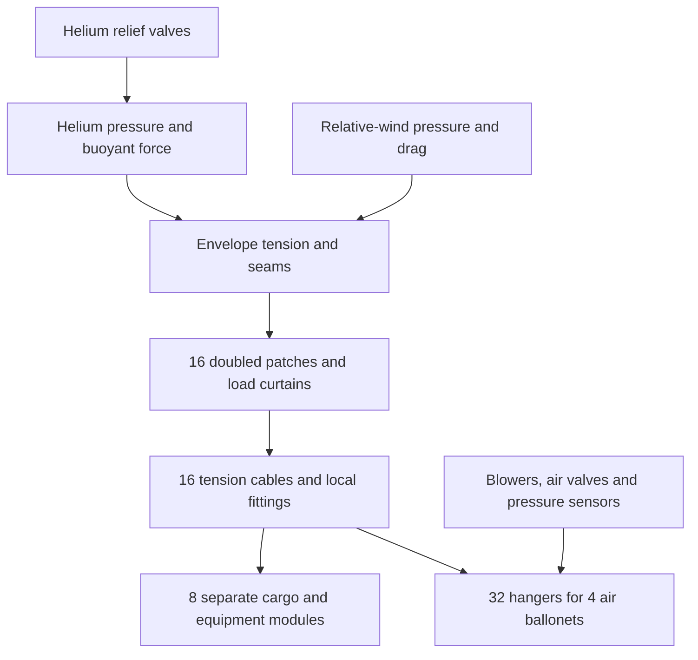

# R3-I006 — near-ambient helium, suspension and pressure control

> Not shown; 70.575 m He envelope: 100 t payload -18.8 t at 2,500 m; confidence UNKNOWN; governing uncertainty: curtain and ballonet routing.

**Internal paper design, 2026-10-14. Programme floatsToday remains not shown.**
The represented 100 t payload case **FAILS** its static mass budget, even with
only 17 t of assumed equipment. The matched 20 t equipment/payload case has
+78.288 t at sea level and +78.241 t at 2,500 m. Those are conditional mass
balances, not a demonstrated airship, neutral trim, mission reserve or available
payload after a 100 t mission. Physical acceptance remains **UNKNOWN**.

Removing the crush lattice saves 60.959 t of represented dry structure against
the repriced I002 control. The coherent altitude-fill state adds 55.571 t of
onboard gas at sea level, mostly ballonet air. The resulting matched improvement
is only **5.388 t**, not the whole lattice saving. The new membrane, suspension,
ballonets, pressure-control hardware and routing provisions are charged below.

## Frozen sources and comparison boundary

This is a separate sibling candidate from
`afb2c2d1726b9d9a805f9781085c3dd6a52913e5`, in the existing worker clone.
I002 at `2da1ca08e9013c4c65cd26984b2b66492da28c46` and its original evidence
remain frozen. Parent notice `rpt-spock-astra-b-i002-landed52-1014` reports
XO signature and landing 52 at 00:35 PDT, with attestation
`985fe3cea7a5b7cf389ad23e6540f8d7e1c5032e`. It reports Captain verification
of origin; this worker has not independently rechecked public main. The
notice identifies no arithmetic correction. Public integration has advanced
beyond I006's source base; `afb2c2d...` is not represented as current main.
I002 remains a **conditional physical control** despite documentation custody
acceptance; that acceptance does not qualify the aircraft or its material.
No I002 file, shared claim location, primary checkout or other worker lane is
changed. No I006 scientific signature or landing is implied by this document.

I002 D used a 70.574858 m nominal sphere, 81,060 Pa pure helium, and local-wall
factor 0.20. Its reported loaded external volume is 181,394.539491 m³, after
its assumed compression and inward-film sag; this is not a measured volume.
I006 uses **exactly that external volume** for its principal comparison. It
does not recover the lost displacement by silently reverting to the larger
184,055.441598 m³ nominal sphere. The corresponding loaded radius is 35.116552 m.
The larger nominal area, 15,647.677946 m², still prices fabric and conservatively
sets the pressure-radius screen. Anchor coordinates use the loaded radius.

Both matched columns use 96% helium **mole fraction**, 4% air impurity, the same
atmosphere and a common 100 m³ non-gas interior-volume debit. The latter reserves
space for solids, folded material and hardware; it is a volume exclusion, not
an extra mass allowance. It exceeds the represented solid volume at the default
and ordinary gauge sensitivities; it is not proof that all hardware fits.
The remaining gas capacity is 181,294.539491 m³. The frozen I002 pure-helium
result is reported separately so the purity repricing cannot be mistaken for
a change to its evidence.

The working-altitude anchor, 2,500 m MSL, comes from
[sim/config.js](../../../sim/config.js), `WORK_ALT_MSL`. The tropospheric form
follows [sim/atmosphere.js](../../../sim/atmosphere.js):

```text
T(h) = 288.15 - 0.0065 h                         K
p(h) = 101325 [T(h)/288.15]^[9.80665/(287.05*0.0065)]   Pa
rho_air(h) = p(h)/(287.05 T(h))                  kg/m³
```

The air gas constant remains I002's 287.05 J/(kg K) for exact common-atmosphere
comparison; the application's 287.0528 differs slightly. This is a stipulated
dry reference atmosphere, not local weather. NASA's
[atmosphere description](https://www1.grc.nasa.gov/beginners-guide-to-aeronautics/earth-atmosphere-equation-metric/)
provides context for the hydrostatic/ideal-gas approach; its rounded curve fits
are not substituted for the constants above. Helium molar mass is
0.004002602 kg/mol from [NIST](https://webbook.nist.gov/cgi/cbook.cgi?Name=Helium).
Air molar mass is derived consistently as `8.314462618 / 287.05` kg/mol.

## Replacement load paths and geometry

The concept uses a gas-tight, tension-loaded spherical envelope, 16 internal
load curtains and tension cables, eight separately slung equipment/cargo
modules, and four collapsible air ballonets. It retains **no compression
lattice, tube girder or vacuum-film support**. There is no zero-mass structure
credit obtained by taking a vacuum formula to zero differential pressure.



With the loaded sphere centre at the origin and vertical coordinate `z`:

- The 16 upper anchors lie at `z=r/sqrt(2)`, horizontal radius `r/sqrt(2)`,
  equally spaced by 22.5°. Eight module reference points lie at radius 4 m,
  `z=-r-5 m`; each receives two neighbouring cables at ±11.25° in azimuth.
  Cable length is 68.235 m and vertical direction cosine 0.95183. Module
  dimensions, sway clearances and local cradle bending remain UNKNOWN.
- Each anchor has a 5 m × 5 m extra fabric layer and a triangular curtain,
  5 m wide by 8 m high, with 2 mm equivalent thickness. Four 5 m transfer
  lengths per patch are an assumed shear-spreading screen. Whether a folded
  seam arrangement actually achieves it without peel is **not established**.
- At full installed capacity the four lobe reference spheres have radius
  14.808 m. Their centres are `(a,a,a)`, `(a,-a,-a)`, `(-a,a,-a)`,
  `(-a,-a,a)`, with `a=14.808/sqrt(2)` m. Their outer extent is 32.945 m,
  inside the 35.117 m hull. Adjacent reference lobes touch; this is not a
  validated folding, chafe-clearance or trim arrangement.

The line/sphere check finds **20 main-cable crossings**, totalling 440.644 m
inside the full-capacity lobes. These are not ignored as empty gas space.
The proposal adds sealed flexible sleeves around those paths, 120 mm nominal
diameter and 1 mm wall, 4 m of extra length per crossing, sacrificial liners
at 1 kg/m and 40 end boots at 8 kg each. Total installed sleeve length is
520.644 m and mass 1.115 t. The air-side pressure collapses flexible sleeves
towards the lined cable; **no unsupported compression-tube stiffness is
credited**. Sliding, folding, seal integrity and wear are UNKNOWN. Secondary
hanger routing needs detailing and may require further sleeves.

Nominal lobe geometry includes an extra 20 m³ routing reserve beyond the
declared 30% usable air capacity. The calculated main-cable sleeve exclusion
is 4.984 m³. That reserve is internal helium space, distinct from the common
100 m³ non-gas debit, and buys no extra displacement. Installed fabric area
is charged at full capacity even when the bags are mostly collapsed.

## Membrane, suspension and wind screens

All material values below are **explicit assumptions for unselected materials**.
They are not supplier allowables or evidence that a particular laminate clears
the demand. Fabric equivalent thickness is a mass/strength surrogate, not a
complete layup or a claim that isotropic properties describe a woven laminate.

| Item | Assumed value and use |
|---|---|
| Outer load fabric | Density 1,400 kg/m³; working tensile stress 80 MPa in each biaxial direction; seam efficiency 0.70; minimum equivalent thickness 1 mm |
| Fabric factor | Working 80 MPa corresponds to assumed 320 MPa ultimate divided by 4, before the separate seam debit; no selected material supports that number yet |
| Barrier/weather layer | 0.10 kg/m² additional to load fabric |
| Main cables and bag hangers | Density 1,440 kg/m³; effective working stress 150 MPa, illustratively 1 GPa ultimate / 4 × 0.60 for termination/long-term debits; all assumed |
| Ballonet fabric | Working stress 30 MPa, seam efficiency 0.60, density 1,400 kg/m³, 0.25 mm minimum gauge; equivalent ultimate/4 interpretation |
| Metal pins | 100 MPa working double-shear stress; minimum 50 mm diameter, rounded upward in 5 mm steps; alloy, fatigue and bearing details UNKNOWN |
| Internal paper wind | 5 m/s relative wind, drag coefficient 0.8, local pressure coefficient magnitude 1.5; sensitivities 10/20/30 m/s |
| Suspended design load | 200 t static mass bound and 1.5 limit manoeuvre multiplier; the 1.5 is not the fabric ultimate factor |
| Internal bag hangers | 80 t apparent internal-load bound, 32 hangers of up to 60 m, vertical cosine at least 0.70; exact routing UNKNOWN |

For a sphere under **uniform** pressure difference, hemisphere force balance
gives `delta_p*pi*R² = 2*pi*R*N`, hence membrane line force
`N = delta_p*R/2` in each direction. Using the cylindrical `delta_p*R` here
would be wrong. For this nonuniformly loaded hull the following is only a
screen, not an exact membrane solution or a proven upper bound on all stresses:

```text
q_wind = rho_air U²/2; F_drag = 0.8 q_wind pi R²
head = (rho_air - rho_lifting_mixture) g R
delta_p_peak = 1000 + head + 1.5 q_wind
delta_p_min  = 1000 - head - 1.5 q_wind
W_limit = 1.5 * 200000 * g; H_limit = 1.5 F_drag
N_screen = delta_p_peak R/2 + (W_limit + H_limit)/(2 pi R)
t = max(minimum_gauge, N_screen/(working_stress*seam_efficiency))
```

At sea level, the hydrostatic half-height increment is 350.002 Pa. The 5 m/s
screen gives differential pressure 627.029–1,372.971 Pa, pressure-only line
force 24.224 kN/m and combined smeared demand 37.818 kN/m. The chosen 1 mm
fabric has assumed working line capacity 56.000 kN/m. Thickness is rounded
up to 0.1 mm in the calculation; force equilibrium and fabric qualification
do not follow from that scalar inequality.

Cable demand is `W_limit/(16*cos(beta)) + H_limit/(4*0.20)`: four windward
cables are assumed to provide at least 0.20 projection in the wind direction.
It gives 283.033 kN per sized cable, 49.015 mm equivalent solid diameter and
50 mm double-shear pins. The doubled anchor patch screen is 51.969 kN/m
against assumed 112 kN/m. Simultaneous positive cable tensions, moment balance,
curtain curvature and local seam peel still need an assembly solution.

The necessary whole-suspension condition `F_drag <= W_suspended*tan(beta)`
is also evaluated, using the actual represented load, including apparent
ballonet weight. It passes the 5 m/s endpoint cases. At 10 m/s it fails the
20 t case at 2,500 m; at 20 m/s it fails both payload cases there, **even after
cables and fittings are made heavier**. Merely increasing cable diameter
does not repair an unavailable force direction. At 30 m/s the lower envelope
pressure screen is negative as well. These speeds are sensitivities, not an
operating envelope or qualified gust limits.

The source [FAA-hosted LFLS](https://www.faa.gov/sites/faa.gov/files/aircraft/air_cert/design_approvals/airships/aceAirshipLFLS.pdf),
printed pp. 32–33, discusses the factor of four for fabric and non-metallic
suspension, distributed suspension loads, avoiding peel/chafe, and air/helium
pressure-control functions. It motivates the represented functions and
debits; this paper makes no claim of compliance with that document.

## Conserved gas inventory and altitude states

The selected helium-plenum pressure is ambient **plus 1,000 Pa at the centre
reference**. Each air lobe has a local reference pressure 250 Pa above the
surrounding lifting gas. At full capacity the air/helium density difference
gives ballonet differential bounds about 101–399 Pa; its 2.955 kN/m pressure
screen is below the assumed 4.500 kN/m working line capacity. Actual folds and
hanger attachments are not covered by the uniform-sphere derivation.

Use one fixed inventory, `n = 5,765,795.032 mol` of lifting mixture. It contains
22.155055 t helium and 6.680298 t air impurity. At 2,500 m the lifting mixture
occupies 95% of available gas space. At other heights:

```text
V_He_space = n R_universal T_gas/(p_ambient + 1000)
V_ballonet_air = V_free - V_He_space
M_ballonet_air = (p_ambient + 1250) V_ballonet_air/(R_air T_air)
```

The lifting-mixture mass is counted once, split into helium and impurity for
inspection. Ballonet air is separate. Gross displacement is `rho_air*V_external`
once: no second net-gas-density or evacuation-fraction multiplier is applied.
The centre-reference gas calculation treats each gas as uniform in temperature;
symmetry cancels first-order vertical pressure terms in the integrated bag
inventories. Detailed hydrostatic shapes and second-order integration remain
unresolved, not hidden precision in the displayed arithmetic.

| Quantity | Sea level | 2,500 m MSL |
|---|---:|---:|
| Ambient temperature K | 288.150 | 271.900 |
| Ambient pressure Pa | 101,325.000 | 74,682.290 |
| Lifting-plenum reference pressure Pa | 102,325.000 | 75,682.290 |
| Ballonet reference pressure Pa | 102,575.000 | 75,932.290 |
| Lifting-gas occupied volume m³ | 134,998.908 | 172,229.813 |
| Actual ballonet air volume m³ | 46,295.632 | 9,064.727 |
| Actual fraction of free volume | 25.536% | 5.000% |
| Installed usable ballonet capacity m³ | 54,388.362 | 54,388.362 |
| Helium plus impurity t | 28.835353 | 28.835353 |
| Ballonet air t | 57.412355 | 8.818901 |

The idealised ascent vents **48.593454 t of air**, with no routine helium
venting, leakage, replenishment or purity change. Descent admits that air
again. Gas and ambient temperature are assumed equal along this quasistatic
schedule. It is a connected inventory calculation, **not a demonstrated
mission**: it proves neither flight dynamics, heat transfer, trim nor endurance.
The I002 pressure-crush film is not extrapolated to this altitude; a conserved
I002 fill could reverse pressure sign and requires a different load case.

At 2,500 m a 10 K helium superheat still fits. At 14.311 K the last ballonet
volume is consumed; 15 K is outside this inventory/volume state. Helium must
then be vented, pressure/volume changed, or the state rejected. Such venting
would create a different return inventory; it is not silently included.

## Pressure control and additional equipment

The internal paper rate is 1 m/s ascent/descent plus a 10 K/hour helium
temperature-change allowance. Airflow includes both changing ballonet volume
**and compression of air already onboard**. With `beta_g=-dln(rho_g)/dh` and
`beta_b=-dln(rho_ballonet_air)/dh`, the descent supply requirement is:

```text
Q_inside = (V_He beta_g + V_ballonet beta_b)*1 m/s
           + V_He*(10 K/hour)/T_gas
Q_inlet = Q_inside * rho_ballonet_air/rho_ambient
```

This is 18.711 m³/s at sea level and 20.233 m³/s at 2,500 m. Four assumed
blowers, each 8 m³/s ambient-inlet flow at 2 kPa rise, leave 24 m³/s with one
unavailable. Three operating blowers require 73.846 kW at assumed 65%
efficiency. These are required ratings and mass hypotheses, not selected
machines or a validated manifold. Valve flow under backpressure and duct
loss, energy reserve, emergency helium loss and all-engine-out control remain
UNKNOWN. The computed endpoint rates are not certified climb/descent limits.

| Pressure-control item | Assumed mass kg |
|---|---:|
| Four blower/motor assemblies, 250 kg each | 1,000 |
| Eight ballonet air valves, 40 kg each | 320 |
| Two helium relief valves, 40 kg each | 80 |
| 60 m duct, 4 kg/m | 240 |
| Sensors, controller and pressure-system wiring | 120 |
| Independent differential-pressure limiter | 80 |
| Filters, mounts and isolation provisions | 160 |
| Total, already inside the common equipment line | **2,000** |

The original 20 t combined UNKNOWN allowance is preserved as **17 t equipment
+ 3 t payload**: 2 t pressure control above, 3 t motors/propulsors, 5 t energy
equipment, 1 t general avionics, 3 t local cargo cradles, and 3 t ground handling,
landing and ballast provision. The new dry suspension carries loads to those
local cradles; the 3 t cradle allowance is not counted again as global rigging.
Eight 375 kg cradle allowances do not establish their bending strength,
container mass, fire protection, fittings or usable payload volume.

The **separate P100 comparison** replaces the 3 t payload by **100 t**, retaining
the 17 t equipment in addition. It is an optimistic equipment case, not the
programme's complete P100 equipment repricing, which is a separate worker lane.
At 5 m/s the drag-power screen alone is 0.342 MW at 70% propulsive efficiency;
at 10/20/30 m/s it is 2.738/21.907/73.936 MW. Those figures do not establish
that the assumed 3 t propulsion and 5 t energy systems can supply the thrust,
power, duration or control authority. No endurance or operational reserve is
claimed. Consumable/ballast provision remains inside the named 3 t allowance;
there is no separately demonstrated mission consumables inventory.

## Inspectable mass ledger

| Dry component | Mass t | Basis |
|---|---:|---|
| Envelope load fabric | 21.907 | Nominal area × 1 mm × 1,400 kg/m³ |
| Envelope seam overlaps | 1.715 | 32 pole-to-pole gore seams plus three latitude seams; 0.30 m overlap, same gauge |
| Barrier/weather layer | 1.565 | 0.10 kg/m² |
| Anchor doublers | 0.560 | Sixteen 25 m² extra layers |
| Load curtains | 0.896 | Sixteen triangular 5 m × 8 m panels at 2 mm |
| Main suspension cables | 2.966 | Sixteen 68.235 m cables, working-load sized |
| Pins, fittings, seals and chafe provisions | 1.160 | 32 × 25 kg fittings at 50 mm pin size; 16 × 10 kg seals; 200 kg chafe provision |
| Ballonet membranes | 3.858 | Full installed area 11,022.528 m² at 0.25 mm |
| Ballonet seams/cradle doublers | 0.964 | 25% additional membrane mass, assumed construction debit |
| Ballonet hangers | 0.968 | 32 × 60 m at the explicit 80 t load bound |
| Cable sleeves, liners and end boots | 1.115 | Twenty lobe crossings, 520.644 m installed sleeves |
| **Represented dry structure** | **37.675** | Rounded rows; calculation retains full precision |

| Mass-equivalent budget, t | I002 repriced, SL | I006 M20, SL | I006 M20, 2,500 m | I006 P100, SL | I006 P100, 2,500 m |
|---|---:|---:|---:|---:|---:|
| Dry structure | 98.634 | 37.675 | 37.675 | 37.675 | 37.675 |
| Equipment | 17.000 | 17.000 | 17.000 | 17.000 | 17.000 |
| Payload | 3.000 | 3.000 | 3.000 | 100.000 | 100.000 |
| Helium and impurity | 30.676 | 28.835 | 28.835 | 28.835 | 28.835 |
| Ballonet air | 0.000 | 57.412 | 8.819 | 57.412 | 8.819 |
| **Total represented mass** | **149.310** | **143.923** | **95.329** | **240.923** | **192.329** |
| **Gross displaced-air mass** | **222.211** | **222.211** | **173.570** | **222.211** | **173.570** |
| **Conditional balance** | **+72.900** | **+78.288** | **+78.241** | **-18.712** | **-18.759** |

The original I002 pure-helium/full-loaded-volume ledger remains +79.011 t;
its demonstrated 1 mm wall sensitivity remains **-2.786 t**. The matched
I002 column above changes only purity and the common non-gas volume debit.
It does not certify its lattice, wind capacity or old equipment allowance.
There are no retained structural tubes in I006 to which that wall floor can
be applied; the fabric, bag, sleeve and cable gauges are priced independently.

A positive M20 balance does not establish level flight. At the stated gas
inventory it needs about 78 t of added load/downforce to be neutral, far beyond
the 3 t ballast/ground provision. That added mass would change the M20 case
and must be charged explicitly. P100 is already about 18.8 t heavy, before
unpriced mission additions. Neither sign is renamed a remaining reserve.

## Finite gauges and other sensitivities

Rows below are at 2,500 m. Unless marked otherwise, lifting-gas inventory and
external volume remain fixed. Wind rows **resize** cable/pin/sleeve masses;
they are not operating claims for the 5 m/s construction.

| Change | M20 balance t | P100 balance t | Interpretation |
|---|---:|---:|---|
| Default 1 mm skin | +78.241 | -18.759 | Physical confidence UNKNOWN |
| Skin floor 0.5 mm; demand selects 0.7 mm | +85.496 | -11.504 | Even this thinner surrogate does not close P100 |
| Skin floor 2 mm | +53.164 | -43.836 | Extra fabric, laps, patches and curtains charged |
| Working fabric stress halved; 1.4 mm selected | +68.210 | -28.790 | Unselected material strength matters |
| Seam efficiency 0.50 | +78.241 | -18.759 | 1 mm floor still governs; this is not a seam qualification |
| Ballonet floor 0.5 mm | +73.419 | -23.581 | Full installed membrane and reinforcement area charged |
| Wind 10 m/s, resized | +74.814 | -22.186 | M20 necessary suspension direction test FAILS |
| Wind 20 m/s, resized | +57.374 | -39.626 | Both necessary suspension direction tests FAIL |
| Wind 30 m/s, resized | +19.212 | -77.788 | Direction tests FAIL; minimum envelope pressure also negative |
| Pure helium, newly charged inventory | +83.998 | -13.002 | Separate fill, not spontaneous purification during the schedule |
| 1% less volume, newly charged inventory | +76.926 | -20.074 | Same 95% altitude fill rule; changed gas charge |
| 1% less volume, original inventory retained | +78.270 | -18.730 | Ballonet air vents; this is bookkeeping, not a deformation proof |
| 30 t extra equipment | +48.241 | -48.759 | At sea level the P100 suspended-load bound also exceeds 200 t |

For the fixed-inventory 1% volume loss, both gross displacement and ballonet
air decrease. At regulated pressure, helium occupied volume stays fixed and
the lost ballonet air is slightly denser than the displaced ambient air. The
small +0.029 t change is therefore consistent bookkeeping, not a structural
benefit or evidence that deformation is harmless. Sufficient volume loss or
heating exhausts the bag volume and invalidates that calculation. Changed
geometry, skin stresses and routing have not been solved by this scalar row.

## Weakest assumption, decision and next change

The weakest assumption is **compatible load transfer through the envelope,
curtains and gas-bag routing at the priced mass**. The membrane inequality,
positive pressure and tensile-strength screens are necessary arithmetic only.
They do not establish a fabric allowable, spatial equilibrium, tear arrest,
non-peeling seams, sleeve life, bag folding or a stable complete hull.

Excluded or unresolved terms can reverse a positive M20 result: actual energy
and propulsion equipment, mission tanks/cradles, crew systems, emergency
pressure protection, leak compensation, weather/icing, fatigue and damage
tolerance, mooring infrastructure and complete trim control. They have named
functions and partial allowances above, but no demonstrated component bills.
The dominant priced dry item is the 21.907 t outer fabric. P100's negative
result needs no favourable interpretation of those UNKNOWN additions.

**Decision:** retain the near-ambient design as a more explicit conditional
comparison; reject the current 70.575 m construction as a closed 100 t payload
airship. Do not promote I002 or this candidate to established physical results.
Carry any later demonstrated I002 finding before reusing its affected figures.
Its reported documentation acceptance does not establish a physical baseline.

**Next concrete design change:** price a 76 m nominal sphere with the same
gas-inventory rule and equipment/payload split, and carry the full curtain,
ballonet and sleeve construction into its larger geometry. Extra volume may
cover the 18.8 t deficit, but additional fabric, gas, longer suspension and
wind load must be recalculated; no surplus is asserted here. The routing and
load-transfer UNKNOWNs remain explicit rejection gates. This is a proposed
next assigned iteration, not another unit started in this record.

## Reproduction, checks and carry

Run `python3 research/design-iterations/R3-I006/calculate.py` from the repository
root. The [bounded calculation](calculate.py) uses only the Python standard
library and emits the inventory, geometry, masses and sensitivities. Its
assertions check conservation, capacity, arithmetic closure and selected
screening counterexamples; they are not material or aircraft tests. No CFD,
FEA, native solver, physical work, purchase or external scientific review was
performed. Native-solver/physical attempts: zero; control stops: zero.

Proportionate repository checks are `make readmecheck linkcheck`, followed by
postcommit `make buildercheck` with the already available Node and explicit
TAP reporter. Those check documentation/history, not the physical design.
The single unit evidence file records exact base/candidate/tree, source and
candidate hashes, checks, governance result and outstanding uncertainties.
The [claim gate](../../../docs/CLAIM-GATE.md) remains in force. I002's prior
environment-related check failures remain in its original evidence; this
iteration does not rewrite that attempt history.
