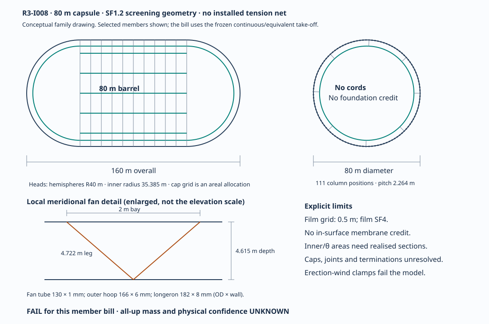

# R3-I008: an 80 m capsule with no tension-net credit

Internal conditional geometry trial, 2026-10-14. No aircraft has been built or flown.
This is a member-priced screening configuration, not a qualified structure or an authorisation
for a new public scientific claim.

**FAIL for positive margin on this represented member bill.** At SF1.2 the 80 m hull is
1128.552 t. A specified 1000 Pa retained-air state adds 8.088 t.
The known subtotal is 1136.640 t against 819.472 t of sea-level lift:
**-317.168 t margin**, before unresolved carried systems or corrections
to the represented members. At 2500 m the matching margin is -496.545 t.
The model's erection-wind clamp check also fails. These failures close this fixed-bill
hypothesis; they do not prove that all 80 m structures or all chordal nets must fail.

`not shown · margin UNKNOWN · confidence UNKNOWN · weakest assumption: realised stable frame mass`

The original [R3-I001](../R3-I001/README.md) is preserved. Its 80 m suggestion came from a
historical **both-moves bound**, with unpriced shear hardware and an unrealised chordal net.
The later I004 review demonstrated that its particular near-antipodal realization did not
engage odd modes as claimed. That finding invalidates that realization, not every possible
net. I008 neither copies those modal factors nor implements the separate corrected-net task.

## Geometry and declared loading



[Vector drawing](geometry.svg), [machine-readable budget](budget.json) and
[bounded reproducer](budget.py) are part of this unit. The picture resolves the capsule,
column positions and fan geometry. It is not a fabrication drawing: joint details, polar
closure and realised profiles for area-sized frame members remain open.

| Quantity | 80 m trial | Matching 112 m comparison |
|---|---:|---:|
| Outside diameter / total length, m | 80 / 160 | 112 / 224 |
| Cylindrical length / head radius, m | 80 / 40 | 112 / 56 |
| Scaled wall depth, m | 4.615385 | 6.461538 |
| Inner radius, m | 35.384615 | 49.538462 |
| Longerons / circumferential landing pitch, m | 111 / 2.264211 | 155 / 2.270054 |
| Gross volume, m³ | 670206.433 | 1839046.452 |
| Boundary area, m² | 40212.386 | 78816.276 |
| Effective lift/gas volume after film sag, m³ | 668949.796 | 1836583.443 |
| Ring / bar pitch; axial bay, m | 0.5 / 0.5; 2 | 0.5 / 0.5; 2 |

The barrel is centred on x=0 with head centres at x=±40 m and tips at x=±80 m.
Column angles are 2πj/111. The nominal inner capsule has the same barrel length and
radius 35.384615 m. The model uses a maximum-circumference inner-ring take-off even in
the heads; it does not integrate a tapered cap inventory. Keep that approximation visible.

The material world is the same favourable comparison as I001: T700 laminate proxy,
E=135 GPa, density 1600 kg/m³ and compression ceiling 1450 MPa. These are unqualified
model inputs, not member/process allowables. General-instability knockdown is 0.65;
local-wall knockdown 0.30, classical factor 0.605 and orthotropic factor 0.5699 are retained.
The **structural factor stays 1.2**; this unit does not lower it to recover margin.

Structure is sized for 101325 Pa full-vacuum external pressure at both altitudes.
Retained gas is prescribed at 1000 Pa absolute, 288.15 K, with dry-air gas constant
287.05 J/(kg K). This is a screening setpoint, not demonstrated vacuum or thermal control.
It earns no member-thinning credit. Ambient altitude changes lift only; no sea-level lift
is paired with a separately downsized 2500 m structure.

## No free structural credit

Both optional flags are false: `gi_chordal=False`, `gi_membrane=False`. In addition,
this particular trial installs **no tension net at all**: zero cords, zero anchors, zero net
mass. A private instance of the frozen model sets `SHIP0.eSpoke=0` only to switch off
its default even-mode diametral foundation. This is not a zero-modulus material claim;
the parameter is restored and the model source is unchanged. Merely turning off chordal
credit would still leave the model's diametral credit. I008 does not use that credit either.

The explicit mode table in `budget.json` checks n=2 through n=12 using only the series
combination of ring bending and circumferential-web crimp. Every foundation and membrane
term is exactly zero. The minimum is n=2 for both sizes. The 80 m frozen sizing result has
capacity 122792.509 Pa against SF1.2 demand 121590 Pa,
margin 1.009890; the cap check is
3.872676. This reproduces the scoping equations;
it does not verify continuum assumptions, all possible modes, imperfections or connections.
The greedy member allocation is not a proven mass optimum.

A future credited net must supply actual endpoints, lengths, engagement at each critical
mode, pretension/tension-only behaviour, series anchor compliance and a reconciled anchor
mass bill. The I004 failed topology provides none of that credit to this configuration.

## Member take-off and represented carried mass

The outer hoop section is **166 × 6 mm**, barrel/cap bending bar **43 × 1 mm**,
longeron **182 × 8 mm**, and fan web **130 × 1 mm** (outside diameter × wall).
The fan leg is 4.722476 m; a longeron is billed over
107.174649 m, including the model's end transfer zones.
Inner rings receive 6615.752 mm² per ring; circumferential webs
receive 934.303 mm² per member. Those last two are **allocated
areas**, not selected manufacturable sections: local stability and joint detailing are
still required. Their masses remain in the bill in full.

| Family | Equivalent total length, m | Area, mm² | Base kg/m | Junction factor | Mass, t |
|---|---:|---:|---:|---:|---:|
| Outer hoop rings | 40212.386 | 3015.929 | 4.825 | 1.00 | 194.044 |
| Barrel bars | 40212.386 | 131.947 | 0.211 | 1.00 | 8.489 |
| Longerons including 5% junction addition | 11896.386 | 4373.097 | 6.997 | 1.05 | 87.400 |
| Inner rings including 5% addition | 23122.122 | 6615.752 | 10.585 | 1.05 | 256.990 |
| Fan webs including 5% addition | 107807.842 | 405.265 | 0.648 | 1.05 | 73.401 |
| Circumferential webs including 5% addition | 118692.141 | 934.303 | 1.495 | 1.05 | 186.303 |

There are 104 model inner rings and 23088 circumferential
webs, with nominal web length 5.140859 m. Fan webs are billed as
22828.671 equivalent legs. This fractional number is an integral
approximation, not a proposed fractional part. The rounded display counts in the source
model are not multiplied into this bill. In particular, its all-meridian ring count must
not be mistaken for a separate inventory of barrel hoops plus another billed cap grid.
Cap grid pricing is area × (axial-grid kg/m² + bending-bar kg/m²), and the head/grid design
still needs a discrete member and connection schedule. Realisation corrections are UNKNOWN.

| Component | 80 m, t | 112 m, t |
|---|---:|---:|
| Outer hoop rings | 194.044 | 468.674 |
| Cap grid including bending bars | 116.394 | 312.729 |
| Barrel bars | 8.489 | 16.639 |
| Boundary film | 4.658 | 9.129 |
| Clamps | 5.648 | 11.738 |
| Pads | 4.825 | 9.458 |
| Longerons including 5% junction addition | 87.400 | 223.400 |
| Inner rings including 5% addition | 256.990 | 840.962 |
| Fan webs including 5% addition | 73.401 | 275.680 |
| Circumferential webs including 5% addition | 186.303 | 938.332 |
| Flange doubler including 5% addition | 0.000 | 52.965 |
| Junction shear members including 5% addition | 20.542 | 56.368 |
| Installed net, cords and anchors | 0.000 | 0.000 |
| Gust-sized torsion straps | 0.933 | 2.561 |
| Joint mass efficiency allowance | 166.511 | 562.191 |
| Void skin and jacket | 2.413 | 4.729 |
| Additional record-policy stability reserve | 0.000 | 0.000 |
| **Represented hull subtotal** | **1128.552** | **3785.554** |
| Retained air at specified 1000 Pa state | 8.088 | 22.204 |
| **Known carried subtotal** | **1136.640** | **3807.758** |

These are geometry-dependent quantities actually charged in this trial, not another vehicle's
allowance pasted into it. Carbon members take the shown 5% junction addition where the frozen
model applies it. The joint allowance is `member_mass × (1/0.85 − 1)`; no extra cellular-node
fraction is added. The `tiJoints` key names an efficiency allowance, not a designed titanium
joint inventory. The favourable accounting basis has no extra record-policy stability
reserve; zero in that row does not demonstrate that an as-built hull needs none.

Boundary film is 0.115825 kg/m², using the existing one-way price, SF4, strength proxy
5.8 GPa, efficiency 0.5 and bulge fraction 0.25 on the 0.5 m grid. It gives no in-surface
stiffness credit. Clamps scale with hoop diameter, pads with panel area, skins/jacket with
0.060 kg/m² and torsion straps with the existing gust load. The film-sag debit is area ×
0.03125 m. Seams, damage tolerance and attachment designs are not supplied by these factors.

| Carried item or correction | Treatment in this trial |
|---|---|
| Members, priced joints, film, pads, clamps, straps, skins | Included above; actual manufacturing/connection corrections UNKNOWN |
| Retained gas | Included at the explicit pressure/temperature/volume state; not subtracted again from lift |
| Evacuation plant on the ground | Excluded from carried mass by the unladen hull-screen scope |
| Onboard isolation valves, sensors, controls, emergency venting, leak makeup or pump if needed | UNKNOWN; no zero-mass hardware assumed |
| Propulsion, electrical source, actuation, landing/mooring equipment | UNKNOWN; no selected equipment case exists for this geometry |
| Mission payload | Zero only for this deliberately unladen screen; a mission mass is not assessed |
| Trim/ballast and its retention hardware | UNKNOWN |

Complete-vehicle mass and margin remain UNKNOWN. Write
`M_all = M_represented_hull + M_retained_gas + U + C`, where U is omitted carried mass and
C is the signed replacement correction to the represented bill. This prevents charging both
an allowance and its replacement. With C fixed at zero, added U only worsens this negative
budget. Because realisation can change the member bill, the calculation is not an impossibility
proof or a guaranteed lower bound on every possible structure.

## Matched lift, failures and historical sensitivity

| Same selected structure and gas state | 80 m, t | 112 m, t |
|---|---:|---:|
| Sea-level lift after sag | 819.472 | 2249.837 |
| Sea-level margin, ideal vacuum before gas | -309.081 | -1535.716 |
| Sea-level margin including prescribed gas | -317.168 | -1557.921 |
| 2500 m lift after sag | 640.095 | 1757.363 |
| 2500 m margin including prescribed gas | -496.545 | -2050.395 |

The frozen source's `checksPass` is true, but it excludes the erection-wind result.
The 80 m erection demand is **7018.733 N** against
2000/1.5 = 1333.333 N allowed per clamp. `windOk` and `allOk` are false at both sizes.
At the existing pitch, the 80 m nominal clamp capacity would need at least
**10528.099 N** under that same erection convention;
the replacement and its mass are unpriced. A positive ring-sizing margin cannot waive this.

For historical context only, the existing rounded **both-moves** ledger gives 80 m
767.6 t with +51.9 t sea-level / −127.5 t at 2500 m, and 112 m 2330.7 t with −80.9 t /
−573.4 t. Those rows have different credit treatment and ideal vacuum. They remain labelled
sensitivities with `floatsToday=false`; they are neither the I008 budget nor qualified net
or shear hardware. Their complete original case records are retained in `budget.json`.
No broad size sweep or new both-moves solve was run for this unit.

## Weakest assumption, sensitivities and next concrete change

The weakest assumption is the mass of a realised, stable frame with qualified members and
connections. Even this favourable material/knockdown allocation misses sea-level balance by
317.168 t (28.104% of represented hull mass)
before omitted equipment. Lowering retained pressure to zero recovers only 8.088 t.
Even removing the entire 166.511 t joint allowance, an unrealistic bound,
would leave a 150.657 t deficit.

| Assumption or missing expertise | Quantified exposure / required resolution |
|---|---|
| GI knockdown 0.65 | At fixed 80 m allocation, 0.30 scales the governing margin to 0.466103; qualified knockdown evidence is absent |
| Tube and area-sized members | Compression ceiling, laminate layup, area-to-section conversion and local/joint modes need materials/structures work; code sizing is not qualification |
| Retention state | Each +100 Pa at fixed temperature/volume adds 0.809 t at 80 m; pumping, leaks and thermal control remain unresolved |
| Loaded volume | A 1% effective-volume loss at fixed carried gas mass costs 8.195 t sea-level or 6.401 t at 2500 m |
| Additions/replacements | Each extra tonne lowers either margin by 1 t; a physical joint/attachment inventory must replace its allowance, not duplicate it |
| Erection and handling | Clamp failure requires a changed attachment/load path plus mass and installation checks |

**Next geometry experiment:** retain the 80 m diameter, depth, SF1.2 and no-credit policy,
but explicitly draw and reprice a **two-column circumferential X-web panel**, connecting
outer station j to inner stations j±2. On the barrel those endpoints have angular offset
0.113210546 rad and straight length 6.278763 m. This is a frame-web
change, not the separate chordal tension-net topology. Re-derive the panel crimp/load path,
select actual sections, count end joints and re-evaluate the global and local modes before
assigning it any mass saving. It has not been solved here and may fail.

The current inner-ring and circumferential-web family, including its share of the joint
allowance, costs 521.521 t. If all other quantities were
held fixed, that family would have to fall to at most 204.353 t just
to reach zero sea-level margin; equipment would reduce that limit further. This gives the
next trial a concrete target, not a promised improvement from the greedy routine. The
erection attachment defect remains an independent requirement even if frame mass improves.
No expert was contacted and no physical or public-science approval is claimed.

## Reproduction and custody

The calculation pins the unchanged [model](../../analysis/vacuum-cell.py) and
[historical ledger](../../analysis/float-ledger.json) to their SHA256 values in `budget.py`.
Only 80 m and 112 m are evaluated. It independently checks member take-off sums, total mass,
ISA lift, retained gas and the zero-credit mode sum. The complete unrounded outputs are in
`budget.json`; displayed precision is reproducibility, not physical measurement accuracy.

```sh
PYTHONDONTWRITEBYTECODE=1 python3 -B research/design-iterations/R3-I008/budget.py --check
```

The builder ran each two-call calculation within a 60 s wall / 30 s CPU / 1 GiB address-space
envelope. No native solver, FEA, CFD, broad sweep or topology solver was launched. One frozen
unit evidence file records exact candidate/base/tree, preserved reviews and failed hypotheses,
source/output hashes, checks and governance. Custody, XO signature and landing remain separate.
