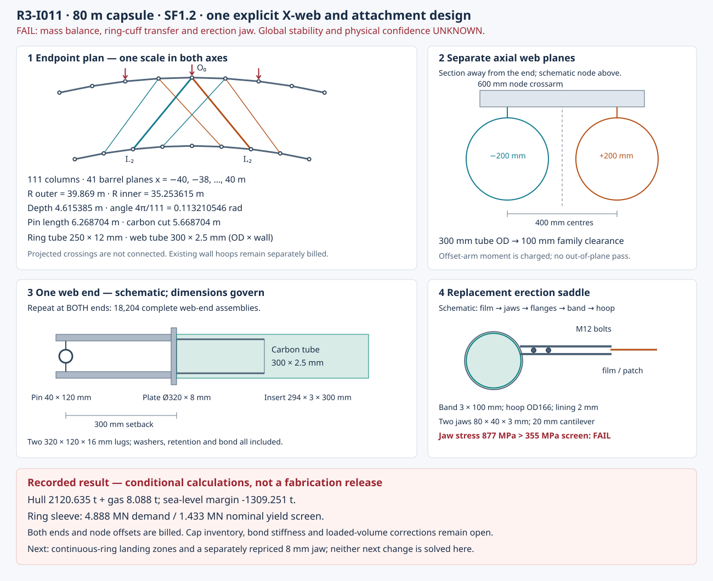

# R3-I011: a two-column X-web and a priced erection attachment

**FAIL for this represented design.** The 80 m, SF1.2 configuration has a 2120.635 t
hull bill plus 8.088 t of retained gas. Its known subtotal is 2128.723 t against
819.472 t of sea-level lift: **−1309.251 t margin**, or −1488.628 t at 2500 m.
Two component screens also reject it: the ring coupler cannot transfer the calculated
axial force, and the selected erection jaw fails its bending screen. This is a failed
construction hypothesis, not a rejection of every X-web or every 80 m frame.

`not shown · margin UNKNOWN · confidence UNKNOWN · weakest assumption: realised joint load path`

The preceding R3-I008 no-net bill is retained in [baseline.json](baseline.json), with
its source commit and budget hash. Its first technical review found no demonstrated
candidate defects and reproduced its arithmetic; that does not qualify the model or
hardware. The unequal drawing scales noted in that review are avoided in the plan
view below. Detail views are explicitly schematic. The original I008 object is unchanged.

This unit selects **one** geometry and component schedule. It does not resize members
until the number turns positive. The underlying [hull model](../../analysis/vacuum-cell.py)
and [historical ledger](../../analysis/float-ledger.json) remain unchanged and are not
called by this unit's calculation.

## Geometry, endpoints and connection schedule

The [drawing generator](draw.py), [calculation](calc.py), [full results](result.json)
and [source register](sources.json) accompany this record.

The pressure surface remains an 80 m diameter, 160 m long capsule with an 80 m barrel.
The dedicated frame occupies 41 barrel planes, x = −40, −38, …, 40 m. Interior frames
have a 2 m tributary width; the end frames have 1 m. The load screen conservatively
uses 2 m for a single frame. Cap and polar detail are not inferred from that calculation.

The new outer and inner frame rings use 250 × 12 mm round carbon-composite tubes.
Their 262 mm outside-diameter steel couplers fit inside the 40 m pressure radius by
putting the outer frame centreline at **39.869 m**. The inner centreline is
**35.253615 m**, retaining 4.615385 m centreline depth. This moves both centrelines
inward 131 mm from I008's ideal node circles to account for section envelope. It does
not enlarge the lift volume. Existing wall-hoop and cap pricing remains the explicit
I008 approximation; real transition geometry, interference and loaded volume require
further work.

At each plane let theta_j = 2 pi j / 111, with every index modulo 111. In coordinates
(x, y, z), the actual web pin axes are:

    O_j^s = (x_k + s*0.200, R_o*cos(theta_j), R_o*sin(theta_j))
    I_j^s = (x_k + s*0.200, R_i*cos(theta_j), R_i*sin(theta_j))
    W_j^+ : O_j^+ to I_(j+2)^+
    W_j^- : O_j^- to I_(j-2)^-

Each web stays in one axial plane. The + and − families are 400 mm apart, leaving
100 mm between their 300 mm tube envelopes at projected crossings. **Crossings are
not joints.** The node crossarm transfers the offset forces to the ring plane;
its bending and weld/interface requirements cannot be omitted.

The angular separation is 0.113210546 rad. Direct endpoint subtraction gives
**6.268704 m pin-to-pin length**, and the specified 300 mm setback at each termination
leaves **5.668704 m of carbon tube**. Repeating the calculation on the old ideal
40/35.384615 m circles gives the I008 reference 6.278763 m. The difference is the
explicit section-envelope offset, not a stiffness claim.

| Repeated item | Per frame plane | Barrel total |
|---|---:|---:|
| Outer polygon ring segments | 111 | 4551 |
| Inner polygon ring segments | 111 | 4551 |
| +2 webs / −2 webs | 111 / 111 | 4551 / 4551 |
| Web ends, counted separately | 444 | 18204 |
| Ring nodes, each serving two ring ends and two web ends | 222 | 9102 |

Outer and inner chord cuts are respectively 2.256494 and 1.995274 m. Ring segments
are mitred at the nodes. The two half-cuffs at each node are one billed 300 mm sleeve,
not two whole sleeves. Each carbon web has two complete end assemblies. The dedicated
outer frame is **additional** to the retained pressure-wall hoops; it is not silently
substituted for four axially separate hoops with assumed rigid load transfer.

## Actual sections and provisional properties

| Member | OD × wall, mm | Area, mm² | I, m⁴ | Z, m³ | kg/m |
|---|---:|---:|---:|---:|---:|
| Outer and inner frame tubes | 250 × 12 | 8972.389 | 6.369050e−5 | 5.095240e−4 | 14.355822 |
| X-web tube | 300 × 2.5 | 2336.560 | 2.585184e−5 | 1.723456e−4 | 3.738495 |

These are round-tube fabrication geometries, suitable for a proposed mandrel/roll-wrap
route, not allocated areas masquerading as sections. Their layup, cure, tolerances,
joining process and actual allowables have not been selected or qualified.
The comparison retains I008's E = 135 GPa, density = 1600 kg/m³ and 1450 MPa ceiling.
Toray's current T700S sheet reports typical composite E = 134 GPa and compression
strength 1450 MPa for a specified epoxy/volume fraction; it does not establish these
custom tubes' properties. [Toray T700S data sheet](https://www.toraycma.com/wp-content/uploads/T700S-Data-Sheet.pdf)

Steel mass uses 7850 kg/m³ and E = 200 GPa.
[SSAB steel properties](https://www.ssab.com/en/support/product-material-data/steel/20-questions)
The 355 MPa screen is supported for the specified Domex 355MC sheet thicknesses,
not for every formed, welded or machined assembly. Pin grades, weld allowables and
assembly properties remain UNKNOWN.
[SSAB Domex 355MC](https://www.ssab.com/en-gb/brands-and-products/ssab-domex/product-offer/355mc)
Adhesive and lining densities are mass allowances; no adhesive strength is assumed.

## Endpoint load path, ring contribution and crimp diagnostic

The represented path is pressure wall → existing wall/fan transfer → new outer
frame nodes → ring compression and paired X-web axial forces → inner ring compression.
The old wall/fan transfer is retained as an unresolved interface. It is not assigned
new stiffness. Web crossings carry no load. There is no installed cord net, external
foundation, membrane-stiffness term or credited support holding the inner ring fixed.

The calculation forms the actual member unit vector e from its endpoints. For each
circumferential harmonic n it uses four displacement coordinates, outer/inner radial
cos(n theta) and tangential sin(n theta). If B maps those four amplitudes to an endpoint
and D = B_b − B_a, a member contributes:

    k_axial = 1 / (L_carbon/(E*A) + 1/k_end_a + 1/k_end_b)
    K_member = k_axial * transpose(e*D) * (e*D)
    U_member = 0.5 * q' K_member q

The two end compliances are in series. The chosen hypotheses are 100 MN/m per web
end and 1 GN/m per ring-segment end. They are **not measured properties**. Rotational
stiffness is zero in the screen: no benefit is taken for rigid connections. Crossarms
are assumed rigid only for this projected in-plane diagnostic; their offsets and
out-of-plane behaviour remain separate requirements.

K is summed independently for the two rings and each web family. Condensation leaves
outer radial amplitude one and frees the other three coordinates. That is a deformation
normalization, not a fixed foundation. The full ring's resulting coefficient is
3.015990 MN/m at n=2, but the softest checked elastic harmonic is **n=28**, at
0.805857 MN/m. No n=2-only or short-lever benefit is claimed. At n=2 the ring contributions
to twice the normalized energy are 1.382397 and 1.404207 MN/m; the two web contributions
are 0.114692 MN/m each. At n=28 the web contributions dominate, about 0.369859 MN/m each.

A separate imposed outer tangential displacement with the inner ring held gives the
2.359771 GN/m whole-ring web shear diagnostic. That imposed boundary condition is
only an energy probe; it is not used as an aircraft foundation or a pressure capacity.
The actual ring and web matrices are used together above, without copying I008's
scalar crimp coefficient or its continuum ring inertia.

Only n=2…55 material-stiffness diagnostics are tabulated. The n=0 radial equilibrium
is solved, and n=0 rotation/n=1 translation null motions are checked. The other n=0/1
subspaces, preloaded geometric stiffness, follower-pressure tangent, imperfections,
caps and out-of-plane modes are **not qualified**. A positive elastic coefficient is
not a buckling result. For the normalized n=28 vector, a destabilizing geometric
coefficient of 6.627656 m at 121590 Pa would consume all 0.805857 MN/m material stiffness.
The actual coefficient has not been established. Global pressure stability stays UNKNOWN.

## Pressure, local-member and connection screens

Full-vacuum demand stays 101325 Pa with structural SF1.2, hence 121590 Pa. For a 2 m
tributary width the integrated circular-sector pressure resultant at each outer node
is p × 2 R_surface b sin(pi/111). The axisymmetric two-coordinate solve gives the
following conditional forces and local screens. Gravity bending is also factored by 1.2.

| Family | Compression at factored pressure, MN | Pin-ended Euler load, MN | Local proxy, MPa | Compression + amplified self-weight bending interaction |
|---|---:|---:|---:|---:|
| Outer frame segment | 4.300001 | 16.666318 | 1408.132 | 0.340545 |
| Inner frame segment | 4.888079 | 21.315869 | 1408.132 | 0.387041 |
| Either X-web | 0.198876 | 0.876535 | 234.689 | 0.369582 |

Euler uses pi² E I / L_pin². The local tube proxy is the lesser of 1450 MPa and
0.30 × 0.605 × 0.5699 × E × t/r_mean. It is an unqualified inherited orthotropic-shell
screen, not a laminate buckling analysis. Self-weight M = SF w L²/8 is amplified by
1/(1−N/N_E), then added to N/(A sigma_local) as M/(Z sigma_local). The selected carbon
sections pass this limited arithmetic. The **assembly fails at its connection**.
This bending screen includes carbon-tube self-weight only. Concentrated hardware
weight, gust/handling combinations and joint-rotation interactions remain outside
the quantified member screen; no assembly pass is inferred from it.

| Hardware | Geometry and count basis |
|---|---|
| Ring node sleeve | Two mitred 150 mm half-cuffs; 262 mm OD, 5 mm wall, 252 mm bore; 1 mm bond layer over each 250 mm tube |
| Node crossarm | Formed box, 120 × 120 × 8 mm, 600 mm long; four 6 mm fillet seams, total 480 mm, represented by weld volume |
| Each web insert | 294 × 3 mm steel tube, 300 mm bond length inside the 295 mm carbon bore; 0.5 mm bond line |
| Each web end plate | 320 mm diameter × 8 mm |
| Each web clevis | Two 320 × 120 × 16 mm plates, each with a 40 mm hole; 40 × 120 mm pin and two 60/42 × 5 mm washers; 0.020 kg retention allowance |

The web end volume bill includes the inserted overlap in addition to the carbon tube,
plus both clevis ends. Its mean bond demand is 0.718 MPa under the selected force;
peel, concentrations, fatigue and thermal mismatch remain unresolved. The pin's nominal
double-shear and lug-bearing screens are 0.515 and 0.454 MN. The axial offset imposes
39.775 kN m on each node arm, compared with a nominal section yield moment of
44.559 kN m. This does not qualify the weld or composite interface.

The ring sleeve has only 4036.946 mm² of steel axial area. Its 355 MPa nominal capacity
is **1.433116 MN**, versus **4.888079 MN** demanded. It would require 1210.836 MPa yield
at the same area, and the 150 mm half-overlap would require 41.491 MPa average bond
shear. **FAIL.** There is no parallel butt-bearing path credited. The assumed linear
end spring cannot be realized by simply calling this failed sleeve rigid. The elastic
mode table is therefore a conditional diagnostic, not an operating prediction.

## Erection attachment: selected, priced and still failed

The independent I008 erection convention gives 7018.733 N demand and requires
**10528.099 N nominal capacity** after its factor 1.5. The replacement is a split steel
saddle around the existing 166 mm wall hoop, with 2 mm lining, 3 mm band, 100 mm axial
width, two 60 × 50 × 6 mm flanges, two M12 shanks, and two **80 × 40 × 3 mm jaws**.
Each jaw has a 20 mm cantilever arm. Two 200 × 200 mm film patch plies are charged.
The 0.120 kg bolt-head/nut/washer row is an explicit allowance, not a certified fastener
mass or grade. The band/jaw-to-flange attachment and final grip detail are unqualified.

The resulting bill is 2.052666 kg per saddle. The barrel schedule is 161 wall-hoop rows
at 0.5 m pitch × 126 saddles per row = 20286 saddles; circumferential pitch is no more
than 2 m. An additional **20107 equivalent cap saddles** retains the old one-per-square-
metre cap approximation, rounded up. It is not a polar attachment drawing. Total:
40393 saddles, **82.913319 t**, replacing the old 5.648294 t allowance.

The band and nominal two-shank shear screens exceed 10.528 kN, but dividing that force
between the two jaws gives **877.342 MPa root bending stress**, above 355 MPa. The jaw
therefore fails even this simplified screen. The minimum ideal thickness from that
single check is 4.716 mm; that threshold does not address bolts, grip or prying. Film
pullout, a 1.645 MPa mean lap-shear requirement, and 0.634 MPa average hoop-bearing
requirement are also unqualified. The erection failure is **retained**, not waived by
the ring-section arithmetic or the larger attachment mass.

## One replacement bill, matched mass and lift

The I008 inner-ring/theta bill was spread over 104 maximum-circumference equivalent
stations. Only the 41 barrel stations are replaced here. The remaining 63 cap-equivalent
stations stay as their explicitly approximate allowance. Their topology and transitions
are UNKNOWN. No new X-web stiffness is assigned to the caps.

Remove 41/104 of the old inner/theta component rows, which already include their 5%
junction addition. Remove that amount's share of the old joint allowance using
(1/0.85−1), then remove the old clamp row. The new schedule is added directly: **no
second 5% addition or efficiency multiplier** is applied to its already priced joints.

| Hull accounting step | t |
|---|---:|
| I008 represented hull | 1128.552229 |
| Remove replaced inner/theta members, including old 5% | −174.759595 |
| Remove their attributed joint allowance | −30.839929 |
| Remove old clamps | −5.648294 |
| Retained other hull, including cap-equivalent family | 917.304412 |
| Add dedicated outer frame tubes | 147.424324 |
| Add inner frame tubes | 130.357932 |
| Add X-web carbon tubes | 192.893440 |
| Add both-end web hardware | 406.370393 |
| Add ring-node cuffs, crossarms, bonds and welds | 243.371246 |
| Add replacement erection saddles | 82.913319 |
| **New represented hull** | **2120.635066** |
| Retained air, unchanged state | 8.087557 |
| **Known carried subtotal** | **2128.722623** |

The matched air state remains 1000 Pa absolute, 288.15 K in the I008 effective volume
668949.796 m³. Gas is charged once. Full-vacuum structural demand is retained.
I008's sag-adjusted volume and retained components are a comparison convention;
actual solid intrusion, cap shape, loaded volume and realization changes are unresolved.
No thinning or lift benefit is taken for the inward frame offsets.

| Altitude | Same lift, t | I008 known margin, t | I011 known margin, t |
|---|---:|---:|---:|
| Sea level | 819.471705 | −317.168081 | **−1309.250918** |
| 2500 m | 640.094937 | −496.544850 | **−1488.627686** |

The old complete inner/theta family plus joints cost 521.521 t, with a 204.353 t
whole-family balance threshold if everything else stayed fixed. This unit replaces
only its barrel fraction and adds a separate outer frame and attachment bill. Its new
frame/node bill is 1120.417 t. With the retained cap/other bill and new attachments,
the remaining sea-level allowance for that new frame is already **−188.834 t**.
Even a zero-mass barrel replacement would not balance this selected retained bill.
This is a rejection threshold, not a mass optimum or a proof against other designs.

Complete-vehicle mass remains UNKNOWN: M_all = M_represented + M_gas + U + C.
U covers omitted onboard systems, propulsion/energy, controls, ballast and handling
hardware. C is the signed replacement correction to existing approximations. Unresolved
welds, grip parts, transitions and interference are not silently assigned zero physical
mass. Ground evacuation is excluded only by the unladen screen; mission payload is
zero only within that screen. None of these conventions authorizes construction or flight.

## Weakest assumption and next change

The weakest assumption is a realized joint load path with sufficient stiffness and
acceptable mass. The demonstrated sleeve and jaw failures are more immediate than an
optimistic continuum crimp coefficient. Reducing all listed web-end and ring-node
hardware mass to zero would recover 649.742 t and still leave about 659.509 t sea-level
deficit. The 8.088 t retained-gas mass is not the dominant limitation.

The next single frame concept is a **continuous ring with locally thickened integral
web landing zones**, keeping the 80 m envelope and explicit ±200 mm web planes. It must
replace the failed sleeve load path, re-establish local section geometry and joint
transfer, and account for the retained cap family before claiming any saving. An 8 mm
jaw is a separate concrete attachment change to evaluate with its added mass, bolt
prying, film grip and hoop-bearing path. Neither next change has been solved here.
Do not infer a benefit from deleting sleeves or raising a section thickness alone.

## Reproduction and evidence

The calculation needs Python 3 and NumPy; the builder used NumPy 2.3.5. It evaluates
one geometry with 4 × 4 material-stiffness matrices, a 2 × 2 radial equilibrium solve,
and n=2…55 diagnostics. There is no native structural solver, FEA, CFD, broad geometry
sweep, new net-routing solve or call to the frozen hull model.

    OPENBLAS_NUM_THREADS=1 PYTHONDONTWRITEBYTECODE=1 python3 -B research/design-iterations/R3-I011/calc.py --check
    PYTHONDONTWRITEBYTECODE=1 python3 -B research/design-iterations/R3-I011/draw.py --check

Checks compare the recorded results; verify direct endpoint lengths and counts, rigid
motions, independently calculated finite-extension energy, baseline mass/gas arithmetic,
replacement accounting and the retained failures. The builder limits the numerical call
to 60 s wall, 30 s CPU and 1 GiB address space. A single evidence handoff records the
exact candidate, base, tree, source/file hashes, carried review and governance.
Implementation checks passing does not change the engineering FAIL/UNKNOWN result.
