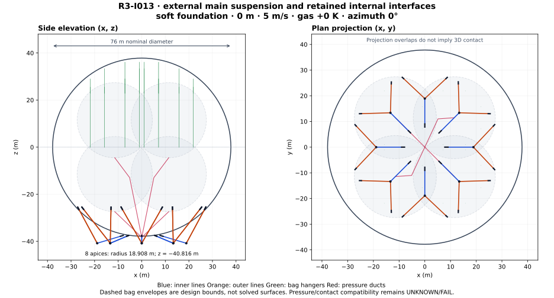
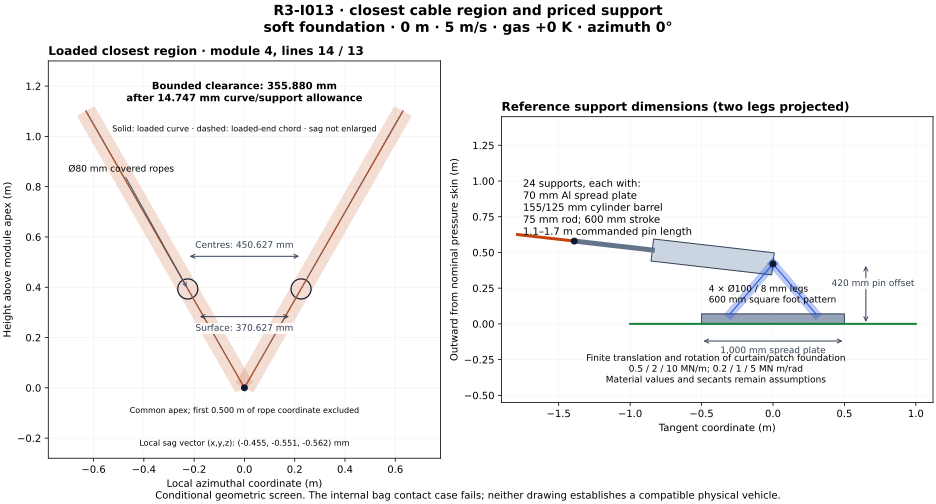

# R3-I013 — external main routing with finite supports

**P100 buoyant mission: FAIL. Physical compatibility: UNKNOWN, with explicit pressure/contact screen failures.** The priced 76 m construction is 66.854565 t. With 100 t payload and the separate 17 t provisional equipment allowance it is 14.148183 t heavy at 2,500 m. M20 instead needs 82.851817 t of carried water to consume its raw margin.

The external main lines have a minimum represented finite clearance of **355.880 mm** in the declared benign cases, after cover radii and curve/support allowances. The calculation closes their elastic-catenary, actuator and finite-support equations. It does not establish a compatible vehicle: the connected bags retain a negative differential-pressure region at sea level, and the stated one-sided cuff-load screen displaces their design envelopes into overlap.

`R3-I013 | 76 m | P100 14.148 t heavy @2500m | M20 ballast 82.852 t | external-main clearance conditional PASS | bag/contact UNKNOWN/FAIL`

## Source and declared scope

This one layout depends on [the corrected I010 construction](../R3-I010/README.md), exact source commit `89e8a7ddd4c79871072075145f5ad24b36a0157e`. Its source calculator SHA256 is `a61daa351d923e8293751d315e1f56af2432576897e9285341f2c11a7c442c51`. The original I010 source `7fa2f29281d88dfdc280b8cfaee42e48403e034a` is retained as history. The shared pressure datum correction is carried here; resetting 250 Pa independently at each connected bag centre is not allowed by that model.

Only I013 files are new. The [calculator](calculate.py) imports the exact corrected I010 source, reuses its gas, cradles and ducts, replaces the main routing and prices the changed support/penetration hardware. No earlier unit, primary checkout, hardware or mission-equipment qualification is changed. This is bounded analytic and small-system work, not FEA, CFD, a broad parameter search or a physical test.

There are 18 declared main-line cases: 0/5 m/s at sea level/2,500 m for three finite foundation secants; the same four cases at +10 K gas superheat for the nominal foundation; and two cold 5 m/s cases at 22.5° azimuth. Four capped cuff-contact screens test the cold/hot endpoints at nominal stiffness. Six adverse-wind chord diagnostics preserve the earlier failures and distinguish changed directions from a qualified operating state.



## Coordinates and physical routing

The origin is the hull centre, z upward. Loaded radius remains the inherited assumed `r=37.815987504 m`; its deformation and coupled membrane shape are not solved. Module k has azimuth `phi=k*pi/4` and apex `C=(0.5r cos(phi),0.5r sin(phi),-r-3)`. Thus module radius is 18.907993752 m and apex z is −40.815987504 m.

Each module has one lower-hemisphere inner anchor at horizontal fraction 0.20 and two outer anchors at fraction 0.75, azimuth offsets ±18°. For fraction f and angle alpha, the skin point is `P=r*(f cos(alpha),f sin(alpha),-sqrt(1-f²))`. A 70 mm plate lies outside that pressure-skin reference; 350 mm radial legs above its outer face put the unloaded upper pin at `A=P+0.420*(P/r)`. All main cable/actuator paths are outside the hull, so the former 24 lower-envelope seals and main bag pass-through sleeves are removed from the ledger.

| Module 0 anchor | Skin point (x,y,z), m | Unloaded upper pin (x,y,z), m | Apex-to-pin chord, m | Fixed free rope length, m |
| --- | --- | --- | --- | --- |
| inner | (7.563198, 0.000000, -37.051949) | (7.647198, 0.000000, -37.463464) | 11.749253 | 10.290231 |
| outer | (26.973856, -8.764337, -25.012925) | (27.273439, -8.861677, -25.290729) | 19.736861 | 18.258298 |
| outer | (26.973856, 8.764337, -25.012925) | (27.273439, 8.861677, -25.290729) | 19.736861 | 18.258298 |

All 24 coordinates, the four 600 mm-square-pattern leg feet at each station and all loaded pins are exported. The other seven modules are rotations by multiples of 45°. Positive `P dot (C-P)` screens the original straight ray against the convex hull; the loaded finite-radius paths are checked separately. The free main rope lengths are calibrated once, then fixed across every case. Actual loaded arc lengths include elasticity. Commands move the paid upper actuators; free lengths are not silently reset to fit each load.

The eight cargo frames, their four lower slings, the 3.2 m square floors and eight sagged wet ballast-hose spans remain the I010 construction. The present capsule calculation covers main ropes, actuators, stand-off legs/plate bounds, bag hangers/actuators and air ducts. Rotor swept volumes, flexible hose/lower-sling motions and actual folding bag surfaces still need their own coupled clearance proof.



## Priced supports, stiffness and load paths

There are 24 stand-offs. Each has a 1,000×1,000×70 mm aluminium plate; four 100 mm OD, 8 mm-wall legs of length 550.000 mm; 30 kg of pins/gussets/fasteners and 5 kg of bedding/shims. The 70 mm plate offsets the leg feet; the pin is 420 mm outside the nominal pressure skin. The original 24 5×5 m fabric doublers, 24 triangular 5×8 m curtains and 48 main 50 mm pin fittings are retained and charged. The pressure fabric is still the inherited 1 mm assumption. Plate, gussets and curtains transfer axial force **and** the finite stand-off/cylinder couple into the envelope. Local bearing, fastening, overlapping patches and coupled shell deformation are UNKNOWN.

Each main actuator has a 125 mm bore, 155 mm barrel OD, 75 mm rod, 850 mm barrel and 1,000 mm rod material length, two 30 mm end caps and 600 mm stroke. Commanded pin length is 1.1–1.7 m, nominal 1.4 m; cap/clevis space is included in the closed length. Its mass is 121.455 kg, including oil and a 25 kg clevis/lock-valve/yoke allocation. Pull capacity uses the **annulus**, not the full piston area. Assumed working pressure is 25 MPa. Steel modulus is 200 GPa and working stress 160 MPa.

Actuator axial compliance includes barrel/rod elasticity and oil compression: oil bulk modulus is an assumed 1.4 GPa, charged chamber volume plus a conservative 1 litre connected volume per actuator for the stiffness calculation. Actual hose oil is also itemized in mass. Main effective axial stiffness is 7.455 MN/m. The 32 bag actuators have 63/79 mm bore/OD, 35 mm rods, 600/700 mm barrel/rod lengths, 400 mm stroke and commanded 0.8–1.2 m pin lengths, nominal 1.0 m. Their mass is 27.590 kg each. There is no free change of prestrain or uncharged length-control device.

Metal leg stiffness is `sum(E A/L u u^T)` with E=70 GPa. The plate has a conservative four-strip bending compliance using 250 mm-wide, 300 mm-long cantilever strips. These act in series with the assumed curtain/patch foundation. The three foundation pairs are `(K_translation,K_rotation)=(0.5 MN/m,0.2 MN m/rad)`, `(2,1)` and `(10,5)`. The rotational law includes the displaced lever in its small-rotation equilibrium. Cable loads, actuator and bracket weight, and separate actuator/bracket aerodynamic loads all enter the station force and couple; their actual shifted centres enter global trim.

These secants are **unmeasured assumptions**. They prevent an infinitely rigid-anchor assumption, but do not supply a simultaneous membrane/curtain solution. Maximum station translation is 0.272934 m and maximum rotation 0.190817 rad in the selected cases. The clearance allowance includes `0.420*theta²/2` per station for omitted second-order pin geometry. The model retains the hull radius and treats its foundation stations independently; mutual membrane coupling remains open.

The main rope retains I010's 48.790479 mm load-bearing diameter, area 0.001869648819 m², density 1,440 kg/m³ and 150 MPa assumed working stress. Its secant modulus is 50 GPa. An 80 mm OD cover costs 0.50 kg per free metre. A separate 1.5 limit-load multiplier is applied to the scalar strength screens; selected material, seam, fatigue, creep and termination data are absent. [FAA LFLS](https://www.faa.gov/sites/faa.gov/files/aircraft/air_cert/design_approvals/airships/aceAirshipLFLS.pdf) is standards context, not evidence that this hardware meets it.

| Scalar screen | Limit demand | Working bound |
| --- | --- | --- |
| Main rope tension | 147.605 kN | 280.447 kN |
| Main actuator pull | 147.605 kN | 196.350 kN |
| Actuator inner-wall von Mises at 25 MPa | 123.847 MPa | 160 MPa assumed working |
| Stand-off leg axial stress including couple | 84.858 MPa | 100 MPa assumed working |
| Stand-off leg compression | 196.209 kN | 1407.334 kN Euler/4 |
| Spread-plate strip bending | 93.308 MPa | 100 MPa assumed working |
| Doubled curtain/patch strip | 58.130 kN/m | 112.000 kN/m |
| Bag hanger tension | 33.328 kN | 38.170 kN |
| Bag actuator pull | 33.328 kN | 53.878 kN |

All entries above pass their stated scalar bounds. The first 6 mm-leg/50 mm-plate estimate did not; the selected 8/70 mm gauges and their mass are used in all final outputs. The tube Euler screen does not establish local buckling or joint adequacy. The doubled-patch strip uses the retained 20 m load-spreading assumption and includes the station couple; real curtain load sharing is unproven.

## Loaded main curves and actual closest region

For reference arc coordinate s, `N(s)=N0+q*s`, where q is the negative of uniform gravity/aerodynamic force per free metre. The elastic curve satisfies `dr/ds=N/|N|+N/(E A)` and is integrated analytically. The loaded length is `L0+integral(|N|/(E A),ds)`. A 12-variable local solve closes three vector endpoints and the three apex force equations for each module. At reference, the remaining three variables are rope free lengths; subsequently they are actuator commands with those lengths frozen. A bounded trim iteration includes the spatial moments of distributed rope drag/weight and shifted hardware, rather than treating them as mass at the hull centre.

Hull drag retains Cd=0.8. Covers use Cd=1.2 and a declared uniform reference-chord projection; this is a forcing approximation, not a flow solution. Each station additionally charges 0.3 m² actuator area and 1.3 m² bracket/plate/leg area at Cd=1.2, with no shielding credit. Their separate forces act at the corresponding modelled centres. This allowance covers the full plate face and edges, four legs, barrel, rod and clevis envelope; bluff-body coefficients remain assumptions.

Sixteen chords per main curve carry a position-error bound `|q|*(1/T_min+1/(E A))*delta_s²/8`. Capsule distances subtract both radii, both chord bounds and both second-order foundation allowances. The reported sag vector is displacement from the loaded-end chord at the same reference fraction s/L0; it includes the elastic curve's axial component. Its sampled maximum is distinct from the continuous clearance certificate. No comparison of an unrelated maximum sag and minimum straight gap is used to infer contact.

| Foundation | h, m | U, m/s | Hot, K | Azimuth, deg | Minimum T, kN | Maximum upper T, kN | Max sampled sag, mm | Min capsule bound, mm | Main / bag stroke |
| --- | --- | --- | --- | --- | --- | --- | --- | --- | --- |
| soft | 0 | 0 | 0 | 0 | 66.278 | 76.389 | 10.585 | 360.364 | PASS / PASS |
| soft | 0 | 5 | 0 | 0 | 46.744 | 93.509 | 13.816 | 355.880 | PASS / PASS |
| soft | 2500 | 0 | 0 | 0 | 66.250 | 76.358 | 10.589 | 360.373 | PASS / PASS |
| soft | 2500 | 5 | 0 | 0 | 50.755 | 89.605 | 12.969 | 356.915 | PASS / PASS |
| nominal | 0 | 0 | 0 | 0 | 66.319 | 76.431 | 10.580 | 370.209 | PASS / PASS |
| nominal | 0 | 5 | 0 | 0 | 46.762 | 93.578 | 13.814 | 369.911 | PASS / PASS |
| nominal | 2500 | 0 | 0 | 0 | 66.291 | 76.400 | 10.585 | 370.209 | PASS / PASS |
| nominal | 2500 | 5 | 0 | 0 | 50.777 | 89.668 | 12.966 | 369.973 | PASS / PASS |
| firm | 0 | 0 | 0 | 0 | 66.326 | 76.439 | 10.580 | 370.606 | PASS / PASS |
| firm | 0 | 5 | 0 | 0 | 46.764 | 93.592 | 13.813 | 370.488 | PASS / PASS |
| firm | 2500 | 0 | 0 | 0 | 66.298 | 76.407 | 10.584 | 370.606 | PASS / PASS |
| firm | 2500 | 5 | 0 | 0 | 50.781 | 89.680 | 12.966 | 370.508 | PASS / PASS |
| nominal | 0 | 0 | 10 | 0 | 70.627 | 81.302 | 9.945 | 370.099 | PASS / PASS |
| nominal | 0 | 5 | 10 | 0 | 50.986 | 98.404 | 12.783 | 369.812 | PASS / PASS |
| nominal | 2500 | 0 | 10 | 0 | 70.860 | 81.566 | 9.913 | 370.093 | PASS / PASS |
| nominal | 2500 | 5 | 10 | 0 | 55.293 | 94.805 | 11.997 | 369.867 | PASS / PASS |
| nominal | 0 | 5 | 0 | 22.5 | 48.152 | 94.015 | 13.884 | 369.935 | PASS / PASS |
| nominal | 2500 | 5 | 0 | 22.5 | 51.898 | 90.068 | 13.026 | 369.993 | PASS / PASS |

The limiting represented pair is `main-14`/`main-13`, module 4, at s=0.500 m on each rope in the soft-foundation, sea-level, 5 m/s case. Closest coordinates are `(-19.120492, -0.225314, -40.422840)` and `(-19.120492, 0.225314, -40.422840)` m. Centre separation is 450.627 mm; subtracting two 40 mm radii gives 370.627 mm, and the combined 14.747 mm curve/support allowance leaves **355.880 mm**. The local sag vectors are `(-0.000455, -0.000551, -0.000562)` and `(-0.000455, 0.000551, -0.000562)` m. Their azimuthal components open the pair slightly; their downward components do not consume an unrelated lateral gap.

The maximum sampled sag anywhere in the 18 cases is 13.884 mm, with each position/direction exported. Maximum main-rope extension is 19.176 mm. Main commands range 1.174929–1.449687 m; bag commands 0.966266–1.162112 m. All selected no-lateral-contact cases retain positive main tension, valid module/water limits and available stroke. These results remain conditional on the imposed support laws and bag containment.

Across those cases, main/actuator clearance to the loaded hull is at least 0.318795 m and to the full bag design envelopes at least 3.763934 m. The preserved I010 38.574 mm minimum was also near the common apex, whereas its roughly 0.308 m maximum sag occurred elsewhere. The changed geometry, covered diameter and loaded calculation account for the new result.

Intentional contacts are narrowly identified: the first 0.500 m of lower rope reference coordinate inside each common apex joint; each connected rope/actuator/stand-off assembly and its own skin bedding; same-duct elbows and the first 3 m within the common manifold; designated bag cuffs and each hanger's own bag attachment. Unrelated same-module ropes are still checked. Plates use circumscribed finite capsules; the 32 bag actuators are separately included. Excluded rotor, flexible sling/hose and folded-surface motions remain UNKNOWN.

## Bag pressure, finite hangers and remaining penetrations

Four retained spherical design envelopes have radius 15.949183886 m, tetrahedral centres `(±11.454552776,±11.454552776,±11.454552776)` in the four inherited sign combinations, and 0.500 m nominal inter-envelope gap. Actual bags are connected through the common air system. Both air and lifting gas therefore retain the one hull-centre datum `dp(0)=250 Pa` and `dp(z)=250-(rho_air_bag-rho_lift) g z`. Extrema include the centre elevations as well as radii. The corrected sea-level cold bound is −25.868..525.868 Pa. It precludes credit for everywhere-positive inflation of those full envelopes; it is not proof of fabric failure or a known folded surface.

| h, m | Gas hot, K | Lifting-gas space, m³ | Inside ballonet air, t | Equal occupied-radius diagnostic, m | Full-envelope dp min / max, Pa |
| --- | --- | --- | --- | --- | --- |
| 0 | 0 | 168604.327 | 71.704073 | 15.104043 | -25.868 / 525.868 |
| 0 | 10 | 174455.596 | 64.447769 | 14.575500 | -27.793 / 527.793 |
| 2500 | 0 | 215103.159 | 11.014199 | 8.752614 | 33.542 / 466.458 |
| 2500 | 10 | 223014.272 | 3.317627 | 5.832033 | 31.946 / 468.054 |

The equal occupied-radius diagnostic uses actual lobe air after subtracting internal duct air and adding the conservative helium pass-through volume. It documents contraction with altitude/heating; it is not substituted for a solved surface. The full installed envelopes are retained for conservative geometric screening **only if containment is achieved**, which is unproven under folding and negative local pressure. Flexible cuffs must accommodate changing occupied shapes without unexplained necks or free guide reactions.

The external main route removes its bag penetrations. Eight foreign-bag penetrations remain on the 32 vertical hangers. Each receives a 240 mm OD, 2 mm-wall aluminium liner with rings at no more than 1 m, radial saddles at no more than 1.5 m, two flexible bag cuffs and two end collars. Two metres of reserve are added at each crossing end, clipped only by the original hanger span. The actual paid rigid span is preserved when rope/actuator lengths change; it is not scaled down with the rope.

| Host hanger | Foreign bag | Start / end above original lower point, m | Rigid liner length, m | Charged mass, kg |
| --- | --- | --- | --- | --- |
| 9 | 0 | 0.453 / 22.810 | 22.357 | 168.266 |
| 10 | 0 | 0.453 / 22.810 | 22.357 | 168.266 |
| 11 | 3 | 0.453 / 22.810 | 22.357 | 168.266 |
| 12 | 3 | 0.453 / 22.810 | 22.357 | 168.266 |
| 16 | 0 | 0.453 / 22.810 | 22.357 | 168.266 |
| 21 | 3 | 0.453 / 22.810 | 22.357 | 168.266 |
| 22 | 3 | 0.453 / 22.810 | 22.357 | 168.266 |
| 23 | 0 | 0.453 / 22.810 | 22.357 | 168.266 |

Total liner/cuff/collar/saddle mass is 1346.129 kg. Each saddle has a 2 kg allowance for a split collar, three 15×3 mm radial spokes, sliding bearing and two M10 bolts; each end collar/joint has 5 kg including an M12 double-shear pin. These dimensions identify an assumed load path, not a qualified assembly. End collars carry tube gravity into its host hanger. Side load travels through rings/spokes into the hanger, then through its finite upper patch and its bag's cradle bands. The lower reaction is not silently assigned to a fixed lateral bag anchor. External-pressure/local tube buckling, bearing damage, friction/preload, cuff sealing and fatigue remain UNKNOWN.

Hanger load-bearing diameter is 18.0 mm, sized with the largest individual liner mass rather than spreading tube deadweight equally among all 32 hangers. The whole original hanger length is charged conservatively, even where a length adjuster replaces rope. The 70 mm fitting envelope is used away from penetrations, and 280 mm conservative clearance diameter on each liner host. Hanger elasticity and guide gravity enter the fixed-free-length and commanded-stroke calculation. The band network has assumed E=5 GPa and finite effective stiffness `4 E (0.25*t_band)/(2*pi*r_b)` per attachment, 179.620 kN/m. Supported load supplies its prestrain; no extra pretension is credited. The corresponding finite vertical pad extension and upper-foundation displacement are exported.

The no-lateral-cuff-force cases have vertical gravity-loaded hangers. A separate contact screen applies +x line load `q_contact=max(|dp_min|,|dp_max|)*0.240` over each rigid liner, with an equal opposite force on its foreign bag. This is a declared capped contact scenario, not a proven upper bound on arbitrary fabric self-stress. Four bag horizontal balances use natural hanger pendulum stiffness, finite upper foundations and finite cradle bands. Individual hanger displacement/reactions and band extensions are returned. A small-slope string screen gives the bending demand if the tube follows it; it does not solve tube/bag contact or beam/string coupling. Axial friction and seal behaviour remain unresolved, rather than credited as a successful operating mode.

| h, m | Hot, K | Largest centre shift, m | Maximum small-slope value | Spherical-envelope clearance, m | Bag stroke | Following-liner strength screen |
| --- | --- | --- | --- | --- | --- | --- |
| 0 | 0 | 1.413 | 0.145 | -0.757 (FAIL) | PASS | PASS |
| 2500 | 0 | 5.096 | 0.532 | Outside small-slope scope | FAIL | Outside small-slope scope |
| 0 | 10 | 1.549 | 0.159 | -0.874 (FAIL) | PASS | PASS |
| 2500 | 10 | 8.389 | 0.878 | Outside small-slope scope | FAIL | Outside small-slope scope |

At cold sea level the screen remains within the declared slope≤0.2 domain and its spherical-envelope clearance fails. At altitude the formal response leaves that domain; its raw displacement/stress values in JSON are not accepted physical predictions. The resulting contact cases are not appended to the successful vehicle trim states. Their additional water-trim amplitude requirement is exported, so the changed bag first moment is not silently ignored. This remains a failed/unknown interface, even though the external main route clears.

## Repriced mass, conserved gas and trim

The new construction adds 6.198756 t to I010's 60.655809 t. The 17 t provisional equipment ledger stays separate: pressure 2 t, propulsion 3 t, energy 5 t, avionics 1 t, local cradles 3 t and ground/ballast 3 t. Component increments above the corresponding allocations are charged once. The paid hydraulic systems add eight main and four bag pump/control groups, reservoirs, dual lines and their oil. Their ratings and the mission propulsion/energy allocation remain assumptions; no other research record supplies hardware qualification here.

| Construction item | Mass, t |
| --- | --- |
| envelope fabric | 25.404175 |
| envelope seam laps | 1.846571 |
| barrier weather | 1.814584 |
| main anchor doublers | 0.840000 |
| main load curtains | 1.344000 |
| main pin fittings | 1.200000 |
| bag membranes | 4.475225 |
| bag 32 gore laps | 0.224474 |
| bag cradle bands | 2.020267 |
| bag cradle fittings doublers | 0.165600 |
| bag hanger fittings | 0.320000 |
| bag anchor doublers curtains | 0.537600 |
| cradle construction over 3t | 11.740684 |
| pressure hardware over 2t | 1.925664 |
| ballast hardware over 3t | 0.000000 |
| external main ropes and 80mm covers | 1.195369 |
| 24 standoffs and spread plates | 5.705629 |
| 24 main length adjusters | 2.914916 |
| 32 bag length adjusters | 0.882878 |
| hydraulic controls lines and oil | 0.575196 |
| eight rigid hanger pass through liners | 1.346129 |
| bag hangers and 70mm clamp envelope | 0.375605 |
| Total | 66.854565 |

| Case | Altitude, m | Construction, t | Equipment, t | Payload, t | Total before ballast, t | Gross displaced air, t | Raw margin, t |
| --- | --- | --- | --- | --- | --- | --- | --- |
| M20 | 0 | 66.854565 | 17.000 | 3.000 | 194.596732 | 277.495142 | +82.898409 |
| M20 | 2500 | 66.854565 | 17.000 | 3.000 | 133.901530 | 216.753347 | +82.851817 |
| P100 | 0 | 66.854565 | 17.000 | 100.000 | 291.596732 | 277.495142 | -14.101591 |
| P100 | 2500 | 66.854565 | 17.000 | 100.000 | 230.901530 | 216.753347 | -14.148183 |

The frozen inventory is 27.670136 t helium plus 8.343231 t air impurity, corresponding to 96%/4% **mole** fractions. All altitude and thermal cases conserve it. The same 100 m³ non-gas debit and installed air-capacity/routing reserve are retained. The liners' helium-volume bound is 8.091082 m³, below the inherited 50 m³ routing reserve. Outside manifold/tail air is charged separately; inside duct air is already included in the ballonet inventory. No displacement credit is taken for outside hardware.

[NIST helium data](https://webbook.nist.gov/cgi/cbook.cgi?Name=Helium) supplies the inherited molecular mass. [NASA atmospheric context](https://www1.grc.nasa.gov/beginners-guide-to-aeronautics/earth-atmosphere-equation-metric/) is background; the exact I010 lapse/ideal-gas equations and constants are reused. The pressure-volume relation and inventory are arithmetic assumptions, not a buoyancy test.

M20 is 17 t equipment plus 3 t fixed payload. Its fixed water ballast is 82.851817 t at both altitudes. P100 is 100 t payload **plus** 17 t equipment; its negative budget cannot be relabelled as available payload by supplying unpriced powered lift. No P100 loaded-curve or endurance success is claimed. The retained wet ballast system includes fixed hose water inside its 3 t allocation, distinct from movable trim water.

For the nominal foundation at 5 m/s, the settled trim is:

| h, m | Hot, K | Water/module min / max, t | Downforce, kN | Water moved, t | Optimistic transfer time, s | Shaft proxy, kW |
| --- | --- | --- | --- | --- | --- | --- |
| 0 | 0 | 7.284 / 13.429 | 0.457 | 7.419 | 185.5 | 1460.7 |
| 0 | 10 | 7.284 / 13.429 | 71.617 | 7.419 | 185.5 | 2737.3 |
| 2500 | 0 | 7.956 / 12.757 | 0.000 | 5.795 | 144.9 | 1137.6 |
| 2500 | 10 | 7.956 / 12.757 | 75.478 | 5.795 | 144.9 | 2835.9 |

Water redistribution closes both horizontal moments using distributed loads and shifted hardware. The quoted transfer time is only the optimistic volume/aggregate-40-L/s lower bound; network losses, scheduling, cavitation and gust response are unqualified. Residual positive margin requires downward thrust, including the hot cases, and is not reserve lift. The shaft estimate retains I010's 4 m actuator-disk, axial-momentum tilt proxy and assumed 0.70 efficiency; [NASA's axial momentum description](https://www1.grc.nasa.gov/beginners-guide-to-aeronautics/propeller-thrust/) does not qualify this non-axial installation or the 3 t propulsion/5 t energy allocation.

At the assumed 5 mm/s simultaneous adjustment rate, main hydraulic power is 14.421 kW and bag adjustment power 5.142 kW. These are charged hydraulic-power demands with assumed 0.65 efficiency, not demonstrated pump/servo capability or an endurance claim.

## Air management, heat and adverse wind

The retained four-blower common manifold supplies three surviving 10 m³/s units. Duct diameter is 1.030065 m; charged length 125.445724 m, 1 mm aluminium wall, rings and paid supports at ≤4 m. In addition to beam bending, each support has finite stiffness K_foundation/5. Gravity/contained-air support displacement is included as a clearance allowance; its largest selected bound is 4.237 mm. Losses, failure isolation and actual pump/duct curves remain unverified.

The inlet demands include descent at 1 m/s, compression of existing inside/outside air, and an additional gas-cooling rate of 10 K/hour. Hot cases use the actual elevated gas temperature in the volume derivative:

| h, m | Hot, K | Ambient inlet demand, m³/s | Three surviving blowers, m³/s | Capacity arithmetic |
| --- | --- | --- | --- | --- |
| 0 | 0 | 23.370794 | 30.000 | PASS |
| 0 | 10 | 23.506108 | 30.000 | PASS |
| 2500 | 0 | 25.271808 | 30.000 | PASS |
| 2500 | 10 | 25.467379 | 30.000 | PASS |

The assumed 2 kPa/0.65 blower demand remains 92.308 kW, plus 12.070 kW for the retained ballast pumps. Cold/hot flow arithmetic is within the stated one-out capacity; no performance curve is validated. The +10 K endpoints retain positive usable air volume. At 2,500 m the rigid-air-volume superheat limit is 14.165745 K; +15 K is invalid and receives no buoyancy or powered-operating credit.

The adverse diagnostics use signed chord directions and the changed mass/drag/settled water schedule. A chord result does not supply a compatible loaded curve or actuator stroke at that wind:

| h, m | Wind, m/s | Min formal chord T, kN | Min water/module, t | Max module, t | Direction cone | Water/module | Outer strip / pressure |
| --- | --- | --- | --- | --- | --- | --- | --- |
| 0 | 10 | 4.353 | -1.936 | 26.366 | PASS | FAIL | PASS / PASS |
| 0 | 20 | -261.506 | -38.813 | 63.243 | FAIL | FAIL | FAIL / PASS |
| 0 | 30 | -1394.685 | -100.274 | 124.704 | FAIL | FAIL | FAIL / FAIL |
| 2500 | 10 | 14.016 | 0.755 | 23.676 | PASS | PASS | PASS / PASS |
| 2500 | 20 | -155.537 | -28.050 | 52.480 | FAIL | FAIL | PASS / PASS |
| 2500 | 30 | -854.173 | -76.058 | 100.488 | FAIL | FAIL | FAIL / FAIL |

The revised directions remove the old 10 m/s signed-direction failure in this formal chord diagnostic. Sea-level water/module limits still fail, and no 10 m/s loaded operating envelope is established. At 20/30 m/s both altitudes still fail tension direction and water/module limits; the retained outer membrane/pressure failures also persist as shown. More cable strength alone cannot repair a direction-cone failure. The inherited bag pressure/contact restrictions apply throughout.

## Reproduction and limits

From the repository root, with the exact corrected I010 source present:

```sh
python3 -B research/design-iterations/R3-I013/calculate.py > /mnt/scratch/R3-I013.json
MPLCONFIGDIR=/mnt/scratch/R3-I013-mpl python3 -B research/design-iterations/R3-I013/draw.py /mnt/scratch/R3-I013.json
```

The calculator uses only the Python standard library and writes JSON to stdout, including source hashes, all loaded coordinates, reactions, extensions, guide loads, commands, geometry, mass, flow and failure flags. Drawing uses Matplotlib and the saved output; SVG metadata is deterministic. The two committed figures show the selected minimum-clearance case and explicit dimensions.

Independent saved-output checks integrate the cable ODE numerically, recompute apex forces and the external three-axis wrench, verify fixed lengths/gas/mass, and differentiate the entire air inventory for flow. Across 18 cases/432 main lines, maximum independent endpoint error is 1.740e-10 m, force residual 5.093e-11 N and external moment residual 4.625e-06 N m. Maximum sampled curve error uses 0.965511 of its analytic chord bound. Independent flow error is 2.325e-09 m³/s. These are numerical consistency tolerances, not measurement accuracy or physical validation. Exact check/output/figure hashes and governed-candidate custody are recorded separately.

The weakest assumption is containment and load transfer of the actual folded bags and their cuffs under the imposed pressure field. The finite foundation and band secants are also unmeasured, and independent spring stations cannot establish a globally compatible membrane. This iteration supplies a priced conditional main route and demonstrates remaining interface failures; it does not establish float, structural qualification, rated propulsion or mission endurance.

The next concrete hypothesis is physically isolated, independently regulated upper lobes, with their extra manifold/valve/control mass charged. A new design must calculate their actual pressure fields and conserved inventories, then test the retained cuff-motion failure. Merely giving each still-connected lobe a new arithmetic pressure datum would repeat the corrected error.
