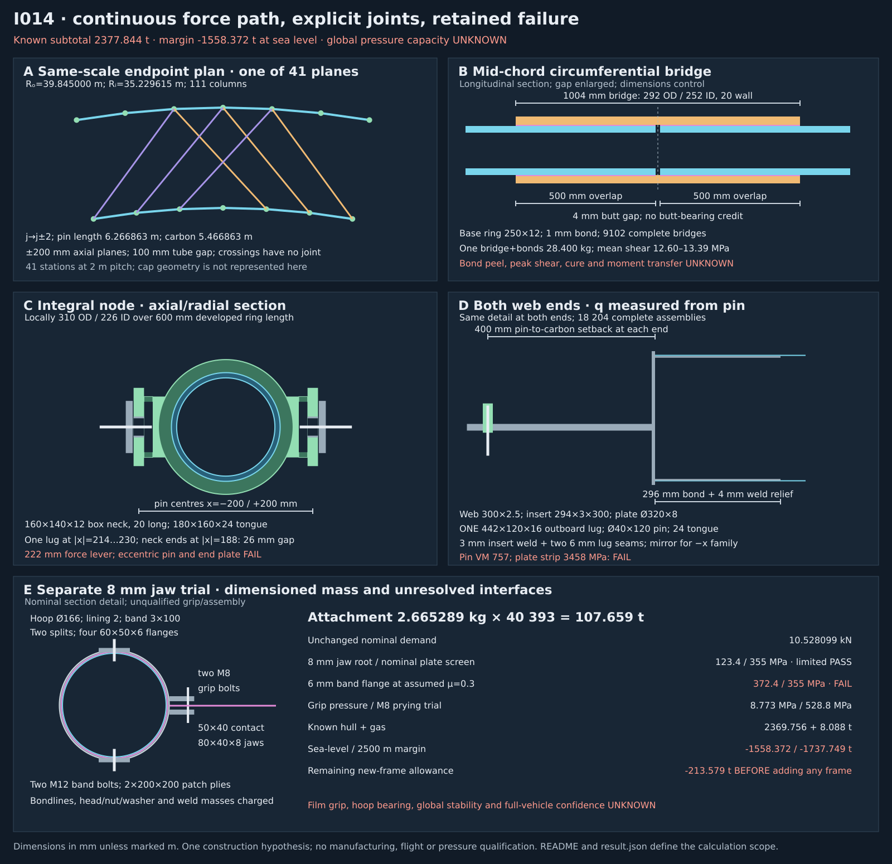

# R3-I014: a continuous circumferential force path and an 8 mm jaw

**FAIL for this represented design.** This corrected construction has hull mass
**2369.756 t** and known hull-plus-gas subtotal **2377.844 t**.
Margins are **-1558.372 t at sea level** and
**-1737.749 t at 2500 m**. The single outboard lug clears the
previously demonstrated hollow-neck collision, but the explicitly eccentric pin and
end-plate nominal screens fail. The 6 mm erection-clamp flange still fails.
Bond/laminate/assembly, global pressure stability and full-vehicle confidence remain UNKNOWN.

`not shown · margin UNKNOWN · confidence UNKNOWN · weakest assumption: cured joint and grip transfer`

The status line describes complete-vehicle physical confidence. Represented subtotal
margins are known only within the accounting convention. The [frozen baseline](baseline.json)
and [sources](sources.json) are unchanged. They pin all seven [I011 files](../R3-I011/README.md)
and the [I008 80 m record](../R3-I008/README.md). I011's review limitations carry.
The sole first I014 review demonstrated a nominal inboard-lug/neck overlap; its
other recorded limitations carry, without a second technical round.

[Calculation](calc.py), [results](result.json) and [drawing generator](draw.py)
record one geometry. No frozen hull calculation, optimizer, native FEA or CFD runs.

## One segmented construction with an explicit circumference joint

The nominal pressure envelope is unchanged: 80 m diameter, 160 m total length,
80 m barrel, 111 columns and 41 frame planes x = −40, −38, …, 40 m. Interior frames
have a 2 m tributary width and the end frames 1 m; the single-frame load screen uses
2 m. Caps and polar terminations remain the retained approximation, not this topology.
Structural demand remains full 101325 Pa with SF1.2: **121590 Pa**.

The frame remains a polygonal j→j±2 X-web. A ring comprises 111 short, moulded node
modules, each containing a web node and the two adjacent half-chords. The shallow
mitred turn is co-cured across the node, not an unconnected butt. Extra laminate and
the two web landings are integral with that node blank. Adjacent modules meet at a
straight **mid-chord** joint, away from the web landing. A wrapped carbon bridge and
two explicit bond laps carry the entire circumferential force across each 4 mm gap.
There is **no butt-bearing credit and no free perfectly continuous 250 m tube**.

| Repeated construction | Nominal dimensions |
|---|---|
| Base ring module | 250 mm OD, 12 mm wall, 226 mm bore; two half-chords |
| Local co-cured node region | 310 mm OD, same 226 mm bore: 42 mm total wall, 600 mm developed length, 300 mm along each adjoining chord |
| Each midpoint bridge | 292 mm OD, 252 mm bore, 20 mm wall, 1004 mm total length |
| Each bridge lap | 500 mm on each side, 1 mm radial adhesive, separated by 4 mm butt gap |
| Fabrication hypothesis | Removable-core node/module moulds; bridge laminate laid over the assembled straight joint and cured/bonded in place |

The extra node annulus is charged only as the difference between 310 and 250 mm OD.
The bridge is a separate part over both base tube ends, so its entire wall is charged.
Base tube cuts remove the 4 mm gap once per chord. Nominal annular volume uses developed
centreline length through the shallow mitre; resin-rich corners, tolerances, cure
shrinkage and final as-built interference remain part of the unqualified realization
correction. The route is a dimensioned fabrication hypothesis, not a qualified layup,
cure schedule, tooling release or production drawing.

The largest ring-node diameter moves the outer ring centreline to
**39.845000 m** and the inner to **35.229615 m**.
The 4.615385 m centreline depth remains. This nominal envelope treatment and the
retained volume convention do not establish a complete 3-D fit or loaded volume.
No extra lift or thinner wall is credited.

For theta_j = 2 pi j / 111, all indices modulo 111, the actual web pin centres are:

    O_j^s = (x_k + s*0.200, R_o*cos(theta_j), R_o*sin(theta_j))
    I_j^s = (x_k + s*0.200, R_i*cos(theta_j), R_i*sin(theta_j))
    W_j^+ : O_j^+ to I_(j+2)^+
    W_j^- : O_j^- to I_(j-2)^-

Pin-to-pin web length is **6.266863 m**. Increasing each termination
setback from 300 to **400 mm** leaves **5.466863 m** of 300×2.5 mm
carbon tube. The two axial families remain 400 mm apart with a 100 mm tube-envelope
gap at projected crossings. Crossings have no joint. Outer/inner chord lengths are
2.255136/1.993916 m, with the midpoint gap removed from each
carbon cut. The 600 mm node region and 1004 mm bridge do not overlap along either chord.

There are 4551 outer and 4551 inner modules; **9102 circumference joints**, **9102
integral nodes**, **9102 webs**, and **18204 complete web ends and landings**. No
single-ended fitting assumption is used.

## Corrected integral landing and both web ends

The co-cured 310 OD / 226 ID node region, 600 mm developed length, is unchanged.
Each curved pad fills from the 155 mm radius ring surface to |x|=168 mm over
r=±70 mm and t=±80 mm. Pad volume integrates
0.168−sqrt(0.155²−r²) over that radial interval, times 160 mm tangential length.
The **160(t)×140(r)×12 mm hollow neck** occupies |x|=168…188 mm.
Its void is |r|<58 mm, |t|<68 mm. The **180(r)×160(t)×24(x) mm tongue**
occupies |x|=188…212 mm, with pin axis at |x|=200 mm, a 49 mm bore,
48/40×24 mm steel bush and 0.5 mm radial bush bond. Node mass remains
29.359482 kg; midpoint bridge and two bonds remain 28.400048 kg.
There are 9102 of each. No co-cure or composite bearing rating is inferred.

The former inboard 16 mm lug occupied |x|=170…186 mm, intersecting the hollow neck.
It is **removed at every one of the 18204 web ends**. The retained **single outboard
442×120×16 mm lug** occupies |x|=214…230 mm, centred at |x|=222 mm.
This leaves **26 mm to the neck** and **2 mm to the tongue**. The positive-x family
uses the positive-x outboard lug; the negative family is mirrored. The carbon web
centre planes remain x=±200 mm. The one-lug force line is 22 mm outboard of each
carbon axis; this eccentricity is charged in compliance and stress, not dismissed.

At each outer and inner termination, q points from the pin toward the web body.
The lug extends q=−50…392 mm, the Ø320×8 mm end plate occupies q=392…400 mm,
and carbon begins at q=400 mm. The 294×3 mm steel insert occupies the next 300 mm
inside the nominal 295 mm carbon bore. The first 4 mm has the same conical
295→300 mm weld relief: 296 mm effective 0.5 mm radial bond, with
0.007456 kg of carbon removed per end. The knife edge and process remain unqualified.

The Ø40×120 mm pin now spans |x|=170…290 mm. The two 60/42×5 mm washers occupy
|x|=183…188 and 230…235 mm; the 0.020 kg retention allowance remains.
The inboard washer and pin pass through the neck's hollow space; their maximum
30 mm radius clears its 58/68 mm half-void. The pin starts 2 mm beyond the pad face.
Intended pin/bush/lug bearing contacts are distinguished from interfering solids.
The insert weld is unchanged: 3 mm leg, length pi×294 mm. The single lug has
**two** 6 mm seams, 240 mm total. No second lug or its weld mass remains.

| Parts at each web end | kg |
|---|---:|
| insert | 6.458847 |
| endPlate | 5.050676 |
| oneOutboardLug | 6.503990 |
| pin | 1.183752 |
| twoWashers | 0.113196 |
| retainers | 0.020000 |
| insertBond | 0.164315 |
| insertWeld | 0.032627 |
| twoLugWelds | 0.033912 |
| **Total** | **19.561316** |

The bounded clearance proof covers the outer/inner × plus/minus four endpoint
classes. For each actual web direction (e_r,e_t), neck material lies within
q≤70|e_r|+80|e_t| mm. The end plate begins at q=392 mm, and the nearest weld at
386 mm, both beyond that projection. The lug and neck have disjoint x intervals;
the pin/washers remain in the hollow void. The proof repeats by all 111 rotations
and 41 planes, covering 18204 ends, with a minimum named positive separation of
2 mm. It does not claim a tolerance, assembly-access, deformed-geometry or whole-hull
collision qualification. The unchanged local swept-circle carbon/ring separations
are about 63/38 mm at outer/inner cuts; end-plate separations are 48/23 mm.

## Materials, compliance and the changed eccentric load path

Carbon density 1600 kg/m³, E=135 GPa and 1450 MPa compression remain unqualified
comparison proxies. The [Toray sheet](https://www.toraycma.com/wp-content/uploads/T700S-Data-Sheet.pdf)
is coupon context, not this tube or integral node's laminate specification.
[SSAB context](https://www.ssab.com/en/support/product-material-data/steel/20-questions)
supports the steel mass/modulus assumptions, 7850 kg/m³ and 200 GPa.
The [355MC sheet](https://www.ssab.com/en-gb/brands-and-products/ssab-domex/product-offer/355mc)
provides a nominal 355 MPa plate screen, not a pin/weld/assembly certification.
Adhesive 1200 and lining 1100 kg/m³ are mass assumptions; strengths remain UNKNOWN.

Circumferential compliance is unchanged. Under the explicit uniform-transfer field
N_tube=N(1−s/l), N_bridge=Ns/l in each lap:

    C_ring = (L−g−2l−L_node)/(E A_base) + L_node/(E A_node)
           + (2l/3)(1/(E A_base)+1/(E A_bridge))
           + g/(E A_bridge) + 2 t_bond/(G_bond A_lap)

Here g=4 mm, l=500 mm, L_node=600 mm. This is an assumed energy field, not a measured
shear-lag solution. Peak shear/peel/cure and rotational transfer are unqualified.

The corrected web compliance adds a 22 mm eccentric carbon-body term
**e² L/(E I)** to L/(E A). Each distinct endpoint includes directional neck bending
and shear over a conservative **222 mm effective load lever**, the same full insert
extension and bond shear, **one** lug's axial extension, and two new strip hypotheses:
**e³/(3 E_steel I_pin)** for the cantilever pin and
**e³/(3 E_steel I_plate)** for a 120 mm wide, 8 mm thick end-plate strip.
These are declared linear elastic proxies, not a compatible 3-D joint solution;
they are used even though nominal stress screens below fail. Contact, bearing
compliance and weld-group distortion remain unresolved. The 4 mm local relief is
priced but not spatially resolved in the uniform-section proxy.

The reference trial retains G_carbon=5 GPa, G_adhesive=1 GPa and zero *additional*
unresolved end compliance. The soft trial uses 0.5/0.1 GPa and 10⁻⁸ m/N extra at
each end. Both use shear factor 0.8. These are not qualified bounds; actual stiffness
can be outside them or the load path can fail completely.

| Member axial stiffness, MN/m | Reference | Soft trial |
|---|---:|---:|
| outer | 917.646574 | 880.606655 |
| inner | 1144.051572 | 1087.047393 |
| plus | 20.455355 | 4.550934 |

The four-coordinate material-energy method credits zero rotational stiffness,
no fixed inner ring, cable net or membrane foundation. At n=2, condensed coefficients
are 8.911998/4.360654 MN/m; the softest checked n=28 values are
0.670404/0.151199 MN/m. The n=0 radial solve and rigid rotation,
n=1 rigid translation, and finite-extension energy checks are distinct from n=2…55.
The largest matrix is 4×4. No prestress/geometric/follower tangent, cap coupling or
out-of-plane eigenproblem is solved. **Positive material energy is not a pressure rating.**

## Connection forces and the cost of the single lug

The retained wall/fan → outer frame → webs/rings → inner frame path remains
unqualified at its interfaces. Under the stated full-pressure/SF convention:

| Compression | Reference MN | Soft trial MN |
|---|---:|---:|
| outer | 4.235218 | 5.258257 |
| inner | 4.946758 | 4.025282 |
| plus | 0.201197 | 0.163718 |

The web section screen now includes **F×22 mm** eccentric bending in addition to
carbon-only gravity, with the same pin-Euler amplification. It omits hardware
gravity, local end flexibility, gust/handling combinations and resolved laminate
buckling. Its stress comparison is diagnostic only.

The bridge's mean axial stress is 289.449 MPa;
adding half the combined node moment gives 318.925 MPa
(reference) and 331.661 MPa (soft).
Average lap shear is 12.596815/13.390041 MPa.
These nominal carbon screens do not qualify the joint or its moment transfer.

For each end M=r×F now uses the **±222 mm outboard force line**, including the
22 mm pin eccentricity as a load-transfer demand. Combined outer/inner moments are
56.731078/
64.163341 kN m. Each neck corner
uses |M_r|/Z_r+|M_t|/Z_t; maximum reference demand is
224.495283 MPa. Mean neck shear is
30.373950 MPa; annulus axial plus full resultant moment is
170.465086 MPa. Half-moment division between outgoing
ring legs remains a symmetry hypothesis, not an established compatibility solution.

| Reference endpoint requirement | MPa |
|---|---:|
| Tongue bearing | 174.650215 |
| Tongue net section / shear-out | 75.524417 |
| Single pin mean shear | 160.107523 |
| Pin cantilever bending | 704.473101 |
| Pin von Mises trial — FAIL vs nominal 355 | 757.090224 |
| One steel lug bearing | 314.370386 |
| 120 mm wide / 8 mm plate strip bending — FAIL | 3458.074247 |
| Insert mean bond shear | 0.735924 |
| Insert weld mean shear | 102.687633 |
| Two lug welds mean shear | 197.594162 |

Pin von Mises combines the **single** mean shear with 22 mm cantilever bending.
The end plate is a stated 120 mm wide strip with 22 mm moment arm, not a plate-FEA
result. Both nominal screens fail; the correction does not exchange the collision
for an unreported strength claim. Bearing, shear-out, bond peel, weld-group bending,
fatigue, bush retention and hot/wet properties remain UNKNOWN.

## Independent 8 mm jaw trial and complete attachment path

The carried erection demand remains **7018.733 N**, with the same factor-1.5 nominal
capacity requirement **10528.099 N**. No favorable change to pitch or tributary load
is made. There are 161 barrel hoop rows ×126 attachments =20286; caps retain
**20107 equivalent attachments**, for **40393 total**. The cap count is still an
area approximation, not a polar fastening layout.

The selected saddle has two split 3×100 mm bands, 173 mm mean diameter, with two 2 mm
developed gaps around a 166 mm hoop and 2 mm lining. **Four** 60×50×6 mm flange ears
make two complete split joints, one M12×60 shank at each. Two 80×40×8 mm jaws have
20 mm load arms. Two M8×45 grip bolts are at 30 mm from the jaw root and at ±30 mm
across its 80 mm width, with 9 mm holes. A **50 mm-wide film/patch tongue** fits
between those holes; each face has a 50×40 mm effective grip area. Film is not assumed
to carry load through pierced bolt holes. Two 200×200 mm film patch plies and two
0.2 mm adhesive layers are separately charged.

Fastener masses are nominal geometry, not catalogued products or ratings: M12 heads
have 18 mm across-flats and 7.5 mm height, nuts 10 mm height, and two 24/13×2.5 mm
washers each. M8 heads use 13 mm across-flats and 5.5 mm height, nuts 6.5 mm, and two
16/8.4×1.6 mm washers each. Full cylindrical shanks overprice the actual thread void.
Assumed 10.0/6.5 mm root diameters are used only for the separate M12/M8 stress trials.
Four flange attachment weld groups have 6 mm legs and 400 mm total length; two jaw
root groups have 3 mm legs and 320 mm total length. Thin-band heat effects and local
load introduction are unqualified.

| Complete saddle component | kg |
|---|---:|
| twoSplitBands | 1.270512 |
| fourFlanges | 0.540193 |
| twoM12Sets | 0.190967 |
| two8mmJaws | 0.385939 |
| twoM8GripSets | 0.065274 |
| flangeWeld | 0.056520 |
| jawWeld | 0.011304 |
| lining | 0.116113 |
| twoPatchPlies | 0.009266 |
| twoPatchBonds | 0.019200 |
| **Total per saddle** | **2.665289** |

The path is film → patch/bond and frictional jaws → grip bolts/jaw roots → band →
lining/contact → composite wall hoop. No step is replaced by a nominal jaw rating.
The 8 mm root bending screen is **123.376 MPa**, below the 355 MPa sheet proxy.
That is the only local improvement established by this thickness change.

For an explicitly **unqualified friction illustration μ=0.3**, two grip faces need
N/(2μ)=17.547 kN total normal preload. That is
8.773 kN per grip bolt and **8.773 MPa** mean face pressure.
The M8 root stress trial is 264.394 MPa without prying and **528.789 MPa** with an
illustrative factor two. No bolt grade or prying factor is qualified. Required patch
line load is 105.281 kN/m per ply under equal sharing; grip mean transfer is 2.632 MPa,
and spreading over each entire 200×200 patch would require 0.132 MPa average bond
shear. Load spreading, edge peel, crushing and tear initiation are not established.

For a separate all-demand-as-slip band case, full-wrap uniform contact gives
N_friction=μ×2 pi T. It therefore needs T=**5.585 kN** band tension. The two split
joints are in series: each M12 joint transfers T, not T/2. With a 20 mm flange arm,
the 50×6 mm root screen is **372.355 MPa**, above 355 MPa: **FAIL in this stated trial**.
The M12 root at twice that tension is 142.229 MPa; actual grade, preload, prying and
contact pressure remain unqualified. Required uniform hoop contact pressure is
0.673 MPa. The full nominal load as a separate projected normal bearing case requires
0.634 MPa; neither average qualifies local hoop ovalization or composite crushing.

The nominal jaw weld group requires 15.509 MPa mean direct shear and 77.547 MPa
moment-related normal stress in its simplified two-line model. This does not resolve
root plate prying, the band wall, weld quality or composite interfaces. A complete
qualified nominal attachment capacity remains **null/UNKNOWN**. Increasing only the
jaw thickness has not repaired the assembly.

## Complete replacement ledger

Retained other hull remains **917.304412 t**, including the 63 cap-equivalent
stations and wall/fan/flight terms. The I008 cross-check removes only the original
41/104 inner/theta members and attributed joints, plus the already replaced old
clamp row. From I011, subtract its entire 1203.330655 t new bill once and add:

| New component | t |
|---|---:|
| outerBaseTubeT | 147.074245 |
| innerBaseTubeT | 130.007854 |
| circumferentialSplicesT | 258.497236 |
| integralNodesT | 267.230005 |
| webCarbonT | 185.889515 |
| bothWebEndsT | 356.094205 |
| erectionAttachmentsT | 107.659021 |
| **Hull including retained terms** | **2369.756491** |
| Gas, exactly once | 8.087557 |
| **Known subtotal** | **2377.844048** |

The new design remains 249.121424 t heavier than I011. Relative to the
original I014 construction, removing 18204 inboard lugs and half their weld seams
removes exactly **119.015975 t**. No other part or unqualified saving is removed.
This lower bill accompanies explicit new eccentric pin/plate failures.
No blanket 5% or 1/0.85 is applied again to these itemized parts.

Gas remains 1000 Pa, 288.15 K, in 668949.796 m³; full 101325 Pa pressure demand is
not reduced. Cap shape, actual intrusion, film drape and loaded volume remain
unknown corrections. The massless-frame allowance remains **-213.579285 t**
before a frame is added, versus I011's −188.833583 t. The actual corrected frame/node
bill is 1344.793058 t.

| Altitude | Carried lift t | Known subtotal margin t |
|---|---:|---:|
| 0 m | 819.471705 | **-1558.372343** |
| 2500 m | 640.094937 | **-1737.749111** |

M_all=M_known+U+C remains unresolved. Onboard systems, propulsion/energy, controls,
ballast and handling belong to U; signed corrections to approximate components and
unqualified realization belong to C. Neither is zero by assumption. Zero mission
payload/ground evacuation are only the unladen screen's conventions. All-up mass,
margin and physical qualification remain UNKNOWN.

## Next construction and reproduction

The weakest local assumption is actual cured composite/bond/contact transfer.
The corrected single-lug load path also requires a different pin/end-plate construction
before it could meet even its nominal strength screens. No physical work is licensed.
The next whole-hull test remains a cap-to-cap variable-radius schedule with a finite
polar closure and explicit shared pressure/film paths, retaining any old term without
a priced replacement. It must carry this four-class clearance proof and the eccentric
load demands, not restore the original colliding inner lug.

Python 3 and NumPy reproduce the two fixed-geometry hypotheses under 30 s CPU,
60 s wall and 1 GiB limits. Hashes, 2×2 radial solve, 4×4 material matrices, rigid
motions, energy, the four-class analytic solid clearance proof and two ledger
identities are checked. The frozen hull model and unchanged I011 checks do not run.

    OPENBLAS_NUM_THREADS=1 PYTHONDONTWRITEBYTECODE=1 python3 -B research/design-iterations/R3-I014/calc.py --check
    PYTHONDONTWRITEBYTECODE=1 python3 -B research/design-iterations/R3-I014/draw.py --check

One correction record binds the exact successor, original immutable candidate,
first-review finding, dependent drawing, affected checks and actual Builder.
Implementation checks do not turn this engineering FAIL/UNKNOWN into feasible float.
