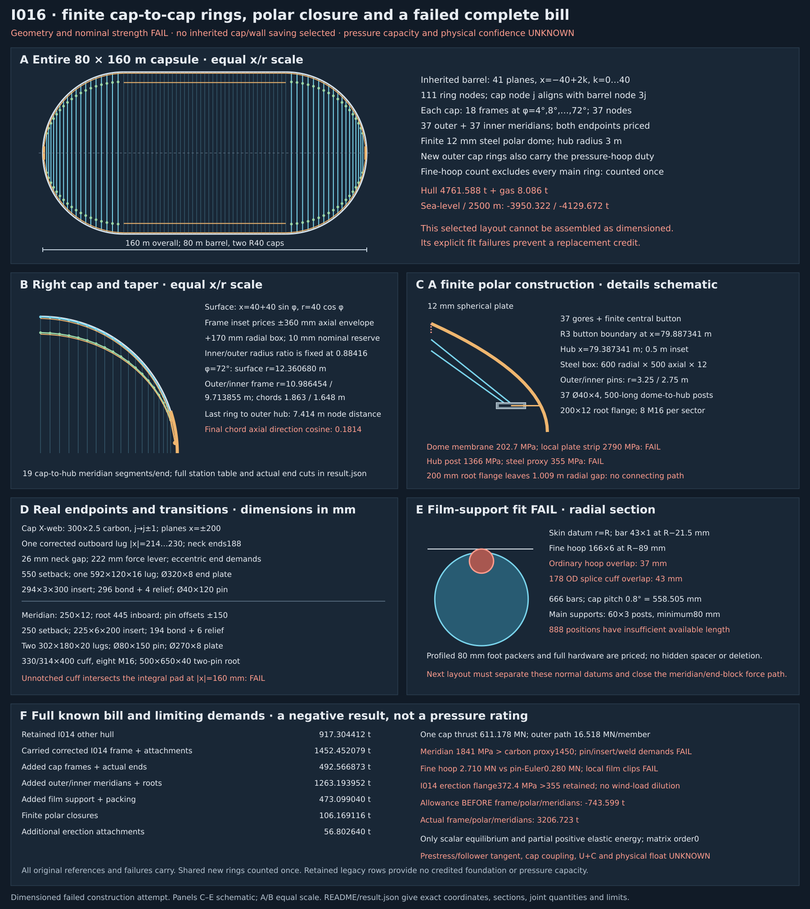

# R3-I016: one finite cap-to-cap ring schedule and polar closure

**FAIL for this construction attempt.** The proposed cap pressure path has explicit
nominal member/end-fitting/plate failures and **known film-support interference**.
It cannot be assembled as dimensioned. All selected parts are priced; no inherited
cap, wall, flight member or diaphragm saving is selected from this failed attempt.
Hull is **4761.588 t**, gas once **8.086 t**, known subtotal
**4769.674 t**. Represented margins are **-3950.322 t at sea level**
and **-4129.672 t at 2500 m**. Global pressure capacity is UNKNOWN.

`not shown · margin UNKNOWN · confidence UNKNOWN · weakest assumption: closed cap/film/joint force path`

The status line concerns physical/full-vehicle confidence. Arithmetic margins below
are conditional on stated volume and mass conventions. This is a negative result
for one finite geometry, not a proof that every cap-to-cap architecture fails.

The fixed comparison is the **corrected [I014](../R3-I014/README.md)** commit
`e36dff0d83455f3ee3e300726e64ef4bed11778f`, whose seven files are pinned in
[baseline.json](baseline.json). The original `b66aa3cd9489b15637fc5d4a7ec5d699c2358e66`
remains a distinct preserved object. The original two-lug geometry has an inboard
clevis-lug/hollow-neck collision. The corrected single outboard lug and its explicit
eccentric pin/end-plate FAIL are carried here. No unchanged I014 calculation
or drawing is executed by [calc.py](calc.py). [result.json](result.json),
[draw.py](draw.py) and [sources.json](sources.json) record this one attempt.

## Finite stations, tapered depth and real polar termination

The external comparison capsule remains 80 m diameter, 160 m overall: a barrel
from x=−40 to +40 m and R40 hemispherical ends. The inherited **41 barrel frames**
remain at x=−40+2k, k=0…40, with 111 nodes, outer radius39.845 m and inner
radius35.229615 m. Its original pressure wall uses the pinned 0.5 m ring/bar
spacing convention; it remains charged, with its unresolved wall/fan interfaces.
The new cap film bars terminate around the shoulder hoop as a collector; a
one-to-one match to the legacy rounded bar count is not asserted. The separately
priced cap clips/meridian saddles are part of the attempted transition.

Each cap has **18 added frame planes**, at φ=4°,8°,…,72° from the shoulder.
At a positive-x station, the surface is x=40+40sinφ, r=40cosφ. The new cap has
**37 nodes**, θ_j=2πj/37, aligned to every third barrel node. No azimuthal merge
is hidden between unmatched nodes: each of the 37 meridians meets barrel node3j.
The other two barrel nodes in each sector stay in the circumferential collector.
The cap/shoulder redistribution is not solved as a coupled frame.

The new cap outer-frame inset is explicitly

    r_o = sqrt((40−0.010)^2 − (40 sinφ+0.360)^2) − 0.170
    r_i = r_o × (35.229615384615386 / 39.845)

This fits a declared local frame box extending +360 mm axially and +170 mm
radially inside the sphere with 10 mm radial reserve. It is **not** a clearance
proof for all secondary wall fittings. The shoulder inherits I014's radius; the
first inclined meridian spans to the actual smaller radius at φ=4°. Radial depth
tapers with radius, rather than continuing a constant-depth frame through the pole.

| φ degrees | x m | Surface r m | Frame r_o m | Frame r_i m | Previous Δx m |
|---:|---:|---:|---:|---:|---:|
| 0 | 40.000000 | 40.000000 | 39.845000 | 35.229615 | 2.000000 |
| 4 | 42.790259 | 39.902562 | 39.695724 | 35.097631 | 2.790259 |
| 8 | 45.566924 | 39.610723 | 39.378346 | 34.817016 | 2.776665 |
| 12 | 48.316468 | 39.125904 | 38.867405 | 34.365259 | 2.749544 |
| 16 | 51.025494 | 38.450468 | 38.164979 | 33.744197 | 2.709027 |
| 20 | 53.680806 | 37.587705 | 37.274037 | 32.956456 | 2.655312 |
| 24 | 56.269466 | 36.541818 | 36.198406 | 32.005419 | 2.588660 |
| 28 | 58.778863 | 35.317904 | 34.942733 | 30.895195 | 2.509397 |
| 32 | 61.196771 | 33.921924 | 33.512425 | 29.630564 | 2.417908 |
| 36 | 63.511410 | 32.360680 | 31.913576 | 28.216916 | 2.314640 |
| 40 | 65.711504 | 30.641778 | 30.152875 | 26.660163 | 2.200094 |
| 44 | 67.786335 | 28.773592 | 28.237463 | 24.966619 | 2.074830 |
| 48 | 69.725793 | 26.765224 | 26.174737 | 23.142826 | 1.939458 |
| 52 | 71.520430 | 24.626459 | 23.972044 | 21.195279 | 1.794637 |
| 56 | 73.161503 | 22.367716 | 21.636168 | 19.129975 | 1.641073 |
| 60 | 74.641016 | 20.000000 | 19.172414 | 16.951607 | 1.479513 |
| 64 | 75.951762 | 17.534846 | 16.582792 | 14.661950 | 1.310746 |
| 68 | 77.087354 | 14.984264 | 13.861955 | 12.256277 | 1.135592 |
| 72 | 78.042261 | 12.360680 | 10.986454 | 9.713855 | 0.954906 |

All cap surface intervals are 40×4π/180 = **2.792527 m**; axial intervals vary as
shown. Each main ring is a 37-sided set of co-cured node modules, with chord
2r sin(π/37). The original 250×12 base, 310/226 local node over600 mm, and
292/252×1004 midpoint bridge with two500 mm laps and4 mm gap remain explicit.
The smallest inner chord is **1.647585 m**, leaving43.585 mm beyond the600+1004 mm
node/bridge developed lengths. No zero-length chord or freely continuous ring is used.
Developed-length laminate volume through each 9.73° node turn remains an unqualified
manufacturing approximation; cure/resin/corner corrections are not a strength credit.

At φ=72°, the selected main rings end. A **12 mm steel spherical dome** covers the
remaining cap to the true pole x=80 m. Its finite central button has boundary r=3 m,
φ=acos(3/40) = **85.698778°**, surface x=79.887341 m. A separate steel annular hub is
inset500 mm to **x=79.387341 m**, with mean radius3 m, radial width600 mm, axial
width500 mm and12 mm closed-box walls. Outer and inner meridian pins are at r=3.25
and2.75 m. The left end mirrors this geometry. The two layers terminate at two
finite pin rows on this priced hub, not at a zero-radius ring or massless point.

The dome has37 gore seams to the button boundary, 60×6 mm cover strips, an80×6
button-seam strip and6 mm fillet deposits. Thin-shell plate volume is area×12 mm;
exact curved-thickness, forming and weld realization remain correction inputs.
Each root has a200×12 mm annular flange,8 mm welds,2 mm gasket and8 M16 sets per
37-column sector. There are37 Ø40×4 steel posts,500 mm long, from the dome to
each hub, each with two100×100×8 feet, fourM12 sets and explicitly priced welds.
These parts establish finite quantities, not acceptable pressure-transfer capacity.
The selected200 mm root flange also leaves a **1.009225 m radial gap**
to the330 mm cuff on the inset last frame. This is an explicit missing connection
in the attempted layout, not an unpriced transition plate credited as a load path.
All pressure forces below are requirements for a closed path that this attempt fails to provide.

## Both web ends, meridians and the shoulder connection

There are **36 added cap frames, 2664 ring nodes, 2664 bridges, 2664 X-webs and5328
complete web ends**. Webs connect outer j to inner j±1, in x offsets±200 mm.
The lower node count changes their angle; no I014 barrel force or stiffness is
silently reused. Each actual pin length is calculated from both endpoint radii
and the new9.73° index angle. Carbon is300×2.5, with **550 mm setbacks at both ends**.
Each end has one **592×120×16 outboard lug**, plateØ320×8 at q542…550 mm,
insert294×3×300,296 mm effective bond and4 mm295→300 bore relief. Carbon cut
L_pin−1.100 m exceeds600 mm at every station, so the two300 mm inserts do not overlap.

The corrected I014 coordinates carry: lug |x|214…230, neck168…188, tongue188…212,
pin170…290 mm, washers183…188 and230…235 mm, with the negative family mirrored.
The26 mm lug/neck separation,2 mm tongue/pad gaps and28 mm pin/washer-to-void
separation hold at both ends. The near-end plate q542 lies beyond the maximum
neck projection70|e_r|+80|e_t| mm. The records cover the144 cap endpoint classes
(18 planes ×2 caps ×2 ends ×2 families), each repeated at37 rotations. They do
not qualify every other fitting, tolerance or deformed shape. The original two-lug
collision is not restored. Each extended end costs **21.822116 kg**:

| Part per cap web end | kg |
|---|---:|
| insert | 6.458847 |
| endPlate | 5.050676 |
| oneOutboardLug | 8.764790 |
| pin | 1.183752 |
| twoWashers | 0.113196 |
| retainers | 0.020000 |
| insertBond | 0.164315 |
| insertWeld | 0.032627 |
| twoLugWelds | 0.033912 |

New **37 outer and37 inner meridian paths** run through the full barrel and both
caps to the hub. Main-station roots lie445 mm radially inboard of their ring
centrelines. Pin points lie150 mm along each adjacent chord from that root.
For root-to-root distance L, pin distance is L−300 mm and carbon cut is
L−800 mm, after250 mm fitting setback at each end. The barrel has40 bays per
path:1.700 m pin length,1.200 m carbon. Each cap has19 actual segments, including
the last outer root-to-hub chord **7.414482 m**, pin length7.114482 m and carbon
6.614482 m. Its axial direction cosine is only **0.181413**. Inner endpoints and
lengths are calculated separately. No radial-only endpoint or zero-length polar strut
is substituted for either one.

All5772 meridian members use250×12 carbon; all11544 ends are charged. A new meridian
end has225×6×200 steel insert,194 mm bond plus6 mm226→234 bore relief, Ø270×8 plate,
two302×180×20 lugs (q−60…242), Ø80×150 pin,110/82×8 washers and retainers.
The forks have a60 mm inner gap around a40 mm root plate (10 mm each side);
no I014 neck is placed between these lugs. The pin direction is tangential, so
inclined x/r meridians can meet their two distinct saddle holes.

| Part per meridian end | kg |
|---|---:|
| steelInsert | 6.481043 |
| endPlate | 3.595647 |
| twoClevisLugs | 15.490704 |
| pin | 5.918761 |
| twoWashers | 0.530321 |
| retainers | 0.040000 |
| insertBond | 0.082461 |
| insertWeld | 0.044391 |
| fourLugWelds | 0.180864 |
| **Total** | **32.364191** |

Each of5698 main-node meridian saddles has a330/314×400 split steel cuff around
the310 mm node,2 mm lining, four100×70×12 flanges, eightM16 sets, a500×650×40
steel root plate with two96 mm bores, two96/80×40 bushes and8 mm weld deposits.
Both pin positions fit this nominal plate envelope. The complete saddle costs
**130.009627 kg**; its mass is substantial. It does not acquire free friction,
root bending capacity or clamp preload. At the two hubs,148 one-pin500×400×40
root plates/bushes and welds are separately priced instead of another composite cuff.
All bolt, pin, washer and insert dimensions are mass geometry, not certified grades.

The selected **unnotched cuff also fails nominal fit** with the existing integral
pad. At local r=t=0, the pad occupies |x|=155…168 mm and the330/314 mm steel cuff
occupies |x|=157…165 mm. The point (|x|,r,t)=(160,0,0) mm lies in both solids:
an8 mm overlap interval. Both signs and ring layers share this witness; node-centred
film foot cuffs have the same problem. No unpriced notch or redesigned root is
assumed. The cuff/plate/bolt stock remains charged in this rejected construction.

## Pressure projections and non-radial cap transfer

All structure is screened at **101325 Pa ×1.2 =121590 Pa**. Residual gas is not
pressure relief. For a37-node sector α=2π/37 and cap dual bounds φ_l,φ_h midway
between the declared stations, exact spherical pressure projections are

    P_x = q α R²/2 × (sin²φ_h − sin²φ_l)
    P_r = q 2sin(α/2) R² × [φ/2 + sin(2φ)/4]_(φ_l)^(φ_h)

The shoulder includes one metre of adjacent barrel radial tributary. Its37 groups
collect the three111-node sectors. The last hub dual extends toπ/2, covering the
finite button; the complete end force is qπR² = **611.178001 MN**.
Summing all sector axial loads independently reproduces that force.

One conservative assigned load path puts **all axial pressure thrust in the outer
meridians**. The inner layer is priced but receives no free load-sharing credit.
Across dual boundary b, C_b e_x,b =qπ(R cosφ_b)²/37, using each actual inclined
member direction. At each station the x/r balances are

    C_lower e_x,lower − C_upper e_x,upper − P_x =0
    2 H sin(π/37) = P_r − C_lower e_r,lower + C_upper e_r,upper

H is the signed ring compression demand. Every recorded residual is checked.
These are statically assigned nodal loads, not a coupled solution for distribution
between main/fine rings, outer/inner layers, old members and the dome. The dome
plate and fine-grid component screens below are conservative alternate local
load envelopes; their full loads are not added a second time to cap thrust.

The barrel outer meridian needs **16.518324 MN**, producing
**1841.017 MPa** versus the unqualified1450 MPa carbon
ceiling: nominal FAIL. The largest end load is
**16.521799 MN**. For the chosen meridian ends,
mean insert bond demand is **120.482 MPa**,
pin double shear **1643.454 MPa**, steel insert
**4002.323 MPa** and root bush bearing
**4302.552 MPa**. Lug/weld/root-plate requirements are
also in the results. These values fail nominal metal screens or lack qualified allowables;
no pressure rating is assigned to this end block.

At72°, the hub transition raises H to **16.778867 MN**. The500 mm bridge
laps need **42.727 MPa mean shear**. The declared half-offset-moment
trial gives **1250.503 MPa** in the bridge; this does not
qualify peak shear, peel, cure, ring-leg moment transfer or cap coupling. Main base
ring section, pin-Euler and inner-ring envelope screens are recorded separately.

An **alternate radial-transfer envelope** asks the two X-webs to transfer all radial
collector reaction: F_web=|reaction|/(2|e_r,outer|). Their inner radial components
then determine the required inner-ring H. Actual load sharing is UNKNOWN. Maximum
web compression in that envelope is **2.181854 MN**. Both outer/inner
local directions drive the biaxial222 mm arm demands. The corrected single-shear
pin,22 mm eccentric body/end-plate moment, one lug, both296 mm bonds and two lug
welds are tested at that force. Original corrected I014 pin/plate failures carry;
this much larger cap envelope does not repair them.

For the meridian's most highly loaded end, the only elastic-energy illustration
uses1.200 m carbon axial compliance plus two0.5 mm insert bond layers. G=1 and
0.1 GPa are the two **named unqualified sensitivities**. They give positive serial
energy, not even a complete endpoint compliance, much less pressure stability.
There are **no matrices (order0), eigenproblem, fixed foundation, net or membrane
stiffness credit**. Prestress, geometric stiffness, follower-pressure tangent,
cap coupling, other load cases and actual restraint remain UNKNOWN.

## Film grid, explicit clashes and failed polar supports

From0° through72° the cap film grid has90 meridional bays at0.8°:
**558.505 mm surface pitch**, with666 meridional43×1 bars. Maximum circumferential
panel chord is377.367 mm. Every fifth hoop station is a shared outer main ring,
charged once in the cap-frame bill. The remaining **72 fine hoops per cap** use
166×6 curved carbon, centre radius R cosφ−89 mm, divided into37 developed-arc
segments with4 mm gaps. Each404 mm178/168 steel sleeve has two200 mm laps and
1 mm radial bonds. All5328 fine-hoop sleeves are priced.

There are119880 fine-bar segments. Each cut removes the explicit4 mm node gap;
121212 full47/44×204 coupling kits and clips are charged at the91 rows on each
end, including both terminal rows. Stock trimmed or unused at a termination stays
in this conservative bill. Two0.5 mm annular bonds, two20×20×30×2 steel angles,
twoM6 sets and two20×30×0.5 mm bond pads are priced at each clip. The existing
film row remains; a proportional whole-areal-mass supplement for558.505 versus500 mm
span is charged on the new cap area. That conservative pricing rule is not a film
strength or drape qualification.

The main cap frame has666 radial supports per plane. Each fine hoop has37 supports
to the actual straight outer-meridian chords. All **29304 posts** are60×3 carbon,
minimum80 mm stock length, with a330/314×80 lower cuff, lining, two80×80×5 plates,
fourM8 sets, two bond wraps and welds. Profiled carbon packing fills from the actual
250/292/310 mm ring surface to310 mm under each main foot; its developed-length
integral accounts for node, free-base and bridge zones. The fine meridian feet fill
from250 to310 mm. All **75.453767 t** of packing is charged; no empty
annulus is treated as a load-bearing spacer. Contact, clamping and laminate properties
are still unqualified.

**The selected datums fail fit.** With local surface radius r_s=40cosφ, a43 mm bar at r=r_s−21.5 mm overlaps the ordinary
166 mm hoop at r=r_s−89 mm by **37 mm**, and its178 mm splice cuff by **43 mm**.
Separately,888 main-foot positions have less than the selected80 mm post allowance;
the smallest available length is **0.338 mm**. Actual selected stock
is still fully priced. The drawing shows these overlaps instead of moving components
without repricing. Consequently these parts are not an installable replacement and
no legacy wall/cap mass is removed. The named web-lug clearance is a distinct,
successful local correction; it does not conceal these new wall-fit failures.

Pressure is not reduced to make the grid pass. At the largest fine hoop, the
nominal compression is **2.710038 MN**, versus a straight pin-column
Euler proxy **0.280387 MN** over its6.777 m segment. This is a failed
component proxy, not a curved-beam/global pressure eigenvalue. Steel sleeve stress
is **997.262 MPa**, with mean bond shear
25.983 MPa. The43×1 bar's maximum-width all-on-bars bending screen remains
1321.330 MPa below the unqualified1450 proxy. **An interior clip receives both
adjoining bar ends.** The clip demand below assembles those signed loads;
one bar end cannot stand for their common two-angle clip.

For this nominal screen, each of the90 actual cap spans retains the
simply-supported rectangular pressure-strip approximation. With
Δφ=0.8°, span j connects rows j and j+1 and has midpoint φ_m=(j+0.5)Δφ:

    L = 40 Δφ
    w_m = 2 × 40 × sin(π/666) × cos φ_m
    H_m = q w_m L / 2,  q = 121590 Pa
    each bar-on-clip end force (X,R) = −H_m (sin φ_m, cos φ_m)

X is global axial and R is cylindrical outward radial on the right cap.
The pressure width and normal are evaluated at the span midpoint; this is
an explicit midpoint approximation, not an integrated curved-film solution.
The full surface pitch remains loaded across the4 mm stock gaps. Neither
those gaps nor the bar's21.5 mm radial offset remove pressure tributary area.
The two half-span forces balance each span's assigned strip load.

At row i, sum the forces from spans i−1 and i **only when those spans exist**.
Project the sum onto the joint's outward normal n=(sin φ_i,cos φ_i) and
increasing-φ tangent t=(cos φ_i,−sin φ_i). Negative normal force is inward.
The left cap reflects the global X force and the X components of these bases;
local normal/tangent demands are identical. Rotate R for each of the666
meridians. All180 ends per cap/meridian appear once in the91 joint rows.

| Row / station | Actual adjoining cap spans | Normal demand, kN | Tangential demand, N | Known cap resultant, kN |
|---|---|---:|---:|---:|
| Shoulder, 0° | 0 | -12.812623 | -89.450439 | 12.812936 |
| Controlling interior, 0.8° | 0 and 1 | -25.622749 | +0.017439 | **25.622749** |
| Polar terminal, 72° | 89 | -4.044391 | +28.235633 | 4.044489 |

The complete span vectors and91 joint rows are in
`filmSupport.clipReactionAssembly` in [result.json](result.json).
The shoulder has no invented cap span on its barrel side, and the polar
terminal has no invented span beyond72°. Additional barrel/shoulder collector
and polar-closure interface contributions are **UNKNOWN**, not zero.
Film in-plane tension and actual collector restraint are also unestablished;
these figures are the known cap-bar contribution, not a qualified total demand.

Under the retained equal-sharing screen, the controlling cap resultant gives
**21.352291 MPa** mean shear across the two20×30 mm bond pads,
**6405.687243 MPa** angle-root bending and **707.983881 MPa** mean shear
across the twoM6 assumed4.8 mm roots. Each angle carries half the full vector
magnitude at the existing10 mm lever, with30 mm width and2 mm thickness.
This nominal screen does not establish peel, torsion, contact, load sharing
or an actual connection; the angle screen remains FAIL against355 MPa.

An equal-span, uniform maximum-width control preserves the omission explicitly:
one end is12.813248 kN, while the shared interior clip requires
**25.626496 kN**. Its bond/angle/bolt demands are respectively
**21.355413 / 6406.623951 / 708.087410 MPa**, twice the former single-end
screen. A terminal's known cap contribution is only one end in that control.
The station assembly above uses its own varying widths and directions; its
slightly smaller maximum does not erase the missing second end in the old screen.
Selected hardware, counts, mass, gas and all other failed screens are unchanged.

A one-way trough at h=a/4 gives factored film tension
72.153 kN/m; no two-way drape saving is credited.

Each polar plate covers **492.033564 m²**, including the finite button,
and must resolve **58.362306 MN** axial pressure force. Nominal spherical
membrane compression is202.650 MPa, but a one-way strip between37 ribs at the root
spans2.099039 m and gives **2790.215 MPa bending**: FAIL against355.
Hub-post stress is **1365.576 MPa** and also exceeds its pin-Euler
proxy. The hub hoop/end-root/bolt stresses are explicit in the result. These are
separate component screens; dome buckling, weld qualification and force sharing
remain UNKNOWN. The mass of the plate, hub, seams and both support families is
retained despite their failure.

## Erection attachments and the full retained ledger

All40393 corrected I014 attachments remain charged at107.659021 t. An additional
**21312** are priced on the new fine cap hoops:148 per hoop, offset to
θ=2π(j+0.5)/148 so they avoid the37 splice centres. Every added assembly is the
same2.665289 kg8 mm-jaw/6 mm-flange geometry. Full original7.018733 kN demand and
10.528099 kN nominal convention carry without dilution by extra clamp count.
Flange demand372.355 MPa still exceeds355; grip/patch/bond/bolt/weld/wind/cradle
capacity is UNKNOWN. Extra supports add **56.802640 t**, not a capacity claim.

The entire original17-row hull ledger is cross-walked below. The only deductions
are those **already made by I014**:41/104 of inner/theta members and their attributed
joint share, plus the old clamp row replaced by the explicit attachment bill.
No new cap, wall, ring, diaphragm, longeron, fan, junction or attachment deduction
is selected. Zero original rows remain zero; no nonexistent diaphragm is invented
as a saving. Legacy residual rows are charged contingencies, not simultaneously
claimed active bracing or a second load-bearing substitute.

| Original family | I008 original t | Still retained t |
|---|---:|---:|
| rings | 194.044318 | 194.044318 |
| capGrid | 116.393969 | 116.393969 |
| bars | 8.489439 | 8.489439 |
| film | 4.657598 | 4.657598 |
| clamps | 5.648294 | 0.000000 |
| pads | 4.825486 | 4.825486 |
| longerons | 87.400403 | 87.400403 |
| innerRings | 256.989983 | 155.676624 |
| fanWebs | 73.400534 | 73.400534 |
| thetaWebs | 186.302649 | 112.856412 |
| flangeDoubler | 0.000000 | 0.000000 |
| junctionShear | 20.542314 | 20.542314 |
| spokes | 0.000000 | 0.000000 |
| torsionStraps | 0.933274 | 0.933274 |
| tiJoints | 166.511225 | 135.671297 |
| skins | 2.412743 | 2.412743 |
| stabilityReserve | 0.000000 | 0.000000 |
| **Retained total** | | **917.304412** |

The unchanged corrected I014 frame/node bill is **1344.793058 t**, plus its
107.659021 t attachments. Rebuild that explicit new bill once, then add:

| Added construction item | t |
|---|---:|
| capFrames.baseTubesT | 176.631161 |
| capFrames.bridgesT | 75.657727 |
| capFrames.integralNodesT | 78.213660 |
| capFrames.webCarbonT | 45.796089 |
| capFrames.bothWebEndsT | 116.268236 |
| meridians.carbonT | 139.688890 |
| meridians.bothEndsT | 373.612222 |
| meridians.saddlesT | 740.794857 |
| meridians.hubRootsT | 9.097984 |
| filmSupport.fineHoopCarbonT | 131.691457 |
| filmSupport.fineHoopSplicesT | 47.259566 |
| filmSupport.meridionalFilmBarsT | 14.033682 |
| filmSupport.filmBarSplicesT | 10.470746 |
| filmSupport.filmBarClipsT | 7.747436 |
| filmSupport.radialPostCarbonT | 11.935853 |
| filmSupport.radialPostHardwareT | 174.247375 |
| filmSupport.profiledFootPackingT | 75.453767 |
| filmSupport.filmThicknessSupplementT | 0.259158 |
| polarClosure.twoDomePlatesT | 92.699124 |
| polarClosure.twoHubBoxesT | 7.642304 |
| polarClosure.goreAndButtonCoverStrapsT | 2.142018 |
| polarClosure.allCoverWeldsT | 0.210651 |
| polarClosure.twoRootFlangesT | 2.926396 |
| polarClosure.rootFlangeWeldT | 0.078037 |
| polarClosure.rootBoltsT | 0.138645 |
| polarClosure.domeHubPostsT | 0.131396 |
| polarClosure.domePostFeetT | 0.121207 |
| polarClosure.domePostWeldsT | 0.010993 |
| polarClosure.rootGasketsT | 0.068345 |
| addedCapAttachmentsT | 56.802640 |
| **All added items** | **2391.831621** |

The two identities checked are

    hull = retained_other + carried_corrected_I014_bill + added_bill
         = corrected_I014_hull − entire_carried_I014_bill + complete_new_bill
         = corrected_I014_hull + added_bill

The subtraction/rebuild form does not subtract I014 twice. No new blanket joint
percentage or 1/0.85 is added to itemized parts. Shared outer cap rings appear once;
fine-hoop count excludes those same stations. Every unused legacy allowance stays
visible instead of being converted to an unsupported mass-saving claim.

## Lift, gas exactly once, confidence and next geometry

The matched comparison uses the unchanged original668949.795704 m³ volume convention.
The selected bookkeeping result adds a one-sided **69.921679 m³** cap-span debit
(area×(558.505−500 mm)/16) and **27.149456 m³** facet debit
(area×[40(1−cos0.4°)+40(1−cos(π/666))]). The original drape loss is retained;
no smaller steel-dome drape or local protrusion earns extra lift. This gives
**668852.724569 m³**, a bookkeeping proxy, not actual displacement volume
for the interfering or pressure-deformed geometry.

Gas is1000 Pa absolute,288.15 K, R_air=287.05 J/(kg K), calculated **once** from
that volume: **8.086383 t**. The reference densities are1.22501226599 and
0.956865434384 kg/m³ at0/2500 m, carried from the frozen programme record.

| Case | Sea-level margin t | 2500 m margin t |
|---|---:|---:|
| Corrected I014 comparison | -1558.372343 | -1737.749111 |
| I016 at exactly the original volume/gas convention | -3950.203964 | -4129.580732 |
| I016 with the additional stated volume debits | **-3950.321704** | **-4129.672443** |

The selected hull **4761.588112 t** plus gas is **4769.674495 t**.
The frame/polar/meridian allowance *before those parts* is **-743.598705 t**,
versus corrected I014's **-213.579285 t**. Actual frame/polar/meridians
cost **3206.722999 t**; the rest of the hull costs
1554.865113 t. The negative allowance is not hidden by deleting the inherited
cap grid or sharing one member's mass twice. Any future removal of legacy cap/flight
allowances is unselected and requires an explicit replacement of those duties.

Arithmetic confidence is limited to reproducibility, vector/projection equilibrium
and explicit selected-part counts. The nominal failures are concrete conditional
screens. Actual carbon/bond/steel-assembly properties, global stability, loaded
volume and fit remain unqualified. M_all=M_known+U+C: unknown onboard/energy/control
systems and signed realization/replacement corrections are not zero. Full-vehicle
mass, physical float and pressure qualification remain UNKNOWN.

The next specific geometry is **one triangulated two-layer cap truss with normal-oriented
film-support nodes, a finite polar compression ring, and separate axial end blocks**.
It must place the fine hoops and bars at noninterfering normal offsets, split thrust
through explicitly sized outer/inner end blocks, and derive the shared-ring reactions
before removing any retained cap mass. It is untested and no saving is credited.
The weakest assumption remains closing that actual cap/film/joint force path;
positive scalar strain energy cannot substitute for it.

## Sources and bounded reproduction

The [Toray T700S sheet](https://www.toraycma.com/wp-content/uploads/T700S-Data-Sheet.pdf)
is context for the inherited135 GPa/1600 kg m⁻³/1450 MPa proxies. Its coupon/laminate
conditions are not properties of these curved modules, tube inserts or integral
nodes. [SSAB context](https://www.ssab.com/en/support/product-material-data/steel/20-questions)
supports7850 kg/m³ and200 GPa mass/modulus assumptions; the
[355MC sheet](https://www.ssab.com/en-gb/brands-and-products/ssab-domex/product-offer/355mc)
is a nominal355 MPa screen, not a dome, machined pin, welded cuff or bolt certification.
The source records were carried from I014; no supplier or expert was contacted.
Adhesive1200, liner1100 kg/m³, packing1600 kg/m³ and all fabrication dimensions are
explicit unqualified assumptions. No new material data are invented.

The standalone standard-library calculation reads frozen input data, checks source
hashes, real cut/insert lengths, cap sector equilibrium, local web clearance,
all17 legacy rows, replacement identities and gas once. It uses **scalar arithmetic
only, no matrices**, no sweeps or optimization, and no frozen hull model import/run.
Limits declared before execution:30 s CPU,60 s wall,1 GiB address space.

    PYTHONDONTWRITEBYTECODE=1 python3 -B research/design-iterations/R3-I016/calc.py --check
    PYTHONDONTWRITEBYTECODE=1 python3 -B research/design-iterations/R3-I016/draw.py --check

The deterministic drawing shows failed support datums, rather than silently correcting
them. An immutable evidence record binds the actual commit/tree/parent, affected checks,
preview and original engineering references. Check PASS is not design PASS.
