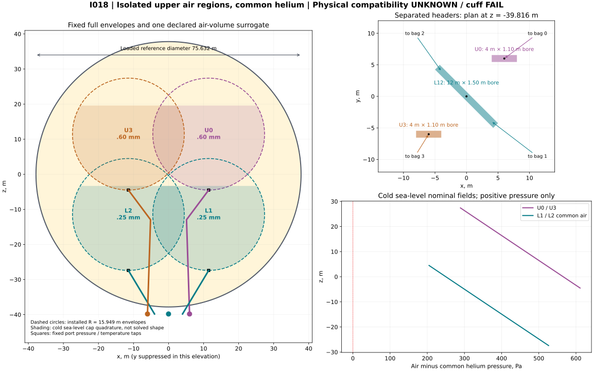
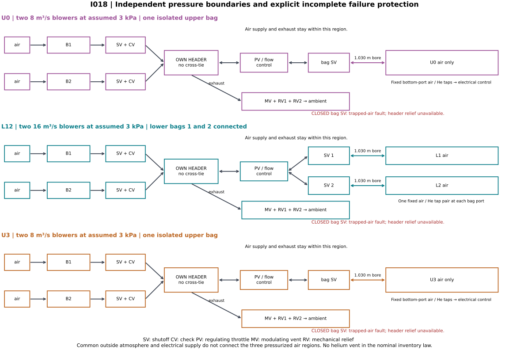

# R3-I018 — isolated upper air regions with explicit failure limits

**P100 buoyant mission FAIL; cuff compatibility FAIL/UNKNOWN; failure pressure protection FAIL.** This one 76 m arrangement separates the two upper ballonets from each other and from the connected lower pair. Its nominal full-envelope differential pressure is positive at the four cold/hot altitude endpoints. That does not solve a partly filled membrane or remove the inherited cuff-contact failure.

The construction is **74.889370 t**, 8.034805 t above I013. Cold P100 is 22.330527 t heavy at sea level and 22.271388 t heavy at 2,500 m, including the separate 17 t equipment allowance. M20's newly calculated cold water ballast is 74.669473 t. Keeping the inherited 82.851817 t water instead makes even cold M20 8.182345 / 8.123205 t heavy. Neither number is reserve lift.

`I018 | three independent air regions | nominal pressure arithmetic PASS | sea-level cuff screen FAIL | fault relief FAIL | P100 FAIL`

## Hypothesis and fixed comparison

The hypothesis is that **physical separation**, local pressure measurement and paid supply/exhaust hardware can remove I013's sea-level negative upper-envelope pressure, while exposing the corresponding added mass and interface loads. There is one selected layout, no pressure/geometry search or budget tuning.

The fixed comparison is [I013](../R3-I013/README.md), source commit `e378d72cabbf642bcf44827e09bcbcf58c825580`, calculator SHA256 `a841d9584ce4f5bffc748d0c4138af813f12fc105c903e8dd85973e73b56d8dd`. Its 66.854565 t construction, +82.851817 t cold M20 altitude margin consumed by water, P100 −14.148183 t altitude margin, −25.868 Pa cold sea-level connected-bag minimum, cuff failures and +15 K invalidity are preserved in [baseline.json](baseline.json). That small extract binds the saved predecessor output by SHA256. Its first review found no actionable defect within the declared analytical scope; it did not establish physical compatibility.

The [calculator](calculate.py) imports that exact I013 source, which itself pins the corrected [I010](../R3-I010/README.md) source. It does not rerun I013's main-curve suite. The previous 355.880 mm conditional clearance is historical: the changed ducts and mass do **not** inherit a new vehicle-clearance or trim PASS.



## Boundaries, ducts and actual measurement locations

Coordinates remain centred on the hull, z upward. Nominal diameter is 76 m; the inherited loaded reference radius is 37.815988 m. Four installed spherical design envelopes retain radius 15.949184 m and centres `(a,a,a)`, `(a,-a,-a)`, `(-a,a,-a)`, `(-a,-a,a)`, with `a=11.454553 m`. Upper bags 0 and 3 are U0 and U3. Lower bags 1 and 2 form L12 through their open branches and **only their own** lower header. Common lifting gas surrounds all four; it has no internal partition or reset pressure datum.

The old common manifold, all four old blowers and old air-control equipment are removed from the pressure ledger. Two upper headers lie at `(6,6,-39.815988)` and `(-6,-6,-39.815988)` m, each 4 m long with 1.10 m clear bore. The lower header is 12 m long, 1.50 m bore, centred at `(0,0,-39.815988)` and aligned along `(1,-1,0)`. Its branch connections are `(4,-4,-39.815988)` and `(-4,4,-39.815988)`. The upper headers run along x. The three headers have separate shells and no pressure cross-tie, balancing hose, supply bypass or shared exhaust collector.

Four 1.030065 m-bore, 1 mm-wall aluminium branches run to fixed bottom ports. Upper branches retain their old intermediate doglegs `(±5.134553,±11.011085,-12.949970)` m; their starts move to their separate headers. Lower branches run directly from their separate lower-header connections. The charged equivalent elbow/tail allowance is 2.5 m per upper branch and 2.0 m per lower branch, placed outside at header elevation for air-mass accounting.

| Bag / region | Fixed port x,y,z (m) | Charged branch length (m) |
| --- | --- | --- |
| 0 / U0 | 11.454553, 11.454553, -4.494631 | 40.408655 |
| 1 / L12 | 11.454553, -11.454553, -27.403737 | 18.285106 |
| 2 / L12 | -11.454553, 11.454553, -27.403737 | 18.285106 |
| 3 / U3 | -11.454553, -11.454553, -4.494631 | 40.408655 |

Every region has two parallel blower branches, each with its own check and shutoff. Upper blowers are each assumed 8 m³/s at up to 3 kPa, with 45 kW motors; lower blowers are each 16 m³/s at up to 3 kPa, with 90 kW motors. One surviving blower in each region gives capacities 8 / 16 / 8 m³/s. This is regional redundancy; spare flow cannot cross a sealed region boundary. Ratings and curves are unqualified assumptions.

Each header has a bidirectional regulating throttle to its bag branch(es), a modulating vent and two independent mechanical reliefs exhausting directly to outside air. Each bag has a separate branch shutoff. Added blower stubs are two 2 m runs per region, with 1.0 m upper / 1.4 m lower bores. The three separate vent/relief stubs per region are each 2 m long, with 0.8 m upper / 1.1 m lower bores. Headers and stubs use 2 mm wall and 2 kg/m ring allowance. Charged valve cavities are 1 m³ per upper header and 2 m³ lower. No external displacement credit is taken.

The four pressure heads are at the fixed bottom ports in the table, not at a point that becomes dry as a lobe folds. Each senses air pressure and adjacent common-helium pressure; four local temperature channels give twelve charged channels. Electrical signals translate the readings hydrostatically to the declared regulator datums. Instrumentation has no pneumatic connection between air regions. Four branch flowmeters and eight 5 kg volume-estimation channels are charged. Their ability to infer the real folded volume is unproved; the calculated equal-volume schedule is a target, not a demonstrated controller response.

Three provisional 2.5×2.0×1.6 m service racks receive 100 kg each for members/joints and carry the headers, valves and supply components. Four nominal upper blower assemblies occupy 1.2×1.0×1.0 m each; two lower assemblies 1.8×1.2×1.2 m each. These are allocated envelopes and masses, not catalogue parts. The 120 kWh buffer is divided into three 40 kWh modules on those racks; two 240 kW converters occupy separate upper racks. Mount/curtain force distribution, the complete service-rack geometry, new duct sag/main/rotor clearances and external appendage drag remain UNKNOWN. The two-dimensional drawing suppresses y; projected overlap is not a three-dimensional intersection result.



| State | Connected air volumes | Consequence |
| --- | --- | --- |
| Normal filling / venting | U0 alone; U3 alone; L1 and L2 through their open lower branches | No cross-region pressure bypass. Blowers fill; independent modulating vents discharge. |
| One blower failed | Same three regions; failed branch shut and check blocks reverse flow | Each region has one full-capacity survivor; calculated flow/head screen only. |
| Holds, no demanded flow | Same three regions; blower checks and vents closed, bag branches open | Header relief paths remain available; pressure targets are quasi-static endpoints. |
| A bag branch shut after leak/isolation | That bag is trapped separately; remaining topology depends on which valve closed | Header relief is cut off from that bag. Its air inventory is then sealed and its pressure no longer follows the nominal control law. **Excluded fault state, not safe nominal operation.** |
| Helium emergency relief opens | Common lifting-gas inventory changes | Outside the conserved nominal inventory law; no retained buoyancy credit after venting. |

## Pressure law, admissible bounds and failure protection

Use the inherited lapse atmosphere and ideal-mixture constants. All air regions are isothermal at ambient `Ta`; common helium/impurity gas is at `Tg=Ta+superheat`. Sealed inventory remains 27.670136 t helium plus 8.343231 t air impurity, 96/4 mole fraction. With `Rg=n Ru/Mgas`, `kg=g/(Rg Tg)` and `ka=g/(Ra Ta)`:

```text
Pg(z) = (Pa + 1000) exp(-kg z)              one common lifting-gas field
PL(z) = (Pa + 1250) exp(-ka z)              connected L1/L2, datum z=0
PU(z) = [Pg(a) + 450] exp[-ka(z-a)]         independently isolated U0 or U3
```

U0 and U3 happen to have equal targets because their centre elevations match; they remain physically separate. Lower pressure is never reset independently at either lower centre. Air added/vented by the six blowers/vents changes air inventories. No nominal helium or impurity is drawn, vented, re-purified or reset.

The declared differential deadbands are 425–475 Pa at z=a for each upper region and 225–275 Pa at z=0 for L12. Below band the controller opens supply and commands blower flow; above band it closes the blower supply branches and opens the regional vent. The bidirectional PV and bag valves remain fully open in these nominal states so exhaust can reach the header; blower drive and the modulating vent perform ordinary regulation. Closing PV is an excluded trapped-air fault, like closing a bag branch. A common-gas gauge error from +1000 Pa requests a coordinated air-volume change. Inlet trips are 525 Pa upper and 325 Pa lower at their respective datums. Actuator gains, observability, rate limits and simultaneous achievement of common-gas pressure, regional pressure and equal lobe volume are not established: they depend on a compatible membrane response.

For each region the calculator derives datum bounds that give at least 50 Pa everywhere on its full installed envelopes and no more than the nominal spherical membrane working bound `2 sigma seam t/rb`, using assumed sigma=30 MPa and seam efficiency0.60. Upper membranes are selected at 0.60 mm; lower membranes retain 0.25 mm. Working bounds are 1354.301 / 564.292 Pa. Across the four endpoints, upper admissible intervals span approximately [176–211,1191–1226] Pa; lower [85–95,286–347] Pa. The chosen deadbands lie within all four intervals. This scalar pressure screen does not establish seam, crease, fatigue or folded-membrane strength.

| h (m) | Hot (K) | Upper full-envelope dp min / max (Pa) | Lower full-envelope dp min / max (Pa) |
| --- | --- | --- | --- |
| 0 | 0 | 289.280 / 611.076 | 204.768 / 526.394 |
| 0 | 10 | 288.159 / 612.198 | 204.452 / 528.320 |
| 2500 | 0 | 323.799 / 576.498 | 214.509 / 466.895 |
| 2500 | 10 | 322.869 / 577.428 | 214.248 / 468.492 |

The selected mechanical relief thresholds are 2.10 kPa upper and 1.90 kPa lower **above local outside pressure at the headers**. They exceed the nominal flowing header demands, but they are inadequate failure protection. With flow stopped at relief pressure, the cold sea-level full-envelope peak is 1135.818 Pa upper / 1169.532 Pa lower. The lower membrane fails even the static working bound. Upper membranes pass that static comparison but fail a separate 1.5 pressure-limit screen. The lower electronic trip also exceeds its sea-level admissible static upper datum. Closing a bag branch defeats header relief altogether. These failures are retained; the record does not silently lower thresholds, add bag-side reliefs or claim a fail-safe system.

## Conserved volumes and the explicit shape approximation

The external volume is 226524.378038 m³. The inherited 100 m³ non-gas debit is subtracted once, leaving 226424.378038 m³. Its included 50 m³ routing reserve is **not** subtracted again. The liner outer-volume bound remains 8.091082 m³; the new branch metal/ring bound is below0.425 m³, within that allocation for these represented items. This is not an audit of all unmodelled installed equipment volume.

The four full installed envelopes have the inherited total `.30 Vfree + 50 m³` capacity; the extra50 is a full-envelope routing/capacity allowance, not a second gas debit. Internal branch air is 78.863977 m³, obtained from actual hull intersections. Outside branch tails, all three headers, all stubs and valve cavities are integrated separately at their own elevations. Replacing the old 10 m³ common manifold is counted once. Every inside duct volume is part of air displacement and air mass, not an extra mass added to the same lobe volume.

For mass integration only, each lobe is represented by a bottom-filled spherical cap in its fixed full envelope. Each cap has the same target **net air volume**; intersections with the eight 240 mm liner outer cylinders are removed. The free gas includes the connected liner bores; liner metal and other solids are within the existing100m³ debit. The debit is represented at z=0 in the hydrostatic integral, and ducts use a thin-axis pressure integral across their circular bore. These are declared spatial quadrature approximations. The cap's horizontal upper plane is **not** a physically supported membrane, a solved fold surface or evidence of containment. The line-load calculation separately retains the full-envelope cuff cap, without shrinking the loaded liner to match this illustrative fill height.

Let `W(k)=integral(exp(-k z) dV)`. Fixed helium moles determine one lobe air volume through:

```text
n Ru Tg / Pg(0) = W_hull(kg) - 100 - W_inside_ducts(kg) - sum(W_lobe_air(kg))
Vgas + Vinside_ducts + sum(Vlobe_air) + 100 = Vexternal
Mair_region = Pregion(0)/(Ra Ta) * W_all_air_in_that_region(ka)
```

The bounded monotone solve uses at most12 outer steps and30 cap inversion steps, not a pressure or geometry optimization. The density/pressure fields and mass closure are internally consistent **within this occupancy/debit model**. Moving the100m³ equivalent debit anywhere inside the hull changes its gas-mass integral by less than0.02kg at these densities, but that numerical smallness does not solve the much larger unknown bag shape. Positive pressure at a partially filled nominal envelope is insufficient to prescribe its volume or shape.

I013 used its declared uniform-density inventory approximation. The air-mass difference here includes both changed pressure/routing and the hydrostatic cap integration; it is not attributed solely to isolation valves. The fixed predecessor comparison is carried as recorded rather than rerun with a different model.

| h (m) | Hot (K) | Common-gas volume (m³) | Lobe air each (m³) | Inside air (t) | Outside air (kg) | Upper / lower cap top z (m) |
| --- | --- | --- | --- | --- | --- | --- |
| 0 | 0 | 168606.629 | 14434.721 | 71.828191 | 94.740 | 19.595 / -3.319 |
| 0 | 10 | 174458.629 | 12971.721 | 64.566083 | 94.741 | 17.322 / -5.591 |
| 2500 | 0 | 215105.770 | 2809.936 | 11.047630 | 74.368 | 3.736 / -19.174 |
| 2500 | 10 | 223015.212 | 832.576 | 3.328730 | 74.368 | -0.223 / -23.132 |

At2,500m/+15K the formal remaining lobe air is negative (−156.079m³ per lobe before the hydrostatic correction). The selected arrangement cannot hold the sealed inventory with its rigid internal ducts; +15K remains invalid. I013's14.165745K conservative rigid-volume limit is retained as a reference, not falsely labelled this changed routing's exact limit. No hot-case helium vent or altered purity is used to repair capacity.

## Flow, actual pressure rise, work and supply

The descent demand differentiates the **whole regional air inventory**, including its ducts and outside air: `mdot = -dM/dh - (10/3600)dM/dsuperheat`, for1m/s descent plus10K/hour gas cooling. The lapse-temperature response is included in the altitude derivative. Inlet flow uses ambient density at actual header height; delivery flow uses each header's own air density. The inherited 30m³/s common-manifold capacity is replaced by the separate8/16/8 capacities.

Branch losses use assumed Darcy f=.02 and K=8, with actual charged L/D and flow. Header loss uses f=.02 and K=4. Density is evaluated at the hydrostatic header endpoint. The blower outlet must exceed that endpoint by both losses. Isothermal work is `mdot Ra Ta ln(Pout/Pin)/0.65`, with the actual ambient inlet pressure at header elevation. There is no fixed free2kPa blower or atmospheric-density substitution for compressed air.

| h (m) | Hot (K) | Upper each / lower inlet (m³/s) | Upper / lower blower rise (Pa) | Shaft (kW) | Supply incl controls/converter (kW) |
| --- | --- | --- | --- | --- | --- |
| 0 | 0 | 5.820432 / 11.640125 | 1925.356 / 1613.381 | 62.825 | 68.237 |
| 0 | 10 | 5.855479 / 11.709533 | 1930.418 / 1617.657 | 63.367 | 68.807 |
| 2500 | 0 | 6.307583 / 12.602512 | 1870.174 / 1582.243 | 66.210 | 71.800 |
| 2500 | 10 | 6.359739 / 12.705463 | 1876.183 / 1587.591 | 66.971 | 72.601 |

All selected one-out flow/head screens pass the assumed ratings. Equivalent reversed ascent/heating flow can pass one open vent per region after subtracting return branch/header losses from the available pressure and applying the declared K=6 vent loss; this is a capacity diagnostic, not fault-transient qualification. Reversible heating vents air and recovers no shaft energy. Nominal endpoint mass tables are quasi-static. Extra pressure in flowing ducts is not itself hydrostatic; bounding every rigid air volume by the maximum calculated loss gives at most0.678kg additional transient air. Subtract that bound from a flowing margin; it is not credited as reserve lift. Gas heating from compression, cooler heat rejection and motor transients remain unmodelled.

Cooling from+10K to cold at fixed altitude over one hour requires7.262108t air at sea level and7.718900t at2500m. Fixed nine-state Simpson integration gives3.546687 /4.774969kWh shaft work, plus2kWh controls before converter loss. This is the air-management work only; it excludes the heat-transfer plant and all mission propulsion work.

The pressure installation adds two assumed240kW/200kg converters, a120kWh gross battery at120Wh/kg and200kg enclosure/thermal allowance. Usable fraction0.80 gives96kWh. One converter survives; a live-motor interlock permits at most45+90+45=180kW, despite360kW of installed motors. At0.95 converter efficiency,30minutes at that180kW limit plus2kW controls needs95.789kWh. That narrow arithmetic pass is not battery, cooling, redundancy or endurance qualification. Existing5t mission-energy and3t propulsion allowances remain separate and unqualified.

## Complete construction and payload ledger

The old3925.664kg pressure hardware is removed once, including its1250kg blowers,371.327kg air valves,1221.505kg branch tubes/rings,380kg supports/ports and250kg common manifold. Its92.832kg helium emergency valves are retained inside the new ledger. The old2t pressure allowance remains inside the unchanged17t equipment budget; only the **new** excess over2t is in construction. No full pressure mass is charged again on top of that allowance.

Upper membrane, gore-lap and doubler gauge increments total3293.709kg. Lower membrane gauges, four meridian bands per bag,32hangers/actuators, eight liner systems and the remaining I013 construction are retained. The original full charged hanger lengths and calibrated free lengths are fixed, not reselected to hide stroke demand.

| New pressure-installation item | Mass (kg) |
| --- | --- |
| four upper blowers 8m3s 3kpa motors drives | 1200.000 |
| two lower blowers 16m3s 3kpa motors drives | 1200.000 |
| six blower shutoffs | 280.000 |
| six blower checks | 180.000 |
| four bag shutoffs | 200.000 |
| three region control throttles | 210.000 |
| three modulating vents | 120.000 |
| six independent reliefs | 280.000 |
| twelve pressure temperature channels | 36.000 |
| four flowmeters | 48.000 |
| eight volume estimation channels | 40.000 |
| controllers and 24v backup | 80.000 |
| two emergency helium valves retained | 92.832 |
| new branch tubes 1mm and rings | 1144.035 |
| branch supports four ports | 360.000 |
| header stubs 2mm aluminium rings | 1061.893 |
| header mount frames | 300.000 |
| wiring feeders breakers | 234.000 |
| two 240kw supply converters | 400.000 |
| 120kwh dedicated buffer 120wh per kg | 1000.000 |
| buffer enclosure thermal | 200.000 |
| Total | 8666.760 |

| Construction item | Mass (t) |
| --- | --- |
| envelope fabric | 25.404175 |
| envelope seam laps | 1.846571 |
| barrier weather | 1.814584 |
| main anchor doublers | 0.840000 |
| main load curtains | 1.344000 |
| main pin fittings | 1.200000 |
| bag membranes | 7.607882 |
| bag 32 gore laps | 0.381606 |
| bag cradle bands | 2.020267 |
| bag cradle fittings doublers | 0.169520 |
| bag hanger fittings | 0.320000 |
| bag anchor doublers curtains | 0.537600 |
| cradle construction over 3t | 11.740684 |
| pressure hardware over 2t | 6.666760 |
| ballast hardware over 3t | 0.000000 |
| external main ropes and 80mm covers | 1.195369 |
| 24 standoffs and spread plates | 5.705629 |
| 24 main length adjusters | 2.914916 |
| 32 bag length adjusters | 0.882878 |
| hydraulic controls lines and oil | 0.575196 |
| eight rigid hanger pass through liners | 1.346129 |
| bag hangers and 70mm clamp envelope | 0.375605 |
| Total | 74.889370 |

| h (m) | Hot (K) | Gross air displaced (t) | M20 total before water (t) | M20 raw margin (t) | P100 total before water (t) | P100 raw margin (t) |
| --- | --- | --- | --- | --- | --- | --- |
| 0 | 0 | 277.495142 | 202.825669 | +74.669473 | 299.825669 | -22.330527 |
| 0 | 10 | 277.495142 | 195.563562 | +81.931580 | 292.563562 | -15.068420 |
| 2500 | 0 | 216.753347 | 142.024736 | +74.728612 | 239.024736 | -22.271388 |
| 2500 | 10 | 216.753347 | 134.305836 | +82.447511 | 231.305836 | -14.552489 |

M20 is3t fixed payload plus17t equipment; P100 is100t payload **plus**17t equipment. Both include the unchanged36.013368t lifting mixture and all inside/outside air. Fixed wet ballast-hose water remains inside its inherited hardware allowance, distinct from movable trim water. The new cold minimum raw margin74.669473t is at sea level. With that water fixed, altitude cold retains59.139kg excess buoyancy; +10K retains7262.108 /7778.039kg. These require downforce, vent/ballast action or other accounted control; no loaded trim or positive operating claim is made. Powered lift is not supplied to rescue P100.

## Retained eight cuffs, finite supports and interface result

The eight foreign-bag hanger penetrations remain at host hanger IDs9,10,11,12,16,21,22,23 (zero-based geometry IDs). Each retained240mm OD/2mm-wall liner is22.356522m long, with1m rings,1.5m saddles, two flexible cuffs and two collars; total1346.129kg. Four intersect U0 and four U3. The full paid physical liner span is retained. Host deadweight is charged to its actual hanger. No pressure contact reaction is assigned to an unpriced fixed bag anchor.

For each bag the actual integrated air apparent weight is its air mass minus the common gas mass displaced by that air volume. Its own fixed fabric/band/fitting mass is added, including1646.855kg extra on each upper bag. Eight original hanger free lengths share that bag's vertical load. The old18mm ropes, 50GPa assumed axial modulus, finite band stiffness179.620kN/m,2MN/m upper foundations and paid0.8–1.2m bag actuators remain.

The selected contact screen is the predecessor's +x full-envelope cap: `q = .240 max(abs(dp))` on the full paid liner, with equal opposite force applied to its foreign bag **at the same spatial load centre**. It now uses that foreign upper region's pressure. At cold sea level q rises from the inherited126.208 to146.658N/m. Thus positive upper inflation pressure increases this screen's side load. Actual pressure at the liner's lower/middle/upper positions is exported; the full-envelope cap is conservative for those positions in the valid small-slope cases. It remains a declared contact scenario, not a rigorous bound on arbitrary fabric self-stress.

The four translational bag balances include finite band/upper displacement and natural hanger pendulum stiffness. Line reactions, elastic extension, geometric arc excess, fixed free length and commanded stroke are recomputed. Constant-q string endpoints are solved with the paid liner span; the linear slope domain remains `|slope|<=0.2`. Coupled tube bending, cuff friction and membrane rotation are not solved.

| h (m) | Hot (K) | Largest formal centre shift (m) | Max slope | Envelope gap / validity | Actuator command range (m) |
| --- | --- | --- | --- | --- | --- |
| 0 | 0 | 1.639 | 0.153 | -0.926 m, FAIL | 0.991–1.090 |
| 0 | 10 | 1.793 | 0.166 | -1.052 m, FAIL | 1.005–1.124 |
| 2500 | 0 | 6.283 | 0.466 | Outside small-slope domain | 1.160–2.488 |
| 2500 | 10 | 10.327 | 0.665 | Outside small-slope domain | 1.229–4.798 |

Sea-level contact envelope gaps−0.926/−1.052m fail within the declared slope domain. At altitude the formal shift/stress/stroke calculations leave that domain; the numeric outputs are diagnostics, not valid collision or stress predictions, and stroke limits also fail. The no-lateral-cuff baseline has zero horizontal shift and strokes0.984–1.162m across the four endpoints, but it omits the contested load and is not a contact solution.

The upper bags also retain about149.939/150.166kNm of unclosed side-load moment per bag in the cold/hot sea-level screen. These are the reported horizontal-force moments about nominal centres; they are not a complete three-dimensional wrench including changed membrane shape. Translational balance alone cannot establish rotational equilibrium. Contact cases are never promoted into a successful vehicle trim set. Their changed mass first moment and additional water-trim cosine amplitude are exported only as a requirement.

The largest valid-domain hanger1.5-limit resultant is34.064kN versus38.170kN assumed rope working capacity and53.878kN actuator pull capacity. Pressure/liner working stresses remain assumptions; even any passing scalar comparison cannot close the observed envelope overlap, cuff seal mechanics or unclosed moment. Inherited curtain/global membrane/rotor/flexible hose/mission propulsion and energy UNKNOWNs remain. New rack/duct drag and overall loaded equilibrium have not been solved.

## Reproduction, confidence and next geometry

```sh
timeout 240s python3 -B research/design-iterations/R3-I018/calculate.py > /mnt/scratch/R3-I018.json
MPLCONFIGDIR=/mnt/scratch/R3-I018-mpl python3 -B research/design-iterations/R3-I018/draw.py /mnt/scratch/R3-I018.json /mnt/scratch/R3-I018-figures
```

The calculator uses the standard library,180s CPU/512MiB process limits, fixed24-point quadrature and bounded scalar iterations. It exports all four pressure/mass/flow states, all256 hanger rows across unloaded-cuff/contact screens, failure flags and fixed comparison. Figures use Matplotlib and saved output, with deterministic SVG metadata. No broad optimizer, FEA/CFD, new review or repeated unchanged predecessor suite is used.

Independent composite-Simpson integration verifies gas/air inventories and cylinder-excluded cap geometry. Analytic implicit-volume and regional-air derivatives independently check the finite-difference flow calculation; their maximum difference is3.693e-8kg per derivative unit. Cap-volume difference is1.104e-9m³, gas-mole difference2.021e-7mol, air-mass difference9.459e-11kg. Independent force integration checks string endpoints within5.818e-15m and forces within6.822e-13N. Full mass reconciliation passes. These are numerical consistency errors, not physical precision or validation. Exact artifact and check receipts are retained separately.

Confidence is high in the stated conditional arithmetic and low in physical feasibility. The weakest assumption is that folded bags can occupy and be controlled to the assigned volumes while carrying the specified pressures and cuff reactions. The cap approximation supplies no membrane, rotational or controller stability solution. Failure protection is explicitly incomplete.

The next specific geometry hypothesis is to move the eight penetrating lower-bag hangers into two spaced guide racks near `(x,y)=(0,±29m)`, running approximately z=0..23m in common-helium corridors outside both full upper envelopes. Lower bridles and finite lateral rack/curtain reactions must be priced and solved; no free bend or guide reaction is allowed. This is a proposed subsequent geometry, not tested here. Bag-side relief paths that remain connected after branch isolation are also required before claiming pressure-failure protection. Raising the present cuff pressure again is not a demonstrated fix.
