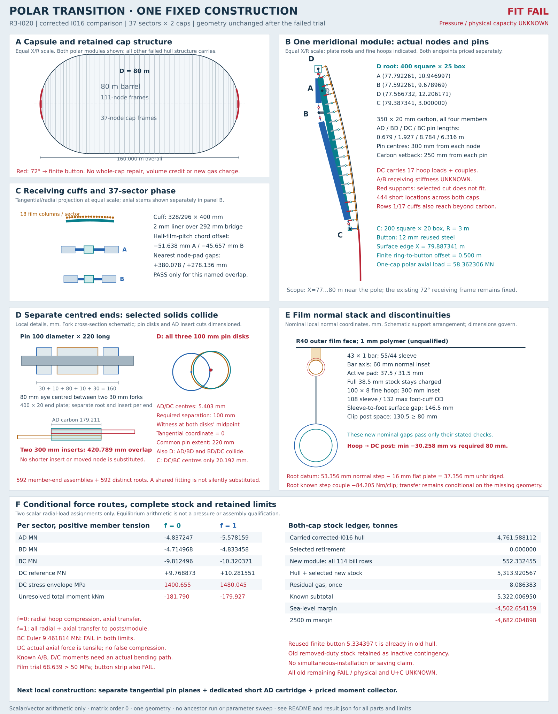

# Triangulated polar transition with finite button

This fixed construction **fails to fit and does not establish a pressure-capable assembly**. It adds a repeated two-triangle module between the last 72° cap frame and a finite 3 m polar ring, with a normal-offset film grid. Four pairs of selected 100 mm pins intersect, the shortest member cannot contain its two inserts, 444 hoop supports are too short, and the old-to-new film adapter leaves a normal gap. Force equilibrium also leaves known joint moments without a demonstrated receiving-frame path. The unsuccessful construction is retained without changing dimensions to improve its result.

The added stock is **552.332455 t**, with **zero selected retirement credit**. The carried hull plus new stock is 5313.920567 t; residual gas appears once at 8.086383 t, giving 5322.006950 t. The resulting sea-level and 2500 m margins are −4502.654159 and −4682.004898 t. This is a failed-construction stock budget, not the mass of an installable aircraft. Physical float, all-up mass, U+C, compatible loaded shape and global pressure capacity remain UNKNOWN.



## Fixed comparison and scope

[Corrected I016](../R3-I016/README.md) is the sole comparison. Its complete result and seven SHA256 file pins are frozen in [baseline.json](baseline.json). The calculator checks those files and reads the frozen result; it does not import or execute an ancestor calculator. The correction already includes both adjacent film-bar reactions at a shared clip and distinct terminal contributions. The incoming 72° reaction used here is the corrected, signed single cap-span contribution.

One geometry is selected, with 37 repeated sectors on each cap and exactly two explicit radial-load limits. The D80 m × 160 m capsule, barrel, all cap stations through 72°, existing 37-node cap frames, 111-node barrel frames, material proxies, residual gas and carried volume remain fixed. This local attempted replacement does not repair the other I016 cap/barrel clashes, strength failures, 888 short posts, remaining cuff/pad collisions, erection failures or global restraint assumptions.

The hypothesis is specific: a finite root collector D, two receiving points A/B and a finite polar ring C might close the old root-to-dome discontinuity with separate centred axial ends and an offset film path. Triangles ABD and BDC provide a conditional force route. DC additionally carries intermediate hoop loads as a beam-column; it is not treated as a two-force member. A/B are ideal receiving points for arithmetic, not demonstrated rigid supports.

## Coordinates and construction

Coordinates are metres in one right-cap meridional X/R plane, with cap centre O=(40,0), X increasing toward the pole and R radially outward. The opposite cap reflects X and axial forces. Let α=2π/37 and β=2π/666. Sector j is centred at θ=(18j+8.5)β, grouping precisely the 18 inherited film columns 18j…18j+17. Relative to each old ring-chord midpoint this is a −β/2 shift, not a new set of film azimuths.

The last frame is at X=78.042261, surface R=12.360680, outer/inner node radii 10.986454/9.713855 and chord lengths 1.863433/1.647585. Its actual cuff radius is `r_node*cos(α/2)/cos(−β/2)`. Cuff centres are displaced −51.638/−45.657 mm along their old outer/inner chords. A and B stand 250/450 mm toward the barrel from that frame; their stem bending is retained.

| Node | X m | R m | Function |
|---|---:|---:|---|
| A | 77.792261 | 10.946997 | Outer-ring receiving cuff and 250 mm stem |
| B | 77.592261 | 9.678969 | Inner-ring receiving cuff and 450 mm stem |
| D | 77.566732 | 12.206171 | Root collector at 500 mm inward normal offset from the 72° surface |
| C | 79.387341 | 3.000000 | Finite polar box ring at the inherited hub datum |
| Button edge | 79.887341 | 3.000000 | Surface at φ=acos(3/40)=85.698778° |
| Pole | 80.000000 | 0.000000 | Surface point; no zero-radius truss support |

For every main member, pins are 300 mm from each ideal node along the member. Carbon begins 250 mm inside each pin. All four tubes are 350 OD × 20 mm wall carbon; the two 309 OD/285 ID × 300 mm steel inserts each have 290 mm bond plus 10 mm relief. They enter the 310 mm carbon bore with a 0.5 mm radial bond line. Every member has two distinct fittings, and every fitting has a separately priced root.

| Member | Node length m | Actual pin length m | Carbon cut m | Space after two 300 mm inserts m |
|---|---:|---:|---:|---:|
| AD | 1.279211 | 0.679211 | 0.179211 | **−0.420789 FAIL** |
| BD | 2.527331 | 1.927331 | 1.427331 | 0.827331 |
| DC | 9.384466 | 8.784466 | 8.284466 | 7.684466 |
| BC | 6.915991 | 6.315991 | 5.815991 | 5.215991 |

Each centred end has a 400 mm diameter × 20 mm plate and a 300 × 220 × 80 mm eye with a 100 mm hole. Its root has two 300 × 220 × 30 mm fork cheeks, 100 × 220 mm pin, two 140/102 × 8 mm washers, retainers, two 400 × 250 × 20 mm gussets, 400 × 300 × 30 mm base, four M24 sets and weld stock. The 100 mm fork gap contains the 80 mm eye plus two 10 mm gaps; the fork outer width is 160 mm, washers extend to 176 mm and the pin is 220 mm long. These are distinct centred, double-shear ends; their coplanar solids demonstrably collide at D/C.

The receiving split cuffs are 328 OD/296 ID × 400 mm steel with a 2 mm radial liner over the inherited 292 mm bridge. Each has four 150 × 100 × 20 mm flanges, eight M24 sets and flange welds. Stems are 200 square × 20 mm wall with two 200 × 200 × 20 mm end plates. The nearest nominal node-pad clearances are 380.078 mm at A and 278.136 mm at B. These tests address only the named cuff/pad overlap; they do not establish grip, joint stiffness or clearance to every inherited attachment.

D is a curved 400 square × 25 mm steel box ring and C a curved 200 square × 20 mm box ring. Each has 37 developed segments separated by 4 mm gaps. Four 304 mm long face covers at each gap give 150 mm overlap on each side; their width and thickness match the ring face, with four 26 mm holes per face and 16 M24 sets per splice. Four 10 mm fillet-equivalent fabrication seams are priced over the full box length. Every root gets 80 × 80 × 12 mm nut backers, with an intended 120 mm axial × 200 mm tangential bolt pattern.

The intended fabrication sequence is to install nut/backer assemblies while the box faces remain open, close and weld the box, assemble the segment covers, fit the receiving cuffs/stems, and then insert the main member pins from the tangential direction. This sequence reaches the recorded pin and AD-insert conflicts and **cannot be completed as drawn**. It does not invent access cutouts, merged forks or shortened inserts. The individual bolt/pin access dimensions are a specified arrangement, not proof of global assembly access or a qualified weld sequence.

## Continuous film and finite button path

There are 18 equal meridional bays from 72° to 85.698778°, at the existing 666 azimuths. The 43 × 1 mm carbon bar centres follow the actual inward surface normal at 60 mm offset, not a constant cylindrical radial subtraction. Bars are straight pin chords; each carbon cut is the chord length less two 60 mm setbacks. There are 23,976 bars across both caps. Each lower end is fixed through an 80 mm bonded 55/44 × 100 mm steel sleeve. Each poleward end has an 80 mm guide liner, 40 × 10 mm axial slot and 8 mm pin; this ideal guide supplies only the transverse reaction in the bar plane. Guide friction, stroke, restraint and actual laminate properties remain UNKNOWN.

Seventeen interior fine hoops per cap use 100 × 8 mm carbon at 300 mm inward normal offset. Each has 37 arcs, 4 mm gaps and 108/102 × 304 mm steel splices with two 150 mm bonds. All clip-foot cuffs are 132/110 × 80 mm with a 2 mm liner onto 108 mm OD. At bare 100 mm hoop portions, explicitly priced 108/100 profiled carbon packing fills the annulus; the calculator intersects each actual cuff footprint with the actual splice intervals. No max-OD cuff is allowed to grip an empty annulus.

One clip at each of 19 rows and 666 columns gives 25,308 clips across both caps. Each has a 120 × 100 × 12 mm base, four 80 × 35 × 8 mm fork cheeks, common 8 × 80 mm pin, two M12 sets, two 30 × 50 × 0.5 mm bond pads and welds. The root clip receives the old incoming bar and new outgoing bar; an interior clip receives the two actual adjacent new bars; the polar film terminal receives one incoming new bar. The finite button has its own flange and supports, so its pressure is not silently made a second fictitious film bar.

Film clip posts are 60 × 3 mm carbon with a minimum 80 mm selected cut, two 80 × 80 × 8 mm plates, four M8 sets and welds. The selected bar-to-hoop normal surface gap is 168.5 mm; the 55 mm bar sleeve to 132 mm foot cuff gap is 146.5 mm. After both 8 mm end plates, the minimum clip-post space is 130.5 mm, so these particular new normal gaps pass the named nominal tests.

Normal stanchions from each fine hoop to DC use 100 × 8 mm carbon, also with an 80 mm minimum cut. The calculator intersects the actual inward normal ray with the actual DC axis. Its 386/354 × 200 mm beam-foot cuff includes a 2 mm liner over 350 mm carbon, four flanges, eight M12 sets and welds; the hoop end uses the full 132/110 foot. Two 160 × 160 × 12 mm plates, eight further M12 sets and 0.640 m of 8 mm weld are charged per stanchion. The plate kit allocates four M12 sets and two 160 mm weld runs to each series foot; the separate beam-cuff and hoop-cuff sets remain distinct. Six of the 17 rows fail the selected length: **444 locations across both caps**, with minimum available cut **−30.258 mm** versus the 80 mm requirement. Rows 1 and 17 also place their 200 mm beam-foot cuff partly outside the actual DC carbon/setback interval; all axes are between the pins, which is insufficient for a physical cuff. These limits are retained without moving a hoop or narrowing a foot.

At row 0, I016's old cylindrical bar datum and the new 60 mm normal datum differ by X/R=(57.063, −2.959) mm. Their normal separation is 53.356 mm. The selected 160 × 120 × 16 mm flat adapter, aligned in the new normal/tangent frame, leaves **37.356 mm unbridged**. Four M8 sets and the plate stock remain charged. Its known transfer couple is retained in the conditional load ledger; no free wedge, spacer or bend is supplied.

The pressure film is a generic, unqualified 1 mm polymer with assumed density 1400 kg/m³ and a 50 MPa tensile proxy. Its outer face uses the R40 unloaded datum. Thirty-millimetre-wide profiled pads have 38.5 mm full stock; trimming 1 mm for film thickness gives active thickness 37.5 mm over bare bars and 31.5 mm over the sleeves. Full stock, including trim, remains charged. This describes a nominal normal stack only; continuous film adhesion, guide-end contact, seams, drape, creep and the loaded surface remain UNKNOWN.

The finite 3 m button reuses the corresponding 12 mm steel portion of the old dome: 5.334397 t across both caps, already in the carried hull. New 100 × 8 mm steel supports run between its mid-surface and C at all 37 sectors per cap; their finite oblique offset and two feet are priced, with eight M12 sets and 0.640 m of 8 mm weld total. Four bolts and two 160 mm weld runs belong to each series foot; the opposite foot does not provide parallel resisting area. Root and button film edges have continuous 120 × 12 mm straps, 120 × 8 mm backing strips, 100 × 2 mm gaskets and 666 M12 sets per edge per cap, plus seam stock. The paired strap describes an attempted supported boundary; material compatibility, compression, sealing and actual restraint remain unqualified.

Erection attachments are included at four locations per sector on every new support ring: 5,032 fine-hoop kits and 592 box-ring kits. Each has a 100 × 80 × 12 mm lug with 24 mm hole, 20 × 80 mm pin and washers, four M12 sets and welds. Fine-hoop kits use a 140/112 × 80 mm cuff with liner to 108 mm and explicitly priced packing to bare 100 mm portions. Box kits use a 120 × 100 × 16 mm base. Each carries the full inherited 10.528099 kN nominal demand; no wind load is diluted among the increased attachment count.

## Signed forces and the two limits

The pressure is q=121,590 Pa. For a new strip spanning φ=a…b and azimuth width w, its exact integrated projected force in the central X/R plane is

```text
Fx = −q*w*R²/2 * (sin²b − sin²a)
Fr = −q*2*sin(w/2)*R² * ((b−a)/2 + (sin(2b)−sin(2a))/4)
```

The pressure tractions are radial to the cap centre, so their integrated moment about O is zero. With actual lower/upper bar pins Pa/Pb, chord unit e, length L and chord-normal n=(−eR,eX), the force **delivered by the bar to** its poleward guide is `Fb=−cross(Pa−O,F)/L*n`; the lower pin receives `Fa=F−Fb`. Thus both force components and moment close, and `dot(Fb,e)=0`. This conditional pin/guide model is a declared restraint choice, not proof of film compatibility.

At each row, the calculator sums the actual incident vectors. Row 0 also carries the frozen old-bar vector (−3837.718933, −1276.639171) N and `cross(Pold−Pnew,Fincoming)=−84.205095 Nm` at each clip. No terminal is arbitrarily doubled. Known root/interior-maximum/polar-terminal clip resultants are 7.759019/7.224532/0.968042 kN. Additional film in-plane forces, guide friction and other unknown interface loads remain null, not zero or a qualified terminal total.

The 18-column group gives axial factor 18 and radial factor `K=sin(α/2)/sin(β/2)=17.978446409`. Symmetry cancels its azimuthal resultant. The projected tangential-axis moment is also multiplied by K; simply applying the aggregate force at a central point without its collector couple would lose moment. All point transfers retain their original moment about O, using `Mlocal=MO−cross(Pcollector−O,F)`.

The new annular strips plus finite button give **58.362305821 MN axial force per cap**, exactly qπ(40 cos72°)². This is the polar projected-area load once. The inherited incoming boundary separately adds 2.555920810 MN axial demand over one cap; its sum of local radial components is 0.850241688 MN, not a full-ring global radial vector. The inherited 611.178001 MN whole-end pressure force is recorded for context and is never applied again to this module. Nor are previously accumulated frame pressures added to the new strip area.

Only these two radial assignments are evaluated:

1. **f=0:** each circumferential collector takes all its radial demand as hoop compression; axial pressure still transfers through the supports and module.
2. **f=1:** radial and axial demand transfer through the posts and beam/truss; no radial hoop credit is selected.

Neither establishes actual elastic sharing. The hoop force uses its actual chord equilibrium, `Nhoop=|Fr,hoop|/(2sin(α/2))`. The corresponding hoop reaction changes the transferred moment and is included explicitly. Fine hoops are screened with their full sector force at the worst pin-span lever, plus the known collector couple; these are local envelopes, not curved-ring or global stability solutions.

Seventeen interior loads reach the actual DC beam-axis intersections, each with its retained transfer couple. Using actual DC end pins, the poleward transverse end share follows the sum of force moments divided by pin length; the lower share is the remaining force. Placing the distributed axial force at D defines an algebraic reference. The free DC axial unknown is then solved at C with BC using two scalar cross-product equations; D similarly solves AD and BD. This reference does not impose a favourable division of thrust between the old layers. Signed DC axial, transverse and bending sections are recorded on both sides of every point load/couple. Between points the bending function is linear, so the recorded extrema cover this declared point-load beam model. The real distributed, compliant structure remains unknown.

| Per-sector quantity | f=0 | f=1 |
|---|---:|---:|
| AD signed tension MN | −4.837247 | −5.578159 |
| BD signed tension MN | −4.714968 | −4.833458 |
| BC signed tension MN | −9.812496 | −10.320371 |
| DC reference tension MN | +9.768873 | +10.281551 |
| DC actual maximum tension MN | 9.768873 | 10.311524 |
| Force delivered to A: X/R MN | +0.852819 / −4.761477 | +0.983444 / −5.490783 |
| Force delivered to B: X/R MN | −2.499258 / +4.761477 | −2.629882 / +5.133462 |
| D unresolved local moment kNm | −250.922050 | −258.956223 |
| C unresolved local moment kNm | +69.132464 | +79.028723 |
| Total unresolved module moment kNm | **−181.789587** | **−179.927500** |

Negative member tension means compression. The equal-and-opposite A/B support forces are explicit in [result.json](result.json). Source force equals the sum delivered to A/B; the sum of the two local unresolved moments equals the global source-minus-receiver moment residual. The latter is **not equilibrium of a realizable pin-only assembly**. Ring/end-block/receiving-frame bending must transmit those moments, including 250/450 mm stem offsets and the phase-shifted cuff's circumferential demand. No ideal rigid frame, torsion stiffness or hidden frame reinforcement supplies them here.

## Fit witnesses and local screens

All main pins are parallel to the sector tangential axis and occupy the same 220 mm tangential interval. The midpoint of each colliding pair's X/R centres lies inside both 50 mm radius disks, at tangential coordinate zero. These are explicit solid-intersection witnesses, not merely crossed centre lines.

| Pin pair | Centre separation mm | Surface gap mm |
|---|---:|---:|
| D: AD/BD | 50.080 | **−49.920** |
| D: AD/DC | 5.403 | **−94.597** |
| D: BD/DC | 55.463 | **−44.537** |
| C: DC/BC | 20.192 | **−79.808** |
| B: BD/BC | 595.226 | 495.226 |

The AD carbon cut is 179.211 mm versus 600 mm of required insert stock. A positive axial-force calculation cannot make either its 420.789 mm overlap or the pin intersections assemblable. The D/C box-plus-cover outer corner envelopes lie 216.221/364.274 mm inside R40; this only checks those box envelopes, not every attached root or the failed surrounding hardware.

Material inputs remain comparison proxies: carbon E=135 GPa, density 1600 kg/m³ and normal-stress ceiling 1450 MPa; steel E=200 GPa, density 7850 kg/m³ and nominal 355 MPa. The primary-source context and explicit unqualified assumptions are in [sources.json](sources.json). The carbon number is not a tube laminate specification; neither the steel number nor a nominal bond stress certifies pins, welds, peel or formed assemblies.

BC compression exceeds its pin-Euler value 9.461814 MN in **both** routes. DC has actual tension throughout the recorded sections: zero maximum compression, not a fictitious compressive envelope. Its additive direct-plus-bending envelope is 1400.655 MPa for f=0 and **1480.045 MPa for f=1**, exceeding 1450 MPa in the latter. The DC peak bending magnitudes are 1.504672/1.590821 MNm at 3.889777 m from the D pin. AD/BD direct stress and pin-Euler screens pass their scalar comparisons, while assembly, laminate, shell/local buckling and support restraint remain unqualified.

All eight main ends are screened independently. Across both limits, nominal maxima are 658.687 MPa pin double shear, 1293.328 MPa eye bearing, 1724.438 MPa fork bearing, 1437.032 MPa fork net section, 921.738 MPa insert axial stress, 36.660 MPa mean bond shear, 7983.451 MPa end-plate strip bending, 8233.584 MPa four-M24 root mean shear and 1016.288 MPa fork-weld mean shear. These large demands leave multiple explicit steel-proxy failures; bond allowable and peel remain UNKNOWN. M24 threaded-area screens use a 20 mm effective root diameter, M12 use 9.8 mm; actual fastener certification and preload are unqualified.

Receiving cuffs have nominal contact pressures up to 47.010 MPa, eight-M24 mean shear up to 2294.976 MPa and four-bolt moment-tension demand up to 7353.143 MPa. These are demand estimates on the specified footprint, not demonstrated carbon bearing, clamp friction, bolt-group restraint or old frame capacity. Fine-hoop and box-ring nominal envelopes pass their comparison ceilings in these two assignments; neither that fact nor the stanchion scalar screens removes their fit failures or qualifies circumferential sharing.

The new bars' largest declared midspan bending sample is 361.412 MPa; the peak over the actual whole bar is not claimed. The largest known clip load gives 77.180 MPa common-pin double shear, 63.195 MPa eye/guide bearing, 51.432 MPa two-M12 mean shear, 2.586 MPa bond-pad mean shear and 67.415 MPa base-plate strip bending. These nominal values omit unknown film tension and friction contributions; the root datum still does not fit.

The film's meridional pitch is 531.308 mm and maximum azimuthal chord 116.613 mm. A one-way trough screen with half-span a and sag h=a/4 uses `T=q(a²+h²)/(2h)`. It gives **68.639 MPa**, exceeding the unqualified 50 MPa trial proxy. The 12 mm finite button's nominal spherical membrane compression is 202.650 MPa, while an unsupported 6 m diameter one-way strip gives **22,798.125 MPa** bending: a failed strip assumption, not a derived shell-buckling rating. Two-way shell restraint remains UNKNOWN. With the complete pressure-resultant couple carried through the selected support, its additive stress envelope is **1980.940 MPa**, exceeding the 355 MPa proxy. Finite support feet transmit both force and known moment; their combined connection capacity remains UNKNOWN.

### Finite support moment and separate series feet

The finite button's integrated pressure has moment M_O=0 about O. At the existing button attachment P, the equivalent force therefore comes with `M_P = M_O − cross(P−O,F) = −93.334261 kNm`. Moving that complete system through the existing support to C gives

```text
M_C = M_P + cross(P−C,F)
    = −93.334261 − 2.338029 = −95.672290 kNm
cross(P−O,F) + M_P = cross(C−O,F) + M_C = M_O = 0
```

Both endpoint sections are recorded. With no distributed load assigned to the support itself, its moment varies linearly between these transferred endpoint values; the C datum controls the conditional additive envelope at **1980.940 MPa, nominal FAIL**. The actual restraint and bolt/weld-group moment transfer remain unqualified. The former short-offset calculation used only −2.338029 kNm and reported 87.610873 MPa. Its implied source moment was +93.334261 kNm instead of zero. That rejected omission is preserved explicitly in `localScreens.button.rejectedOmittedCoupleControl`; it is not an alternative valid load case.

The local support carries the full button force and couple to C in both existing radial limits. Their declared radial-hoop reaction acts downstream at C. The module's global force/couple equations already included the complete source moment; this local correction adds no global load and does not change the retained −181.789587/−179.927500 kNm module residuals.

`seriesPlateFeet` records each attachment datum, the signed force/couple applied to the support and its equal-and-opposite attachment reaction. At the button-side foot the applied couple is −93.334261 kNm; at the C-side foot the receiver applies +95.672290 kNm to the support, which delivers −95.672290 kNm to C. Source and receiver moment identities, and the two-foot free-body force/moment residuals, are checked separately. Normal stanchions use their own routed force and source moment, with the existing hoop collector and DC beam-axis datums; their receiving moments and tube-section screens remain unchanged.

Every 160 × 160 × 12 mm plate foot has **four M12 sets and 0.320 m of 8 mm weld**, allocated as two 160 mm runs. The two feet together still use exactly eight sets and 0.640 m of weld. Using the existing 9.8 mm effective threaded root diameter and 0.707 nominal weld-throat factor gives these force-only demands:

| Plate-kit interface | Maximum mean bolt shear MPa | Maximum mean weld shear MPa | Maximum known datum couple kNm |
|---|---:|---:|---:|
| Button support, either foot | 308.339535 | 51.401034 | 95.672290 |
| Normal stanchions, f=0, each foot separately | 411.622821 | 68.618637 | 9.775801 |
| Normal stanchions, f=1, each foot separately | 430.957563 | 71.841791 | 1.754101 |

The button foot's previous pooled values, 154.169768 MPa and 25.700517 MPa, are retained only as rejected controls. Every affected stanchion foot is evaluated from its own existing force; its corrected force-only mean demands are likewise twice its own previous pooled values. The stanchion maxima cover 17 supports × two interfaces per repeated sector, separately for each of the two existing routes. They are not inferred from the button's numerical example.

These are **force-only mean stresses, not combined connection capacity**. Known couples remain explicit. Actual bolt/weld-group centroids, bolt-group tension/shear sharing, local plate eccentricity, weld moment distribution, material certification and preload are not established, so their additional moment stresses and combined pass fields remain null. Equal weld allocation is a declared distribution of already charged stock, not an as-built qualification. The separate eight-M12 beam-cuff set with 0.600 m of fabrication weld, and four-M8 hoop-cuff set with 0.160 m of fabrication weld, retain their original identities and quantities; neither is pooled with a plate foot or silently doubled. All geometry, stock rows, gas, margins and other failures remain unchanged.

The erection lug's nominal root bending is 274.169 MPa, net section 15.667 MPa, bearing 43.867 MPa, pin single shear 33.512 MPa and four-M12 mean shear 34.894 MPa under the full 10.528099 kN load. Nominal component comparisons do not establish cuff grip, carbon packing strength, load redistribution or wind stability. The other inherited erection-flange failure is retained.

## Replacement and complete stock accounting

All quantities below cover 37 sectors and both caps once. Main-member end assemblies and separate node roots each number 592; receiving cuffs number 148. New stock includes all bars, ends, inserts, bond/liner material, forks, pins, washers, retainers, gussets, bases, bolts, ring splices, fabrication welds, collector supports, film pads, film, finite edges, seals and erection attachments. [result.json](result.json) includes every count, each-unit kg, dimensions and duty; `hardware.partsKg` further separates each fitting's constituents.

The old module is mapped item by item below. Only the finite button plate is labelled active reuse. Everything locally superseded remains an inactive mass contingency because the proposed replacement has not closed fit/transfer; still-needed last-frame saddles and the rest of the hull remain unchanged. The old and new intersecting solids are **not** asserted to coexist in an installable vehicle. Attribution rows are already within the old hull and are never added a second time. Every selected retirement is zero.

| Old module duty | Prior t | Active reuse t | Inactive contingency t | Selected retirement t |
|---|---:|---:|---:|---:|
| polarClosure.twoDomePlatesT | 92.699124 | 5.334397 | 87.364727 | 0.000000 |
| polarClosure.twoHubBoxesT | 7.642304 | 0.000000 | 7.642304 | 0.000000 |
| polarClosure.goreAndButtonCoverStrapsT | 2.142018 | 0.000000 | 2.142018 | 0.000000 |
| polarClosure.allCoverWeldsT | 0.210651 | 0.000000 | 0.210651 | 0.000000 |
| polarClosure.twoRootFlangesT | 2.926396 | 0.000000 | 2.926396 | 0.000000 |
| polarClosure.rootFlangeWeldT | 0.078037 | 0.000000 | 0.078037 | 0.000000 |
| polarClosure.rootBoltsT | 0.138645 | 0.000000 | 0.138645 | 0.000000 |
| polarClosure.domeHubPostsT | 0.131396 | 0.000000 | 0.131396 | 0.000000 |
| polarClosure.domePostFeetT | 0.121207 | 0.000000 | 0.121207 | 0.000000 |
| polarClosure.domePostWeldsT | 0.010993 | 0.000000 | 0.010993 | 0.000000 |
| polarClosure.rootGasketsT | 0.068345 | 0.000000 | 0.068345 | 0.000000 |
| terminal meridian carbon | 13.247968 | 0.000000 | 13.247968 | 0.000000 |
| terminal meridian end fittings | 9.579801 | 0.000000 | 9.579801 | 0.000000 |
| old hub roots | 9.097984 | 0.000000 | 9.097984 | 0.000000 |
| old terminal film clips and splices | 0.200200 | 0.000000 | 0.200200 | 0.000000 |
| last-frame meridian saddles,remaining cap/barrel and attachments | carried in hull | carried in hull | carried in hull | 0.000000 |

The full new-stock bill follows. A count of one on distributed stock means the complete calculated length/area subtotal, not one physical fastening point. Weld entries are explicit stock allowances, not qualified joints.

| New stock | Count | Each kg | Total t | Dimensions / selected stock |
|---|---:|---:|---:|---|
| main carbon AD | 74 | 5.945376 | 0.439958 | 350x20; actual pin length minus2x250mm carbon setback |
| main carbon BD | 74 | 47.352033 | 3.504050 | 350x20; actual pin length minus2x250mm carbon setback |
| main carbon DC | 74 | 274.838977 | 20.338084 | 350x20; actual pin length minus2x250mm carbon setback |
| main carbon BC | 74 | 192.946788 | 14.278062 | 350x20; actual pin length minus2x250mm carbon setback |
| main member end assemblies | 592 | 83.411872 | 49.379828 | 309/285x300 insert;290bond+10relief;400x20plate;centred80mmeye |
| centred double-fork node roots | 592 | 105.677526 | 62.561096 | two30mmcheeks;100x220pin;washers;gussets;base;4M24;welds |
| receiving bridge cuffs | 148 | 77.604107 | 11.485408 | 328/296x400 steel,2mmliner on292bridge,eightM24 |
| outer receiver stem | 74 | 28.260000 | 2.091240 | 200x200x20,length250 |
| inner receiver stem | 74 | 50.868000 | 3.764232 | 200x200x20,length450 |
| box ring D | 2 | 22533.121606 | 45.066243 | 400square x25;37curvedsegments,4mmgaps |
| four face splice covers D | 296 | 23.447221 | 6.940377 | 304developed;four26mmholes per face;150mm overlap each side |
| ring splice bolts D | 1184 | 0.720384 | 0.852935 | M24x120 full set |
| ring box fabrication weld D | 2 | 120.176649 | 0.240353 | four10mmfillet equivalent seams,full ring length |
| root bolt access/nut backing plates D | 888 | 0.552866 | 0.490945 | 80x80x12 backers;M24 pattern120axial x200tangential |
| box ring C | 2 | 2114.023881 | 4.228048 | 200square x20;37curvedsegments,4mmgaps |
| four face splice covers C | 296 | 9.212176 | 2.726804 | 304developed;four26mmholes per face;150mm overlap each side |
| ring splice bolts C | 1184 | 0.720384 | 0.852935 | M24x120 full set |
| ring box fabrication weld C | 2 | 29.361443 | 0.058723 | four10mmfillet equivalent seams,full ring length |
| root bolt access/nut backing plates C | 592 | 0.552866 | 0.327297 | 80x80x12 backers;M24 pattern120axial x200tangential |
| fine hoop row 1 | 2 | 272.937754 | 0.545876 | 100x8carbon,normaloffset300;37arcs with4mmgaps |
| fine hoop row 2 | 2 | 261.207040 | 0.522414 | 100x8carbon,normaloffset300;37arcs with4mmgaps |
| fine hoop row 3 | 2 | 249.430144 | 0.498860 | 100x8carbon,normaloffset300;37arcs with4mmgaps |
| fine hoop row 4 | 2 | 237.609146 | 0.475218 | 100x8carbon,normaloffset300;37arcs with4mmgaps |
| fine hoop row 5 | 2 | 225.746131 | 0.451492 | 100x8carbon,normaloffset300;37arcs with4mmgaps |
| fine hoop row 6 | 2 | 213.843191 | 0.427686 | 100x8carbon,normaloffset300;37arcs with4mmgaps |
| fine hoop row 7 | 2 | 201.902426 | 0.403805 | 100x8carbon,normaloffset300;37arcs with4mmgaps |
| fine hoop row 8 | 2 | 189.925944 | 0.379852 | 100x8carbon,normaloffset300;37arcs with4mmgaps |
| fine hoop row 9 | 2 | 177.915856 | 0.355832 | 100x8carbon,normaloffset300;37arcs with4mmgaps |
| fine hoop row 10 | 2 | 165.874283 | 0.331749 | 100x8carbon,normaloffset300;37arcs with4mmgaps |
| fine hoop row 11 | 2 | 153.803349 | 0.307607 | 100x8carbon,normaloffset300;37arcs with4mmgaps |
| fine hoop row 12 | 2 | 141.705182 | 0.283410 | 100x8carbon,normaloffset300;37arcs with4mmgaps |
| fine hoop row 13 | 2 | 129.581919 | 0.259164 | 100x8carbon,normaloffset300;37arcs with4mmgaps |
| fine hoop row 14 | 2 | 117.435696 | 0.234871 | 100x8carbon,normaloffset300;37arcs with4mmgaps |
| fine hoop row 15 | 2 | 105.268659 | 0.210537 | 100x8carbon,normaloffset300;37arcs with4mmgaps |
| fine hoop row 16 | 2 | 93.082952 | 0.186166 | 100x8carbon,normaloffset300;37arcs with4mmgaps |
| fine hoop row 17 | 2 | 80.880727 | 0.161761 | 100x8carbon,normaloffset300;37arcs with4mmgaps |
| fine hoop splices | 1258 | 2.475814 | 3.114574 | 108/102x304 steel,two150mmannular bonds |
| film bar span 0 | 1332 | 0.086664 | 0.115437 | 43x1carbon;actual chord minus2x60 setback |
| film bar span 1 | 1332 | 0.086664 | 0.115437 | 43x1carbon;actual chord minus2x60 setback |
| film bar span 2 | 1332 | 0.086664 | 0.115437 | 43x1carbon;actual chord minus2x60 setback |
| film bar span 3 | 1332 | 0.086664 | 0.115437 | 43x1carbon;actual chord minus2x60 setback |
| film bar span 4 | 1332 | 0.086664 | 0.115437 | 43x1carbon;actual chord minus2x60 setback |
| film bar span 5 | 1332 | 0.086664 | 0.115437 | 43x1carbon;actual chord minus2x60 setback |
| film bar span 6 | 1332 | 0.086664 | 0.115437 | 43x1carbon;actual chord minus2x60 setback |
| film bar span 7 | 1332 | 0.086664 | 0.115437 | 43x1carbon;actual chord minus2x60 setback |
| film bar span 8 | 1332 | 0.086664 | 0.115437 | 43x1carbon;actual chord minus2x60 setback |
| film bar span 9 | 1332 | 0.086664 | 0.115437 | 43x1carbon;actual chord minus2x60 setback |
| film bar span 10 | 1332 | 0.086664 | 0.115437 | 43x1carbon;actual chord minus2x60 setback |
| film bar span 11 | 1332 | 0.086664 | 0.115437 | 43x1carbon;actual chord minus2x60 setback |
| film bar span 12 | 1332 | 0.086664 | 0.115437 | 43x1carbon;actual chord minus2x60 setback |
| film bar span 13 | 1332 | 0.086664 | 0.115437 | 43x1carbon;actual chord minus2x60 setback |
| film bar span 14 | 1332 | 0.086664 | 0.115437 | 43x1carbon;actual chord minus2x60 setback |
| film bar span 15 | 1332 | 0.086664 | 0.115437 | 43x1carbon;actual chord minus2x60 setback |
| film bar span 16 | 1332 | 0.086664 | 0.115437 | 43x1carbon;actual chord minus2x60 setback |
| film bar span 17 | 1332 | 0.086664 | 0.115437 | 43x1carbon;actual chord minus2x60 setback |
| film bar steel end fittings | 47952 | 0.857297 | 41.109125 | 55/44x100 sleeve,80x40x8 eye/guide lug,4mmweld |
| fixed bar-end bonds | 23976 | 0.006560 | 0.157274 | 80mm bond,0.5mm radial |
| poleward guide liners | 23976 | 0.006013 | 0.144168 | 80mm sleeve liner,40x10 axial slot and8mmpin |
| shared film clips including terminal stock | 25308 | 2.104578 | 53.262647 | 120x100x12base,four8mmcheeks,8mmpin,twoM12,two30x50bondpads |
| root old-to-new datum adapters | 1332 | 2.549960 | 3.396546 | 160x120x16 plate,fourM8 |
| film clip normal post row 0 | 1332 | 0.137458 | 0.183095 | 60x3carbon,selected length at least80mm |
| film clip normal post row 1 | 1332 | 0.112170 | 0.149410 | 60x3carbon,selected length at least80mm |
| film clip normal post row 2 | 1332 | 0.112170 | 0.149410 | 60x3carbon,selected length at least80mm |
| film clip normal post row 3 | 1332 | 0.112170 | 0.149410 | 60x3carbon,selected length at least80mm |
| film clip normal post row 4 | 1332 | 0.112170 | 0.149410 | 60x3carbon,selected length at least80mm |
| film clip normal post row 5 | 1332 | 0.112170 | 0.149410 | 60x3carbon,selected length at least80mm |
| film clip normal post row 6 | 1332 | 0.112170 | 0.149410 | 60x3carbon,selected length at least80mm |
| film clip normal post row 7 | 1332 | 0.112170 | 0.149410 | 60x3carbon,selected length at least80mm |
| film clip normal post row 8 | 1332 | 0.112170 | 0.149410 | 60x3carbon,selected length at least80mm |
| film clip normal post row 9 | 1332 | 0.112170 | 0.149410 | 60x3carbon,selected length at least80mm |
| film clip normal post row 10 | 1332 | 0.112170 | 0.149410 | 60x3carbon,selected length at least80mm |
| film clip normal post row 11 | 1332 | 0.112170 | 0.149410 | 60x3carbon,selected length at least80mm |
| film clip normal post row 12 | 1332 | 0.112170 | 0.149410 | 60x3carbon,selected length at least80mm |
| film clip normal post row 13 | 1332 | 0.112170 | 0.149410 | 60x3carbon,selected length at least80mm |
| film clip normal post row 14 | 1332 | 0.112170 | 0.149410 | 60x3carbon,selected length at least80mm |
| film clip normal post row 15 | 1332 | 0.112170 | 0.149410 | 60x3carbon,selected length at least80mm |
| film clip normal post row 16 | 1332 | 0.112170 | 0.149410 | 60x3carbon,selected length at least80mm |
| film clip normal post row 17 | 1332 | 0.112170 | 0.149410 | 60x3carbon,selected length at least80mm |
| film clip normal post row 18 | 1332 | 0.234275 | 0.312055 | 60x3carbon,selected length at least80mm |
| film post end hardware | 25308 | 0.962376 | 24.355806 | two80x80x8plates,fourM8,welds |
| fine hoop clip-foot cuffs | 22644 | 3.206499 | 72.607956 | 132/110x80cuff,2mmliner to108,flanges,fourM8 |
| profiled fine-clip foot packing | 1 | 2779.725245 | 2.779725 | 108/100 carbon profile outside exact304mm sleeve intervals |
| normal hoop-to-DC stanchion row 1 | 74 | 0.295963 | 0.021901 | 100x8carbon,min80mm;actual normal intersection withDC |
| normal hoop-to-DC stanchion row 2 | 74 | 0.295963 | 0.021901 | 100x8carbon,min80mm;actual normal intersection withDC |
| normal hoop-to-DC stanchion row 3 | 74 | 0.295963 | 0.021901 | 100x8carbon,min80mm;actual normal intersection withDC |
| normal hoop-to-DC stanchion row 4 | 74 | 0.408881 | 0.030257 | 100x8carbon,min80mm;actual normal intersection withDC |
| normal hoop-to-DC stanchion row 5 | 74 | 0.523775 | 0.038759 | 100x8carbon,min80mm;actual normal intersection withDC |
| normal hoop-to-DC stanchion row 6 | 74 | 0.612764 | 0.045345 | 100x8carbon,min80mm;actual normal intersection withDC |
| normal hoop-to-DC stanchion row 7 | 74 | 0.675925 | 0.050018 | 100x8carbon,min80mm;actual normal intersection withDC |
| normal hoop-to-DC stanchion row 8 | 74 | 0.713316 | 0.052785 | 100x8carbon,min80mm;actual normal intersection withDC |
| normal hoop-to-DC stanchion row 9 | 74 | 0.724968 | 0.053648 | 100x8carbon,min80mm;actual normal intersection withDC |
| normal hoop-to-DC stanchion row 10 | 74 | 0.710892 | 0.052606 | 100x8carbon,min80mm;actual normal intersection withDC |
| normal hoop-to-DC stanchion row 11 | 74 | 0.671076 | 0.049660 | 100x8carbon,min80mm;actual normal intersection withDC |
| normal hoop-to-DC stanchion row 12 | 74 | 0.605485 | 0.044806 | 100x8carbon,min80mm;actual normal intersection withDC |
| normal hoop-to-DC stanchion row 13 | 74 | 0.514060 | 0.038040 | 100x8carbon,min80mm;actual normal intersection withDC |
| normal hoop-to-DC stanchion row 14 | 74 | 0.396721 | 0.029357 | 100x8carbon,min80mm;actual normal intersection withDC |
| normal hoop-to-DC stanchion row 15 | 74 | 0.295963 | 0.021901 | 100x8carbon,min80mm;actual normal intersection withDC |
| normal hoop-to-DC stanchion row 16 | 74 | 0.295963 | 0.021901 | 100x8carbon,min80mm;actual normal intersection withDC |
| normal hoop-to-DC stanchion row 17 | 74 | 0.295963 | 0.021901 | 100x8carbon,min80mm;actual normal intersection withDC |
| stanchion beam feet | 1258 | 35.539475 | 44.708659 | 386/354x200splitcuff,2mmliner,eightM12,flanges,welds |
| stanchion hoop feet | 1258 | 3.206499 | 4.033775 | 132/110x80cuff and fullflanges/bolts |
| stanchion end hardware | 1258 | 5.863734 | 7.376577 | two160x160x12plates,eightM12,welds |
| profiled pressure-film pads,full stock | 1 | 16160.059210 | 16.160059 | 30mmwide;38.5mmstock;active37.5mm bare/31.5mm over sleeves |
| new annular polymer film | 1 | 1298.414201 | 1.298414 | 1mm generic polymer,1400kg/m3 |
| root and button edge straps | 1 | 2181.988455 | 2.181988 | 120x12 continuous steel straps |
| edge strap backing plates | 1 | 1454.658970 | 1.454659 | 120x8 backing strip |
| edge seal gaskets | 1 | 42.466159 | 0.042466 | 100x2 continuous gasket |
| edge bolts | 2664 | 0.109991 | 0.293015 | M12 perbarcolumn at root andbutton |
| edge and button weld allowances | 1 | 96.977265 | 0.096977 | two8mmfillets per edge |
| button normal/offset support stock | 74 | 7.151752 | 0.529230 | 100x8steel,finite surface-to-ring offset |
| button support feet and bolts | 74 | 5.863734 | 0.433916 | two160x160x12feet,eightM12,8mmwelds |
| fine-hoop erection kits | 5032 | 5.763717 | 29.003023 | 140/112x80cuff,liner,flanges,12mmlug,20mmpin,fourM12 |
| box-ring erection kits | 592 | 2.944864 | 1.743360 | 120x100x16base,12mmlug,20mmpin,fourM12 |
| profiled erection cuff packing | 1 | 655.914701 | 0.655915 | 108/100 carbon outside actual sleeve footprint |
| **All new stock** | — | — | **552.332455** | Full both-cap bill; no selected retirement |

```text
carried I016 hull                 4761.588112 t
selected old-stock retirement      −0.000000 t
new module stock                 +552.332455 t
new failed-construction hull     5313.920567 t
residual gas, once                 +8.086383 t
known subtotal                   5322.006950 t
sea-level lift                    819.352792 t → margin −4502.654159 t
2500 m lift                       640.002053 t → margin −4682.004898 t
```

The inherited available allowance before frame/polar/meridian stock was already −743.598705 t. The selected volume proxy remains 668852.724569 m³, with zero new displacement credit. No negative stock entry, improved volume, duplicate gas subtraction or unqualified retirement is used to manufacture a favourable margin. Actual displaced volume under load and complete U+C mass remain UNKNOWN.

## Reproduction and next construction

[calc.py](calc.py) uses Python's standard library only: scalar/vector arithmetic, finite point/stock ledgers, no matrix solve, no parameter sweep and no ancestor execution. It has one selected geometry and two explicit radial-load limits. The declared calculation envelope is 30 CPU seconds, 60 wall seconds and 1 GiB address space. [draw.py](draw.py) reads the saved result; it does not execute a model. From the repository root:

```sh
python3 -B research/design-iterations/R3-I020/calc.py --check
python3 -B research/design-iterations/R3-I020/draw.py --check
```

The arithmetic checks frozen file pins, projected polar force, bar force/moment and guide identities, sector radial projection, A/B force balance, local/global unresolved-moment identity and gas-once mass changes. Reproduction is consistency evidence for this declared failed model, not a physical validation.

The weakest assumption is a separable root/polar end-block arrangement that can carry the known moments into the existing receiving rings. The next bounded construction would be one spaced three-dimensional root node with distinct tangential pin planes, a shorter dedicated AD cartridge and a fully priced torsion collector. Its datum adapter and stanchion/cuff geometry must also be made physically continuous before any retirement credit. This unit does not attempt that alternative or reopen the remaining hull. **No assembly, pressure rating, physical float or all-up qualification is established.**
