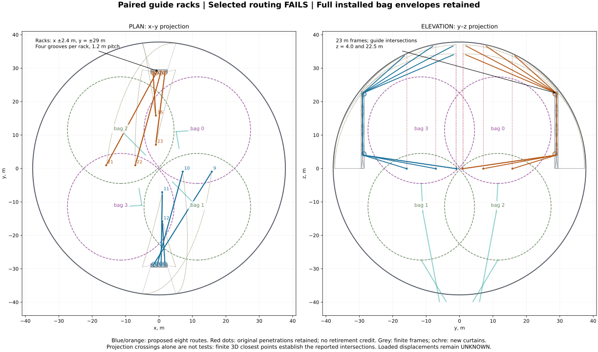
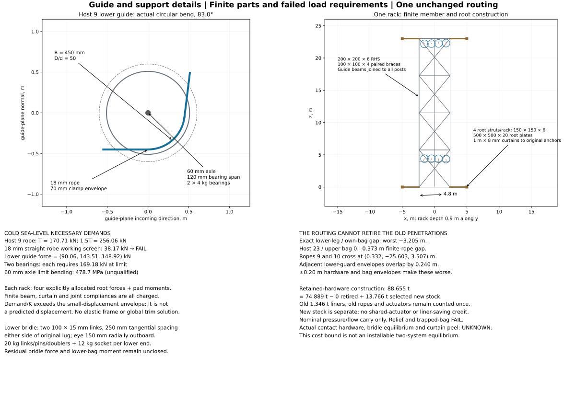

# I022 — Paired guide racks for eight lower-bag hangers

**The selected routing fails.** Direct lower legs intersect installed bag envelopes; two ropes cross; guide envelopes overlap; the retained 18 mm rope, actuator, crossbeam and root assumptions cannot carry the required demands. The old eight penetrations cannot be retired. This is one dimensioned failed construction proposal, with a retained-hardware bill of **88.654957 t**, not a completed conversion or a loaded-vehicle solution.

The fixed comparison is [I018](../R3-I018/README.md), commit `4e08f62c6e860835dfa09880b68e70f7ec291167`, tree `0eb524cfae4921ba6023f105f403622498a98376`. Its six files are unchanged. [baseline.json](baseline.json) contains a hash-bound extract of its saved four states, hardware and pressure geometry, plus unchanged nominal suspension geometry and saved main-curve enclosures. Its source output SHA256 is `230d071964cd0a81ebe03d287bf000fd0eda4d916e1c8977bff1668e982eb8b6`. No predecessor calculator or 256-hanger/flow suite is replayed.



## Fixed construction and one routing

The nominal hull diameter stays 76 m; the loaded reference radius is 37.815987504 m. All four full bag radii remain 15.949183886 m, with centres `(a,a,a)`, `(a,-a,-a)`, `(-a,a,-a)`, `(-a,-a,a)` and `a = 11.454552776 m`. The sealed common 96/4 mole mixture, three isolated air regions, pressure laws, controller setpoints, blower/valve/supply hardware and 17 t equipment allowance are fixed. Folded cap occupancy never creates a clearance corridor.

Only hosts **9, 10, 11, 12, 16, 21, 22, 23** receive proposed new routes. The other 24 hangers and all main suspension geometry are unchanged. Host IDs are zero-based geometry indices. Bag 1 uses the rack at y = −29 m; bag 2 uses y = +29 m. Each rack has four separate lanes at x = −1.8, −0.6, +0.6, +1.8 m. Assignments below are fixed, including their failed ordering; no permutation, geometry sweep or load-driven length tuning follows the failure.

Each 4.8 × 0.9 × 23 m space frame has posts at x = ±2.4 m, y = ±29 m ±0.45 m. Posts and level ties are 200 × 200 × 6 mm aluminium RHS. Tied levels are z = 0, 5.75, 11.5, 17.25, 23 m; both diagonals on each face use 100 × 100 × 4 mm RHS with paid joint stock. Guide beams at z = 4 and 22.5 m have explicit short links to all four posts. The crossed braces require spliced/pinned centre joints; stock and joint masses are included, but local connection qualification is not established.

At each original lower attachment, two approximately 0.292 m links join cradle-band lugs displaced ±0.25 m tangentially and projected back onto the same full sphere. The new eye is 0.15 m radially outboard of the original point. The selected lower assembly is two 100 × 15 mm link bars, 40 mm pins, an eye plate, collars, doublers and retainers within a charged 20 kg assembly, plus a 12 kg rope socket/swivel. Its two-vector force projection leaves an explicit residual; it is not a free three-axis bag restraint.

The rope then passes two actual circular bends of **0.45 m pitch radius** before reaching its original upper anchor through a swivelled actuator of the unchanged selection. A nominal one-metre actuator length is used to draw the unloaded path. Guide intersections are `(lane, rack y, 4.0)` and `(lane, rack y, 22.5)` m. Their actual sheave centres differ from these intersections because finite tangent lengths are removed from the straight segments.

| Host / bag | Original attachment xyz m | New eye xyz m | Original upper anchor xyz m | Lane x m |
| --- | --- | --- | --- | --- |
| 9 / 1 | (15.770, -1.035, -0.177) | (15.811, -0.937, -0.071) | (15.770, -1.035, 34.355) | -1.8 |
| 10 / 1 | (7.139, -1.035, -0.177) | (7.098, -0.937, -0.071) | (7.139, -1.035, 37.122) | -0.6 |
| 11 / 1 | (1.035, -7.139, -0.177) | (0.937, -7.098, -0.071) | (1.035, -7.139, 37.122) | 0.6 |
| 12 / 1 | (1.035, -15.770, -0.177) | (0.937, -15.811, -0.071) | (1.035, -15.770, 34.355) | 1.8 |
| 16 / 2 | (-1.035, 15.770, -0.177) | (-0.937, 15.811, -0.071) | (-1.035, 15.770, 34.355) | -1.8 |
| 21 / 2 | (-15.770, 1.035, -0.177) | (-15.811, 0.937, -0.071) | (-15.770, 1.035, 34.355) | -0.6 |
| 22 / 2 | (-7.139, 1.035, -0.177) | (-7.098, 0.937, -0.071) | (-7.139, 1.035, 37.122) | 0.6 |
| 23 / 2 | (-1.035, 7.139, -0.177) | (-0.937, 7.098, -0.071) | (-1.035, 7.139, 37.122) | 1.8 |


| Host | Lower sheave centre xyz m | Upper sheave centre xyz m | Three straight lengths m | Old free m | Selected new free m |
| --- | --- | --- | --- | --- | --- |
| 9 | (-1.561, -28.619, 4.398) | (-1.561, -28.619, 22.183) | (32.982, 17.785, 33.773) | 33.340839 | 86.000 |
| 10 | (-0.481, -28.566, 4.391) | (-0.480, -28.566, 22.223) | (28.991, 17.831, 31.215) | 36.102544 | 79.500 |
| 11 | (0.607, -28.550, 4.374) | (0.609, -28.550, 22.260) | (21.905, 17.885, 25.064) | 36.102544 | 66.000 |
| 12 | (1.771, -28.551, 4.332) | (1.774, -28.551, 22.299) | (13.498, 17.967, 16.579) | 33.340839 | 49.000 |
| 16 | (-1.771, 28.551, 4.332) | (-1.774, 28.551, 22.299) | (13.498, 17.967, 16.579) | 33.340839 | 49.000 |
| 21 | (-0.814, 28.604, 4.396) | (-0.815, 28.604, 22.187) | (31.782, 17.791, 32.639) | 33.340839 | 83.500 |
| 22 | (0.481, 28.566, 4.391) | (0.480, 28.566, 22.223) | (28.991, 17.831, 31.215) | 36.102544 | 79.500 |
| 23 | (1.744, 28.553, 4.375) | (1.742, 28.554, 22.258) | (22.070, 17.884, 25.211) | 36.102544 | 66.500 |


For incoming/outgoing unit tangents u and v, turn angle θ = acos(u·v), and radius r, the tangent cutback is r tan(θ/2). The circle is tangent at both ends; each bend has arc length rθ. Geometry uses exact straight segments and 16 arc chords expanded by the exact maximum chord error r[1−cos(θ/32)]. A 0.60 m radius swept guard envelope encloses the 0.45 m rope centreline arc, clamps and sheave. D/d = 50 is a selected geometry ratio, **not** a qualified rope-fatigue or bend-efficiency rating.

Each sheave has a 60 mm wide annular rim (410/490 mm inner/outer radii), two 8 mm flanges to 510 mm outer radius, a 60 mm diameter ×220 mm steel axle, two 4 kg bearings on a 120 mm span, two 240 ×300 ×20 mm saddle plates, 6 kg guard, 8 kg hub/fasteners, and a separately modelled 100 ×100 ×4 mm support arm. All 16 assemblies and their concurrent loads are paid. The guard envelopes already overlap, so this is not a usable four-groove travel arrangement.

New free rope lengths are the unloaded curved route length rounded **up to the next 0.5 m**, before looking at loads. Two additional paid one-metre termination tails per rope are outside that free length. The original free lengths and 0.8…1.2 m actuator range remain comparisons. The calculations do not shorten slack or reset actuator commands to make a state pass. The clamp/chafe envelope is 70 mm diameter, with rope line mass 1440π(0.018²)/4 + 0.2 kg/m, assumed secant modulus 50 GPa and working axial stress 150 MPa. These inherited construction values are unqualified assumptions.

## Finite supports and load paths

Four root struts per rack connect `(±2.4, rack y, z)` at z = 0 and 23 m to new inner-skin pads. Their exact coordinates and member lengths follow. Struts are 150 ×150 ×6 mm RHS. Each pad has a 500 ×500 ×20 mm plate, two 250 ×250 ×20 mm clevis plates and 12 kg pins/bolts. A new one-metre-wide, 8 mm laminate curtain follows the actual inner-skin great-circle path to the corresponding original hanger anchor. Twenty percent extra curtain material is charged for laps/bond stock. No pre-existing curtain capacity is credited for this new reaction.

| Rack / root | Rack attachment xyz m | Pad xyz m | Curtain endpoint xyz m | Strut length m | Effective K kN/m |
| --- | --- | --- | --- | --- | --- |
| -1 / 0 | (-2.400, -29.000, 0.000) | (-5.000, -37.383, 0.000) | (15.770, -1.035, 34.355) | 8.7770 | 3.622 |
| -1 / 1 | (2.400, -29.000, 0.000) | (5.000, -37.383, 0.000) | (7.139, -1.035, 37.122) | 8.7770 | 3.622 |
| -1 / 2 | (-2.400, -29.000, 23.000) | (-5.000, -29.470, 23.000) | (1.035, -7.139, 37.122) | 2.6422 | 69.729 |
| -1 / 3 | (2.400, -29.000, 23.000) | (5.000, -29.470, 23.000) | (1.035, -15.770, 34.355) | 2.6422 | 69.729 |
| +1 / 0 | (-2.400, 29.000, 0.000) | (-5.000, 37.383, 0.000) | (-1.035, 15.770, 34.355) | 8.7770 | 3.622 |
| +1 / 1 | (2.400, 29.000, 0.000) | (5.000, 37.383, 0.000) | (-15.770, 1.035, 34.355) | 8.7770 | 3.622 |
| +1 / 2 | (-2.400, 29.000, 23.000) | (-5.000, 29.470, 23.000) | (-7.139, 1.035, 37.122) | 2.6422 | 69.729 |
| +1 / 3 | (2.400, 29.000, 23.000) | (5.000, 29.470, 23.000) | (-1.035, 7.139, 37.122) | 2.6422 | 69.729 |


The local strut bending screen uses E = 70 GPa and K_beam = 3EI/L³. A finite assumed curtain stiffness of 0.5 MN/m and joint stiffness of 0.2 MN/m are in series: 1/K_eff = 1/K_beam + 1/K_curtain + 1/K_joint. Pad rotational stiffness is an assumed 0.2 MN·m/rad. These are requirements/sensitivity denominators, not tested stiffnesses. Curtain peel, fabric load redistribution, shell shape and mixed-mode joints remain UNKNOWN.

For each rack, the complete guide force and guide eccentricity moment enter the frame; member and access-stock deadweights are added at their listed centres. A statically admissible four-root allocation is reported explicitly. About rack midheight, r_i = (±2.4,0,±11.5) m, J = (4·11.5², 4·(2.4²+11.5²), 4·2.4²), ω_j = −M_j/J_j, and R_i = −F/4 + ω×r_i. The sums close force and moment arithmetically. **This is not an elastic frame solution.** The distinct R_i/K_i displacements need not form a compatible frame motion. The equal-opposite force and strut lever-arm moment are carried at every pad; nothing vanishes into a fixed guide reaction.

Large demand/K and demand/Kθ values are printed only to reject the ≤0.20 m displacement and small-rotation assumptions. They are not extrapolated physical displacements and are never used to redraw bags or certify clearances. The isolated crossbeam force-load screen fails. The RHS crossbeam screen is a simply supported force-load calculation; guide eccentric couples, torsion, member weight and local joints may change its result, so this is not a rigorous lower bound on the full member demand. Root strut bending, pad line loads and bond mean shear are requirements, not membrane equilibrium.

Shell-mounted curtains, pads, upper fittings and new actuators deliver their own separately charged gravity directly to the shell/old-anchor interfaces. They are not counted again as rack-mounted weight. Their full mass and nominal spatial centroids are in the output parts list; the resulting loaded shell has not been solved.



## Complete finite-envelope clearance screen

Every new rope chord, guard, fitting, member, root strut and curtain strip has three-dimensional endpoints and a finite radius. Square RHS is enclosed by its half-diagonal; curtain strips use half-width plus their great-circle chord error. Full bags use sphere/finite-segment distance; hardware uses exact segment/segment distance. The output retains each object's closest point to all four bags and the governing closest points in **every** fixed-object class. It also checks each new rope against other new ropes and new hardware, and all pairs of guards. Intended bridle/bag and curtain/hull attachment engagement is identified separately, not sold as positive clearance.

The independent check uses line/sphere roots to confirm actual centreline penetration and convex closest-point stationarity to verify 7,680 saved sphere/segment and segment/segment witnesses. Therefore the failure is not inferred from a drawing projection. Nominal rope-to-own-bag gaps are:

| Host | Owner bag | Finite gap m | Closest rope-axis point xyz m | Gap after ±0.20 m each m |
| --- | --- | --- | --- | --- |
| 9 | 1 | -3.174755 | (10.666, -9.136, 1.119) | -3.574755 |
| 10 | 1 | -1.648604 | (5.179, -7.934, 0.944) | -2.048604 |
| 11 | 1 | -0.015208 | (0.906, -9.107, 0.303) | -0.415208 |
| 12 | 1 | 0.115000 | (0.937, -15.811, -0.071) | -0.285000 |
| 16 | 2 | 0.115000 | (-0.937, 15.811, -0.071) | -0.285000 |
| 21 | 2 | -3.204714 | (-11.183, 9.476, 1.168) | -3.604714 |
| 22 | 2 | -1.648604 | (-5.179, 7.934, 0.944) | -2.048604 |
| 23 | 2 | 0.089612 | (-0.827, 7.980, 0.093) | -0.310388 |


Host 23 also intersects upper bag 0: its governing rope-axis point is **(0.020, 14.761, 1.354) m**, finite gap **-0.373210 m**, or -0.773210 m after allowing 0.20 m motion of hardware and 0.20 m of the bag. The actual 18 mm rope also intersects: the independent centreline/sphere calculation finds a 6.534202 m interior span, so this is not merely a conservative clamp-radius overlap. The rope 9/10 crossing is at **(0.331902, −25.602853, 3.507218) m**, giving a −0.070000 m combined clamp-envelope gap. Host 21 and 16 lower-guard swept envelopes overlap by 0.240187 m.

The following are governing **reference-geometry** witnesses against fixed systems. Old hanger/liner overlap at a shared curtain endpoint is partly intended attachment engagement; other interactions and the new rope crossing still fail. For the main ropes, every saved predecessor curve is enclosed by its reference chord expanded by endpoint movement plus half its total loaded arc length and its 40 mm physical radius. This rigorous length bound covers those saved curves without replaying them. It does not establish main-rope shape after adding this mass.

| Fixed class | New object | Fixed object | Gap m | New closest xyz m | Fixed closest xyz m |
| --- | --- | --- | --- | --- | --- |
| header_stub_bounds | bridle10-1 | header-L12-stub-bound | 31.196261 | (6.908, -1.132, -0.178) | (0.000, 0.000, -39.816) |
| headers | bridle10-1 | header-L12 | 39.040699 | (6.908, -1.132, -0.178) | (4.020, -4.020, -39.816) |
| main_saved_curve_enclosures | rack+1-post0 | main8 | 15.351397 | (-2.400, 28.550, 0.000) | (-8.862, 27.273, -25.291) |
| pressure_branches | rope23-straight0 | duct0-1 | 12.069580 | (-0.426, 11.188, 0.689) | (9.678, 11.330, -6.871) |
| retained_hangers_and_liners | rack+1-curtain0-31 | old-hanger16 | -0.622555 | (-1.039, 15.770, 34.244) | (-1.035, 15.770, 34.244) |
| service_frame_bounds | bridle9-0 | service-frame0 | 36.545517 | (16.001, -1.132, -0.178) | (18.908, 0.000, -38.916) |


Headers retain their actual finite cylinders. Unspecified stub azimuths are screened inside conservative header-centred volumes, not invented exact stub routes. Service frames use their paid 3.2 ×3.2 ×3.8 m dimensions with circumscribed cross-sections. The curtain's 0.5 m bounding radius intentionally crosses the skin at its bonded attachment; the actuator's endpoint hardware likewise requires a local hull penetration/detail. Those interfaces are explicitly UNKNOWN. Other unlocated electrical/service hardware and every changed loaded main-rope/rotor clearance remain UNKNOWN. A large positive gap to a represented fixed class is not complete installed-vehicle qualification.

The ±0.20 m envelopes are declared requirements, not solved motion. Several lower bands and all rack root assumptions exceed that domain. No altitude extrapolation or old 6.283/10.327 m formal shift is used as a validated position. Flexible lines beyond the stated transverse-slope domain, and all lines touching bags, have no claimed loaded solution here.

## Four-state force and travel requirements

The four saved I018 states supply actual bag apparent-air masses and retained membrane/cradle masses. The proposed lower path's vertical share is one eighth of its owner's saved supported mass plus the lower fitting and adjacent rope-gravity allocation. With first-segment unit tangent u, the necessary contact-free tension is T = V/u_z. This equal-share, fixed-position load case is a **counterfactual replacement demand**: it is not simultaneously applied to the retained old eight lines, and it is not a solution of the installed dual set of hardware.

Three-dimensional guide forces are T(v−u), with guide mass, adjacent half-span rope gravity and circular-span gravity added once. The equal/opposite top and bottom forces and their true point moments are retained. An independent sum confirms internal traction closure to 5e−11 N and 2e−9 N·m, and full new rope-assembly deadweight closure to 5e−11 N. Rope gravity adjacent to a guide is lumped at its sheave centre. This moves both half-span endpoint loads from their tangent points and arc weight from its true centroid. The conservative omitted moment per guide is μg·0.45·(L_in/2 + L_out/2 + arc length). Across one complete routed rope, the independent maximum gravity-moment discrepancy is 69.268 N·m, below a 130.900 N·m bound. These residual moment requirements remain open at the guides/curtains; arithmetic moment closure of the rack allocation refers only to its declared lumped loads. Stock-cut excess and tails are split between the two end fittings. All rope mass is still included. Lower bridle and upper actuator gravity use their own stated centres.

Sag diagnostics use q_perp = μg√(1−u_z²), y_max = q_perp L²/(8T), slope = q_perp L/(2T), and positive geometric excess q_perp²L³/(24T²). They require |transverse slope|≤0.2 and no contact. Exact gross segment directions are not replaced by a small angle relative to vertical. Elastic extension is TL_free/EA. Both new-stock and old-free-length commands obey the same fixed-node compatibility: **command + free rope length + elastic extension + actuator stretch = nominal geometric path + positive sag excess**. Thus commands add sag excess and subtract the respective free rope length, its elastic extension and actuator stretch from the nominal path. Actual band, root and shell motions are unclosed; the fixed-node commands cannot establish working travel.

For host 12 at 2500 m/+10 K, the positive excess is 0.000046136802268 m. Adding it instead of subtracting it changes the new-stock command from 0.944772777871703 m to 0.944865051476240 m, a 0.092274 mm correction; both values are inside the 0.8…1.2 m window. Including that same excess in the old-free-length comparison changes 16.618180681495126 m to 16.618226818297394 m, still outside the window. The length residuals for the corrected new-stock and old-free-length values are below 1e−14 m. This numerical compatibility does not resolve contact or loaded-node motion. All four states retain their stroke classifications and the command ranges below at the displayed 0.001 m precision.

| Altitude m / hot K | T range kN | New-stock fixed-node command m | Commands in range /8 | Max band demand/K m | Max root demand/K m |
| --- | --- | --- | --- | --- | --- |
| 0 / +0 | 70.540…170.706 | -0.486…0.691 | 0 | 0.950 | 66.020 |
| 0 / +10 | 64.669…156.535 | -0.384…0.716 | 0 | 0.871 | 60.510 |
| 2500 / +0 | 18.171…44.308 | 0.418…0.916 | 2 | 0.247 | 16.998 |
| 2500 / +10 | 11.538…28.298 | 0.512…0.945 | 3 | 0.158 | 10.902 |


The rope axial working screen is 38.170 kN, and the unchanged actuator tensile rating is 53.878 kN; both are compared to 1.5T. Sea-level demands fail for all eight ropes. The altitude screens do not qualify bending fatigue, guide friction or contact. Old free lengths require much larger out-of-range path commands; both old and selected commands are retained per host in the output.


| Altitude m / hot K | Rack | Applied force xyz kN | Moment at midheight xyz kN·m | Max crossbeam limit MPa |
| --- | --- | --- | --- | --- |
| 0 / +0 | -1 | (246.828, 878.401, 111.122) | (-1036.733, 392.670, -327.427) | 2105.0 |
| 0 / +0 | +1 | (-245.238, -878.024, 111.021) | (1032.987, -389.707, -152.469) | 2186.5 |
| 0 / +10 | -1 | (226.336, 805.419, 98.461) | (-950.318, 360.118, -300.302) | 1929.4 |
| 0 / +10 | +1 | (-224.873, -805.069, 98.368) | (946.879, -357.397, -139.810) | 2004.3 |
| 2500 / +0 | -1 | (64.047, 227.424, -1.806) | (-265.944, 102.316, -85.481) | 539.5 |
| 2500 / +0 | +1 | (-63.589, -227.295, -1.832) | (264.935, -101.515, -39.554) | 560.7 |
| 2500 / +10 | -1 | (40.896, 144.973, -16.110) | (-168.318, 65.541, -54.837) | 341.2 |
| 2500 / +10 | +1 | (-40.582, -144.876, -16.126) | (167.656, -65.013, -25.252) | 354.8 |


Cold sea-level root reactions and pad moments are listed below. Other states and every guide have the same explicit fields in the calculator output. Local RHS deflection and pad rotation ratios outside the assumed domain reject the construction; they are not physical predictions.


| Rack / root | Reaction on rack xyz kN | Pad force xyz kN | Pad moment xyz kN·m | Root RHS limit MPa |
| --- | --- | --- | --- | --- |
| -1 / 0 | (-53.527, -231.170, -29.488) | (53.527, 231.170, 29.488) | (247.197, -76.668, 152.319) | 2823.7 |
| -1 / 1 | (-53.527, -162.956, -26.073) | (53.527, 162.956, 26.073) | (218.575, 67.791, -872.406) | 8480.5 |
| -1 / 2 | (-69.887, -276.245, -29.488) | (69.887, 276.245, 29.488) | (13.867, -76.668, 685.373) | 6485.8 |
| -1 / 3 | (-69.887, -208.031, -26.073) | (69.887, 208.031, 26.073) | (12.261, 67.791, -573.745) | 5433.5 |
| +1 / 0 | (53.191, 181.168, -26.061) | (-53.191, -181.168, 26.061) | (-218.471, -67.758, -916.941) | 8885.9 |
| +1 / 1 | (53.191, 212.932, -29.449) | (-53.191, -212.932, 29.449) | (-246.877, 76.568, 107.717) | 2633.0 |
| +1 / 2 | (69.428, 226.080, -26.061) | (-69.428, -226.080, 26.061) | (-12.255, -67.758, -620.456) | 5869.8 |
| +1 / 3 | (69.428, 257.844, -29.449) | (-69.428, -257.844, 29.449) | (-13.849, 76.568, 637.747) | 6041.0 |


Guide-bearing demand is 1.5|F|/2 per bearing; axle bending uses a central force over the 120 mm bearing span and the 60 mm circular section modulus. The assumed bearing friction coefficient 0.02 gives a further torque requirement 0.02|F|·0.03 m and tension-difference bound torque/0.45 m. The equal-tension calculation does not claim a friction-qualified operating system. At cold sea level host 9's lower guide requires about 169 kN per bearing at limit and a roughly 479 MPa axle bending screen; paying bearing mass is not a load rating.

The two pin-linked lower bridle legs are projected locally onto their two directions. Negative axial requirements and a third-direction residual remain explicit. No compensating bridle moment is silently assigned to the cradle. Even the aggregate lower-bag forces below leave very large horizontal and rotational demands after the four unchanged vertical hangers and all stated lower deadweights are included:

| Altitude m / hot K | Bag | Unclosed force xyz kN | Unclosed moment xyz kN·m |
| --- | --- | --- | --- |
| 0 / +0 | 1 | (-126.732, -466.060, 0.000) | (5309.591, -1438.658, 3271.136) |
| 0 / +0 | 2 | (126.700, 466.039, 0.000) | (-5309.353, 1438.295, 3195.462) |
| 0 / +10 | 1 | (-116.211, -427.336, 0.000) | (4868.425, -1319.223, 2999.237) |
| 0 / +10 | 2 | (116.179, 427.315, 0.000) | (-4868.187, 1318.860, 2929.841) |
| 2500 / +0 | 1 | (-32.885, -120.656, -0.000) | (1374.551, -373.344, 845.898) |
| 2500 / +0 | 2 | (32.853, 120.636, 0.000) | (-1374.313, 372.981, 826.214) |
| 2500 / +10 | 1 | (-20.999, -76.909, 0.000) | (876.150, -238.415, 538.724) |
| 2500 / +10 | 2 | (20.967, 76.888, 0.000) | (-875.912, 238.051, 526.132) |


The nearly zero vertical residual is only a consequence of the assumed shares. It is not horizontal equilibrium or rotational closure. Air centroid locations remain the saved hydrostatic-cap centroids. No water transfer, compensating ballast moment, powered lift, global matrix solution, FEA or CFD is supplied.

## Retention decision and complete changed stock bill

**Retirement gate FAIL.** A new route itself penetrates an upper bag, and the displacement/strength/connection requirements fail. Therefore no old liner, cuff, hanger fitting, rope, actuator or exclusion volume is removed. The original eight hanger allowances stay exactly once in the old construction bill. All proposed new rope stock and eight additional actuators of the same selection are separately identified and paid once. No single actuator is assumed to support two paths. This conservative retained-hardware bill is the cost of the failed proposal before any successful conversion; it is not an installable dual suspension equilibrium and is not described as a lighter replacement.

The eight old 240 mm OD, 2 mm wall liners remain 22.356522 m each, including rings, saddles, collars and cuffs: 1346.129043 kg total. The old cuff pressure law q = 0.24·max|Δp| remains on the old liner spans and still has an equal/opposite foreign-bag load. Its saved application points and domain flags remain in the comparison extract. That force is **not** transferred to the new racks. New rope/bag contact cannot use this old vertical-liner law: its contact construction and load distribution are UNKNOWN and unpriced, and no contact-free clearance/force pass is claimed.

| New selected stock group | kg |
| --- | --- |
| rack RHS 200x200x6 | 3746.217600 |
| rack RHS 100x100x4 | 1766.397826 |
| guide crossbeams | 241.367040 |
| guide crossbeam post links | 90.512640 |
| root RHS 150x150x6 | 426.219897 |
| root plates pins | 258.000000 |
| curtain and bond 20pct | 4401.156421 |
| frame joints | 400.000000 |
| erection access | 160.000000 |
| sheaves axles bearings guards saddles | 1340.615360 |
| guide support arms | 36.680217 |
| new eight ropes | 325.700336 |
| rope sockets swivels | 192.000000 |
| bridle pins bands doublers | 160.000000 |
| new eight same selected actuators | 220.719450 |


`new construction = old construction − retired items + new items`

`88654.956705 kg = 74889.369919 − 0 + 13765.586786 kg`.

The bill includes all defined rope stock, sockets, swivels, sheaves, rims, flanges, axles, bearings, guards, saddle plates, guide arms, posts, ties, bracing, root struts, pads, pins, curtain/bond material, lower bridles/doublers, access and erection stock. Selected steel and aluminium section densities are 7850 and 2700 kg/m³; fabric density is 1400 kg/m³. Exact installed profiles, fatigue, fittings and material allowables remain unqualified assumptions. Global curtain/membrane closure, replacements for failed root/sheave members, safe new bag penetrations and other unresolved interfaces are **not** covered by a fictitious zero allowance. **U+C is unquantified (UNKNOWN); the printed bill carries no claim that it is zero or funded.** No borrowing from mission energy or propulsion closes it.

The old equipment budget remains 17,000 kg, including the unchanged 2,000 kg pressure allowance. Pressure installation mass stays **8666.759795 kg**, with only its inherited excess already present in construction. The 5 t mission-energy and 3 t propulsion allocations are preserved. All helium, impurity air and inside/outside air remain counted. No extra pressure hardware, helium vent, impurity reset or setpoint change is introduced.

## Occupied volume and unchanged thermodynamic representation

New occupied material is **6.670083 m³**, including contained actuator oil and rope covers in that aggregate field. Every new part has a nominal spatial centroid; member/cable endpoints and curtain arcs give its actual represented location. Hollow rack sections are vented to the common lifting gas; no new trapped air inventory is introduced. Their voids are not buoyancy credits.

The inherited 100 m³ non-gas debit already includes a 50 m³ routing reserve. The new material fits within that existing reserve; the full 100 m³ debit is retained at its inherited z = 0 quadrature datum. There is **zero** freed liner exclusion, **zero** restored bag capacity and **zero** external displacement credit. Existing branch metal and all original hardware remain charged. This is the same conservative occupied-volume representation, so its controlling hydrostatic volumes and four saved gas/air inventories do not change.

This is not an exact relocation of solid volume through the hydrostatic field: it preserves the old datum approximation. Actual new part locations are supplied so a future qualified construction can replace the lumped debit. A conservative bound on relocating only the new 6.670 m³ from z = 0 anywhere within the loaded radius is V[exp(k_g R)−1], at most **0.005474 m³ of gas-weighted volume** across these four states. That small unpropagated quadrature effect is stated, not silently promoted to an exact conservation recalculation. Other physical shape errors remain unbounded. No predecessor pressure solve or flow suite is run for an unchanged represented volume.

## Conditional payload and ballast arithmetic

M20 uses the 3 t payload and P100 the 100 t payload, each plus the 17 t equipment budget. The raw margins below subtract all construction, gas and air mass before movable water. They are only conditional mass arithmetic. The installed water comparison stays **74.669473 t** from I018; no ballast release or water redistribution is selected in this unit.

| Altitude m / hot K | All air kg unchanged | M20 raw kg | P100 raw kg | M20 after 74.669473 t water kg | M20 after older 82.851817 t water kg |
| --- | --- | --- | --- | --- | --- |
| 0 / +0 | 71922.931460 | 60903.885717 | -36096.114283 | -13765.586786 | -21947.931462 |
| 0 / +10 | 64660.823942 | 68165.993234 | -28834.006766 | -6503.479269 | -14685.823944 |
| 2500 / +0 | 11121.997885 | 60963.025039 | -36036.974961 | -13706.447464 | -21888.792140 |
| 2500 / +10 | 3403.098319 | 68681.924604 | -28318.075396 | -5987.547899 | -14169.892574 |


The preceding cold P100 values −22.330527/−22.271388 t and the old 74.669473 t cold M20 water remain comparison failures, not targets or reserve lift. With the even older 82.851817 t water, I018 was already 8.182345/8.123205 t heavy at the cold endpoints. This proposal adds its entire stock mass to those overloads. The new minimum cold raw M20 margin, 60.903886 t, is merely a possible arithmetic water limit; using it would require an explicit inventory/trim decision and does not resolve the failed suspension.

## Carried failures, confidence and next change

| Question | Status and scope |
| --- | --- |
| Selected route outside all full bags | FAIL: own-bag and foreign-upper penetration; no liner retirement. |
| Separate grooves and travel | FAIL: rope crossing and guard-envelope overlap. |
| Lower bridle, bag and rack equilibrium | FAIL/UNKNOWN: unclosed forces/moments; finite-demand screens exceed assumed domains. |
| Rope, actuator, crossbeam and root strength | FAIL in stated states; remaining local arithmetic is not hardware qualification. |
| Old cuff case | Retained: sea-level valid-domain gaps −0.925504/−1.052260 m; altitude cases leave the old slope/stroke domain. |
| Pressure protection | FAIL: closed bag branch loses header relief; lower static and upper 1.5 pressure screens fail at selected relief settings; lower sea-level trip also exceeds its admissible bound. |
| Nominal pressure/flow/battery | Carried only within the original fixed pressure topology and occupancy assumptions. |
| +15 K at 2500 m | Invalid same-inventory case retained; no vent/reset. |
| P100 and fixed-water M20 | FAIL in the displayed construction ledger; no powered-lift rescue. |
| Partial-fill membrane, curtains, global shape and rotation | UNKNOWN; nominal positive pressure does not solve them. |
| New loaded main ropes, rotor/service hardware, mission/propulsion energy | UNKNOWN; earlier main-clearance results do not transfer to the heavier installation. |
| U+C and unpriced interfaces | UNKNOWN; no saving or capacity credit. |

Confidence is high in the fixed-envelope intersections and in the recorded conditional scalar/vector arithmetic. It is low in the unqualified construction properties and very low in any loaded-vehicle interpretation. The weakest mechanical assumption is that equal vertical shares can coexist with the prescribed contact-free directions: their unclosed horizontal and rotational demands show why that assumption cannot establish a suspension.

**One next concrete change, untested here:** replace the direct lower departure with a paid radial escape yoke that first clears both its own and foreign full bag envelopes. Its finite link forces and moments must close before reconsidering the rack approach. The current lane, guard, strength and pressure failures remain open; no second geometry is evaluated in this unit.

## Reproduction and bounded checks

[calculate.py](calculate.py) uses only the standard library and the pinned [baseline.json](baseline.json). It prints the full selected geometry, individual closest-point witnesses, bill, per-guide/per-root demands, four-state budgets and retained limits. [draw.py](draw.py) uses matplotlib to draw the saved output and does not execute a model.

From this directory, with a writable scratch destination:

```sh
timeout 240s python3 calculate.py > /mnt/scratch/guide-racks.json
python3 draw.py /mnt/scratch/guide-racks.json /mnt/scratch/guide-racks-preview
```

The numerical bounds are 180 s CPU, 240 s wall and 512 MiB. There is no optimizer, geometric sweep, pressure redesign or global matrix solve. The corrected saved-output execution took 2.617 s wall, exit 0. A separate targeted check took 0.314 s, exit 0, under 30 s CPU, 60 s wall and 512 MiB. It checks both fixed-node length identities for all four states and eight routes, deriving sag excess independently from the integral of squared transverse slope. The maximum corrected length residual is below 5.85e−15 m. Exactly 64 command values and the calculator hash change; every other output value and all stroke classifications are identical to the previous saved output.

The original sphere-intersection, 9/10 crossing, finite closest-point stationarity, circular-bend tangency, traction/moment, rope-gravity, inventory and bill checks retain their exact relevant inputs and results. Their original execution took 0.114 s, exit 0; those unaffected checks were not rerun for this command correction. The drawing source, baseline and all visible drawing inputs are unchanged, so the existing SVGs and visual observations carry. These arithmetic and custody checks leave the construction FAIL/UNKNOWN.

Final calculator SHA256: `08cd3c59212e78b1797688655dfc94964216a87d593f3e9a836566ecd9921357`. Baseline SHA256: `94e002ca1e976434509d5850ca557773120cd35553cdc38ace849e22b46580d2`. Saved output SHA256: `e8eb3302c52fb5fe236acf421d7753ba12642b0a588313917763e9b9922a38d3`. The source commit and predecessor output hashes above bind unchanged inputs; this does not claim a current integration base or independent physical validation.
