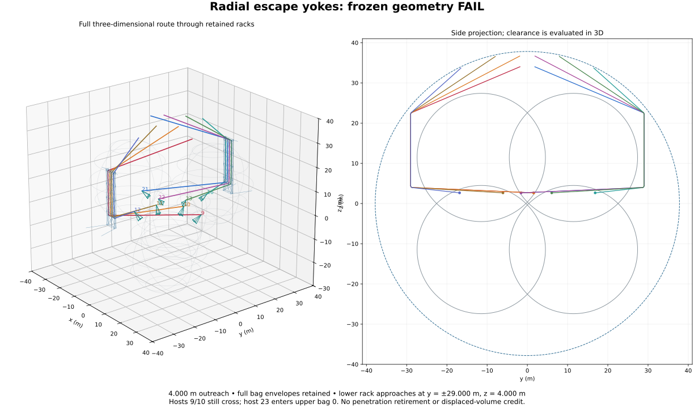
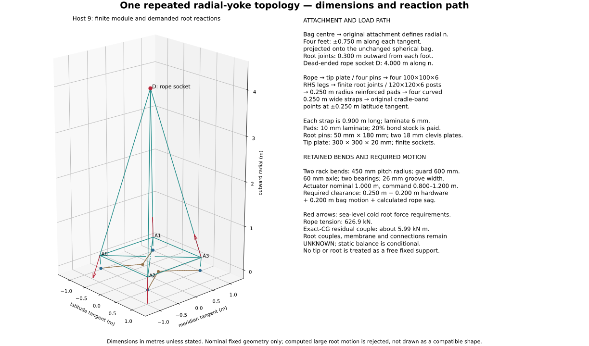

# Radial escape yokes at eight lower-bag attachments

**The single frozen construction FAILS.** A 4 m radial yoke improves the own-bag departure of six of eight ropes, but hosts9 and21 still enter their own full bags, host23 enters an upper bag, and hosts9/10 still cross. Some yoke tips themselves enter upper bags. All32 route/state combinations fail the selected rope and actuator force screens and the new-stock stroke screen. Finite root forces and moments are required; their transfer through the cradle, membrane and joints remains UNKNOWN. Nothing here qualifies a completed hanger conversion or a floating vehicle.

Known construction is **90.910391 t + U + C**, where **U** is unpriced strengthening and **C** is unpriced contact/connection resolution, both in tonnes in the margin tables. This is2.255434 t above the [paired guide-rack construction](../R3-I022/README.md). The cold P100 deficits become38.351548/38.292409 t before U+C. All eight old penetrations and their1346.129043 kg liners/cuffs remain in the bill; no clearance, capacity, ballast-release or powered-lift credit is taken.

## Fixed comparison and source

The original construction's direct source parent is `b0396d128d7bc2d8e63b5470ae7a1b486d350e27`. This upper-anchor accounting correction follows original candidate `eb972cfba84fc20e5506e6d6369521b117c3cb41`, preserving its geometry, selected materials and mass. The guide-rack science is the accepted corrected source `e416c81037b0ba9b7522e3e4dbc8e937847769e4`, tree `f62c6f4e8d9dc2de0bef7fb5b2e994e949fc7fdf`; the inherited text difference is the relative-output-path cleanup in the pressure and guide-rack READMEs. The accepted calculator SHA256 is `08cd3c59212e78b1797688655dfc94964216a87d593f3e9a836566ecd9921357`, saved output `e8eb3302c52fb5fe236acf421d7753ba12642b0a588313917763e9b9922a38d3`. [baseline.json](baseline.json) contains an exact selected-data extract and its source hashes. It reads no predecessor calculator.

The76 m nominal hull, loaded radius37.815988 m, all four full bag radii15.949184 m, and their centres remain fixed. Centres are the existing tetrahedral sign combinations of11.454553 m. The common helium/air96/4 mole inventory, pressure topology, upper support system, unrelated suspension and four endpoint states are unchanged. The [isolated-pressure comparison](../R3-I018/README.md) remains74.889370 t + U + C. Counterfactual necessary replacement loads are used below; the physically retained old and proposed new paths have no solved simultaneous load share.

## One finite construction

The topology and constants in [geometry.json](geometry.json), SHA256 `16c924ba0aad76a19ff303e0fadd5854a2eded07f659daa7ef086d0d66e23615`, were frozen before evaluation. There is one geometry and four inherited states, no search or load-dependent tuning.

For each actual zero-based host9,10,11,12,16,21,22,23, let C be its bag centre and L its original attachment. Define the outward radial unit vector n=(L−C)/|L−C|, the horizontal latitude tangent t1, and t2=n×t1. The outer rope departure is **D=L+4.000n**. For each sign pair sx,sy in±1:

```text
P = C + Rb normalize(Rb n + 0.750 sx t1 + 0.750 sy t2)
A = P + 0.300 normalize(P − C)
cradle point = C + Rb normalize(Rb n + 0.250 sx t1)
```

P is an actual exterior reinforced footprint, A a finite root joint. A straight100×100×6 mm aluminium RHS leg runs A→D; its length is3.888300 m. Four100×100×6 perimeter ties and four half-diagonals join the roots to a0.20 m central hub. The halves are mitred to that hub, not two uninterrupted tubes sharing one volume. Root posts are120×120×6 RHS, from P+0.100 local-normal to A; the conservative root bending lever used in the screen is0.300 m including the foot connection. No member extends through the bag under an attachment exception.

Each root has a300×300×20 mm aluminium base plate, two180×240×18 mm aluminium clevis plates, a50 mm diameter×180 mm steel pin, a5 kg terminal/doubler stock, and a0.250 m geodesic-radius pad with10 mm nominal laminate. Four0.900014 m long,250 mm wide,6 mm nominal curved straps run outside the bag to the two named original cradle-band points at±250 mm latitude tangent. The terminal/doubler stock is newly paid; the original cradle band remains in the inherited construction. Pads/straps carry20% additional bond stock. Their reported CGs lump that adhesive at the nominal laminate layer; the finite inflated enclosures cover the extra bond thickness, while contact/load-spreading and local stacking still require qualification. The footprint shape descriptions in saved output state nominal laminate dimensions.

The tip has a300×300×20 mm plate, four50×180 mm pins, an8 kg saddle stock and the reused12 kg rope socket/swivel. The hub's nominal radius is0.160 m; the plate controls its conservative0.212368 m bounding radius. Four3 kg base gussets, a6 kg central gusset, and8 kg of finite access/erection stock per module are paid separately. Total new module stock is301.192690 kg per host. Root-joint bounding spheres have radius0.240 m. The old short two-leg bridle is specifically removed from this proposed construction; new RHS legs can carry compression only subject to buckling and joint qualification.

The physical path is rope socket → tip plate and pins → four legs → finite root posts/clevises → reinforced pad and curved straps → existing cradle-band points → bag structure. Reactions at P include required couples. The two tension straps and unqualified membrane cannot simply be asserted to provide those couples: their capacity, peel/contact and rotational stiffness remain UNKNOWN and contribute to U+C. Paid metal and a drawn path do not close that physical question.

| Host | Bag | Outer departure D, xyz m | Radial unit n, xyz | Curved rope path m | New free stock m |
| ---: | ---: | --- | --- | ---: | ---: |
| 9 | 1 | 16.852763, 1.577880, 2.651650 | 0.270598, 0.653281, 0.707107 | 88.174915 | 88.5 |
| 10 | 1 | 6.056343, 1.577880, 2.651650 | -0.270598, 0.653281, 0.707107 | 81.082623 | 81.5 |
| 11 | 1 | -1.577880, -6.056343, 2.651650 | -0.653281, 0.270598, 0.707107 | 66.682575 | 67.0 |
| 12 | 1 | -1.577880, -16.852763, 2.651650 | -0.653281, -0.270598, 0.707107 | 47.786715 | 48.0 |
| 16 | 2 | 1.577880, 16.852763, 2.651650 | 0.653281, 0.270598, 0.707107 | 47.786715 | 48.0 |
| 21 | 2 | -16.852763, -1.577880, 2.651650 | -0.270598, -0.653281, 0.707107 | 85.851680 | 86.0 |
| 22 | 2 | -6.056343, -1.577880, 2.651650 | 0.270598, -0.653281, 0.707107 | 81.082623 | 81.5 |
| 23 | 2 | 1.577880, 6.056343, 2.651650 | 0.653281, -0.270598, 0.707107 | 66.729092 | 67.0 |

Each new free length is the unloaded curved path rounded upward to0.5 m, before loads. Two paid1 m tails are outside that free length. The upper nominal1 m actuator retains its original top anchor and orientation. No rope is shortened to fit the loaded answer.



The two retained lower approach intersections remain at (lane,±29,4) m; the upper ones at (lane,±29,22.5) m. Lanes are−1.8,−0.6,+0.6,+1.8 m in the inherited host order. Actual450 mm circular bends, not sharp corners, define entry/exit tangencies. Both guide bodies,600 mm guards and two bearings per guide are reused from the paid rack stock. Each retains its60 mm steel axle,120 mm bearing span,900 mm pitch diameter,26 mm nominal groove width and10 mm assumed groove-root radius. That gives8 mm total nominal side clearance for an18 mm rope; wear, fleet angle, contact stress and bearing/fatigue ratings are UNKNOWN. The lower guide swivels into the changed plane and receives a newly priced support arm; the upper guide and arm remain exact. No new sheave is invented at D: it is a dead end socket.



## Complete geometric screen

Straight members and ropes use finite closest-point calculations. RHS radii are their circumscribed cross-section radii; the18 mm rope has a35 mm clamp/chafe envelope. Sixteen inflated chords bound each circular rope bend, and24 inflated chords bound each curved strap. Guards, fittings, pressure-header stub regions and inherited service-frame/rope-curve envelopes are conservative bounds. A negative bound alone means clearance is unqualified; an actual rope centreline inside a full bag demonstrates intrusion. All coordinates are3D, never a projected clearance pass.

All1736 finite objects are screened against all four full bags, the hull, retained old ropes/liners, unchanged main-rope curve bounds, pressure branches, headers/stub bounds and service frames. Every class has saved closest points and finite radii. New ropes are compared with one another and all other hardware; each rope is also checked against its own module beyond the explicitly shared first0.30 m socket region. Modules are checked against other modules and retained hardware. Defined spherical pads and ribbons have contact only with their own specified footprint, never a blanket exemption for yoke members, other bags or rope segments. The saved output has6944 bag,1736 hull and10416 fixed-class witnesses, plus pair/interface checks.

| Host | Own full bag | First departure envelope gap m | Limited disposition |
| ---: | ---: | ---: | --- |
| 9 | 1 | -1.202295 | FAIL |
| 10 | 1 | 0.679319 | Nominal own-bag segment only |
| 11 | 1 | 3.112200 | Nominal own-bag segment only |
| 12 | 1 | 3.965000 | Nominal own-bag segment only |
| 16 | 2 | 3.965000 | Nominal own-bag segment only |
| 21 | 2 | -1.280242 | FAIL |
| 22 | 2 | 0.679319 | Nominal own-bag segment only |
| 23 | 2 | 3.465727 | Nominal own-bag segment only |

The two remaining own-bag penetrations are host9 at **−1.202295 m** and host21 at **−1.280242 m**; the old worst own-bag gap was−3.204714 m. Six positive first-span gaps do not retire a complete route.

The current controlling upper-bag witness is host23's first span against bag0: centreline point **(1.635869,12.046249,3.003664) m**, bag centre(11.454553,11.454553,11.454553) m, rope enclosure radius0.035 m; gap **−3.015985 m**, versus the predecessor's−0.373210 m. The centreline itself is inside, so this is not merely an overlarge guard enclosure. Host12's yoke tip against upper bag3 has gap−1.872380 m including its0.212368 m plate enclosure; the tip centre itself lies1.660012 m inside the full bag.

Hosts9/10 still intersect at **(0.065833,−25.941300,3.865125) m**: centreline separation below1e−13 m, two35 mm envelopes, gap−0.070000 m. The lower guide guard bounds for hosts21/16 have gap−0.330547 m, versus−0.240187 m previously. Their centres are(−0.811204,28.602642,4.432819) and(−1.679439,28.566451,4.404442) m, each radius0.600 m. The original rack/curtain hull attachments remain intended hull interfaces, with their prior detailed connection qualification unresolved.

The minimum noncontact yoke-to-own-bag bound is only **+0.015147 m**, at a root-post inner end. This does not meet the positive0.250 m nominal clearance requirement. The separate hardware and bag movement allowances are0.200 m each, plus per-state rope sag; they subtract from, never add to, available clearance. The required hardware allowance is budgeted as50 mm each for leg, root post, joint and cradle response. Sections, posts and connections are paid; the assumed2e5 N/m joint and inherited179619.785 N/m band stiffness do not support this budget. Large formal displacements therefore reject the declared operating domain; they are not used as loaded positions or clearance certificates.

The added yokes have20.470711 m minimum nominal hull clearance. Their main-rope curve bound clearance is17.027299 m. Minimum pressure branch, header, stub-region and service-frame gaps across the full represented assembly are11.435703,38.259174,30.331687 and35.738445 m. Their finite positions/radii remain in the output. Retained ropes are not all clear: the new host21 central gusset enclosure overlaps its retained old hanger by0.083192 m, in addition to inherited rack/curtain interface overlaps. The old path cannot be removed merely to erase this clash.

## Forces, local balance and the missing couples

All material data are **screening assumptions**, not certified alloy, composite, weld or purchased-hardware ratings: aluminium E=70 GPa, density2700 kg/m³, working stress150 MPa; steel density7850 kg/m³ and working normal stress160 MPa; laminate density1400 kg/m³; rope axial E=50 GPa, density1440 kg/m³ plus0.2 kg/m coating, working axial stress150 MPa. The1.5 load factor is applied to the reported strength requirements. Fatigue, joints, rope bend knockdown and bearing/contact ratings remain UNKNOWN even when an isolated scalar is below its assumed threshold.

For each state the original supported bag mass gives the necessary old vertical share W/8. The new rope must additionally support the entire module, its reused lower socket and the assigned first-span/tail deadweight. Thus T=(W/8+new lower deadweight)/u_z, using the actual outgoing direction D→lower bend. At host9 u_z is about0.037618: raising D while retaining the low approach makes the rope nearly horizontal and increases its tension sharply. This is a counterfactual replacement demand. All old penetrations remain physically paid and their contact forces remain on the original comparison paths; they are not silently loaded alongside this replacement model.

Every rack bend reports incoming T u_in, outgoing T u_out, force on its guide T(u_out−u_in), the opposite force on the rope, and the separately included guide/rope gravity. The tip receives T u; the rope receives−T u. The saved scalar/vector identities close, subject to the stated lumped-gravity approximation. A uniform span's weight is split to adjacent endpoints; actual arc weight is lumped at its guide. This preserves force but is not an exact catenary or distributed moment solution. Friction torque0.02|F|×0.030 is a rating requirement only, and its possible tension difference is reported.

Each of the32 changed cases also records `upper_anchor_wrench` about the actual retained top anchor A. The force on that support is the existing upper traction −T u plus the gravity of the paid upper socket, retained actuator and allocated endpoint rope. The rope allocation is half of the final straight span plus half of the current paid-minus-geometric length, including stock rounding and both paid tails, lumped at the upper rope endpoint E. Socket and actuator gravity act at their actual paid part CGs. Arc gravity stays at its guide. With F_j = (0,0,−m_j g), the transmitted moment is (E−A)×(−T u) + Σ(CG_j−A)×F_j. All three components and every gravity contribution are saved; the support reaction on the upper assembly has the opposite force and moment signs. The tension lever is retained even though the nominal actuator and rope are collinear. These are current demands computed from this route's allocation, not copied predecessor moments. The same endpoint-gravity approximation remains; neither a distributed-rope moment solution nor anchor, joint or global equilibrium qualification is implied. Required connection capacity remains UNKNOWN with U+C.

The local module screen is a **3×3 fixed-root truss**, one module at a time. For each leg d points from tip to root, k=EA/L, K=Σk ddᵀ, δ=K⁻¹F_tip and axial N=−k d·δ. Positive N is tension; negative N is compression, not a permissible negative rope tension. All module deadweight is initially placed at the tip for this explicit leg allocation, not as a universal worst-case theorem. The actual paid part CGs then restore the exact gravity moment. The remaining couple is exposed and assigned as a required, unqualified quarter-couple at each foot. It is not supplied by a free fixed point.

With original attachment L as moment origin, the reported force and moment identities are:

```text
rope force + actual total gravity + Σ foot reaction = 0
Σ(actual external force moments about L)
  + Σ((P − L) × foot reaction + required foot couple) = 0
```

For a reaction R at A, the demanded foot couple contains (A−P)×R and one quarter of the negative actual-CG residual. Every equal/opposite force and couple on the bag is retained. Local numerical closure does not establish the membrane/strap couple capacity. Across32 modules, residual force is below1.12e−9 N and residual moment **after including these demanded couples** is below3.01e−10 N m. Without the extra CG correction, each module leaves about**5.990054 kN m** unclosed; the complete finite-foot couples reach93.008603 kN m in the cold state. These are explicit UNKNOWN requirements.

Host9 cold sea-level example, with forces on the module and required couples at the physical feet; the bag receives their negatives:

| Foot | Physical surface point P, xyz m | Reaction R, xyz kN | Required foot couple, xyz kN m |
| --- | --- | --- | --- |
| A0 | (16.654743, -0.855709, -0.730794) | (-15.195, -338.791, -482.316) | (-29.201, 44.685, -30.109) |
| A1 | (16.249740, -1.833471, 0.327529) | (74.277, 467.882, 304.523) | (-49.965, -10.433, 28.759) |
| A2 | (15.271978, -0.282949, -0.730794) | (-133.084, -145.582, -280.523) | (-30.966, -6.128, 17.512) |
| A3 | (14.866975, -1.260711, 0.327529) | (400.231, 551.286, 437.910) | (-39.592, 61.163, -41.357) |

The new module's known stock is301.192690 kg + its share of U+C. The existing cradle-band points, all four root positions, full force vectors and CGs are in the saved output. The unchanged four other vertical hangers per lower bag retain their old share in this necessary comparison. The resulting lower-bag horizontal force residual is about1.717 MN cold and0.452 MN at2500 m/+10 K, with moments up to tens of MN m. Global bag rotation, shape, simultaneous load sharing and vehicle trim are not solved.

## Strength, movement and length compatibility

| Host, cold sea level | Rope T kN | Most compressive leg kN | Most tensile leg kN | New-stock command m | Old-free-length command m |
| ---: | ---: | ---: | ---: | ---: | ---: |
| 9 | 626.888 | -809.856 | 589.609 | -3.965561 | 53.911306 |
| 10 | 547.542 | -900.235 | 742.408 | -3.169267 | 44.181826 |
| 11 | 403.162 | -672.640 | 610.796 | -1.620534 | 30.255955 |
| 12 | 221.162 | -275.282 | 292.597 | -0.146435 | 14.767535 |
| 16 | 221.162 | -275.282 | 292.597 | -0.146435 | 14.767535 |
| 21 | 606.007 | -742.858 | 528.557 | -3.515159 | 51.652114 |
| 22 | 547.542 | -900.235 | 742.408 | -3.169267 | 44.181826 |
| 23 | 401.376 | -651.045 | 603.450 | -1.563813 | 30.308338 |

The100×100×6 legs have a pinned Euler load152.436 kN under the assumed E. After1.5 loading, compression checks fail in16/14/10/8 of32 legs at the four respective states. Axial-plus-simple-selfweight bending screens fail in28/27/8/2 legs; the maximum is601.098 MPa against150 MPa. The small local fixed-root tip displacement ranges up to74.070 mm cold, but a rigid-root calculation cannot hide the root response.

Cold finite root-post bending reaches1408.607 MPa, pin double-shear demand343.864 MPa, pin bending2200.731 MPa, and clevis bearing750.195 MPa. The pin bending estimate uses an80 mm span; root posts use their0.300 m conservative moment arm. These isolated section checks omit combined weld/joint/connection behavior and cannot qualify the assembly. Pad mean traction reaches6.877 MPa and strap line-force demand5.401 MN/m; membrane peel, spread and rotational stiffness remain UNKNOWN with U+C.

The assumed joint offsets reach4.501 m and the conservative sum-of-root-force band offset12.836 m cold; even2500 m/+10 K reaches1.176/3.336 m. These violate the50 mm allocations and invalidate small-deflection use. The retained rack's four-root **static** reaction allocation is recomputed for changed guide loads, with the same paid supports and stiffness assumptions. Its formal displacement reaches243.789 m cold, versus about66 m previously; this is a domain FAIL, not a realizable shape. The force-only guide crossbeam screen reaches8441.685 MPa, and the retained60 mm guide axle screen1844.167 MPa cold. One bearing's factored requirement reaches651.782 kN. Paying16 guide bodies does not provide those ratings. Curtain/root moments, peel and global rack compatibility remain UNKNOWN.

The actuator free command uses the corrected positive-sag identity for **both** new stock and inherited old free length:

```text
command + free rope + T·free rope/EA + actuator stretch
  = nominal curved path including 1 m actuator + positive sag excess
sag excess for a straight span = L · maximum_transverse_slope² / 6
```

All32 new-stock commands are outside0.800–1.200 m; the cold range is−3.965561 to−0.146435 m, and the2500 m/+10 K range−0.548159 to0.542656 m. Negative commands indicate incompatibility, not a physically negative actuator. Old free lengths require14.767535–55.327301 m across states and also all fail. No cut length, gas inventory or fixed water is adjusted to repair this. The18 mm rope's assumed working axial force is38.170 kN, and the retained selected actuator's tensile rating53.878 kN; **all32** factored rope and actuator demands fail. Small calculated transverse sag cannot compensate for this loss of compatibility.

## One reconciled bill and fixed inventories

Retire only the specifically replaced **I022** eight ropes325.700336 kg, eight short bridles160.000000 kg and eight lower guide arms19.420078 kg: total505.120415 kg. They are not credited as removals from the old penetration system. Reuse the16 guide bodies/guards,16 sockets, eight selected actuators, upper guide arms, racks, roots, curtain bands and access stock once in their same physical duties. The first guide/socket positions change, and their capacity remains unqualified. Replacing the lower arms and entire eight rope stocks is separately paid.

| New or replacement stock | Known mass kg |
| --- | ---: |
| replacement lower guide arms | 20.497747 |
| replacement eight ropes | 330.515037 |
| yoke legs RHS 100x100x6 | 757.901203 |
| root posts RHS 120x120x6 | 47.278080 |
| root plates clevis pins terminals | 538.670688 |
| conformal pads and bond | 105.557513 |
| four curved straps and bond | 72.577110 |
| base ties and diagonals | 487.895514 |
| base gussets | 144.000000 |
| tip plate four pins and saddle | 191.661408 |
| erection access | 64.000000 |

Known arithmetic, with unknown strengthening and contact mass always additional:

```text
88654.956705 − 505.120415 + 2760.554300
  = 90910.390591 kg + U + C
```

The full32 root joints, all steel pins and aluminium clevis plates,32 straps/pads,32 legs, base ties/diagonals, tip and base fittings, replacement guide arms, rope/tails and erection stock are included once. No member or moment connection is assigned zero strengthening demand merely because its nominal metal is priced. The original eight liners/cuffs1346.129043 kg, old hangers and old actuators remain once in the74.889370 t predecessor comparison. The complete geometry/travel/connection/duty gate FAILS, so there is zero penetration retirement.

The material within the unchanged routing reserve becomes **7.525627 m³** =6.670083−0.327772+1.183316. The inherited100 m³ non-gas debit contains a50 m³ routing reserve;42.474373 m³ of that reserve remains after represented material. Actual new part locations and CGs are supplied, hollow sections vent to common gas and no new sealed air is introduced. The original cap/liner quadrature and z=0 representation of that reserve remain an approximation. No helium volume, displaced-volume or restored-bag-capacity credit is claimed, and there is no pressure/flow replay. Unsupported shapes/contact remain UNKNOWN.

The common inventory stays27670.136441 kg helium plus8343.231319 kg impurity air. Four saved gas/air volumes and air masses are reused because the controlling represented volumes, pressure laws, full bag envelopes and100 m³ datum debit do not change. The17 t equipment convention,8666.759795 kg pressure hardware with its original2 t allowance counted once,5 t energy allowance and3 t propulsion allowance remain. **74.669473 t fixed water stays aboard** in the M20 comparison. Conditional margins below use the frozen old inventory and new known construction; U+C subtract further. They are bookkeeping comparisons, not positive float certificates.

| Altitude m / superheat K | Tension range kN | M20 raw t | P100 raw t | M20 after fixed water t | Saved air mass t |
| --- | --- | --- | --- | --- | ---: |
| 0 / +0 | 221.162–626.888 | 58.648452 − U − C | -38.351548 − U − C | -16.021021 − U − C | 71.922931 |
| 0 / +10 | 204.910–580.948 | 65.910559 − U − C | -31.089441 − U − C | -8.758913 − U − C | 64.660824 |
| 2500 / +0 | 76.204–217.126 | 58.707591 − U − C | -38.292409 − U − C | -15.961881 − U − C | 11.121998 |
| 2500 / +10 | 57.844–165.227 | 66.426491 − U − C | -30.573509 − U − C | -8.242982 − U − C | 3.403098 |

## Original and current failure disposition

| Requirement | Guide-rack comparison | Radial-yoke result |
| --- | --- | --- |
| Full own-bag departure | Worst gap−3.204714 m | Hosts9/21 still FAIL; six local spans improve |
| Upper full-bag clearance | Worst gap−0.373210 m | Rope gap−3.015985 m; yoke tip also inside: FAIL |
| Rope9/10 crossing | Gap−0.070000 m | Gap−0.070000 m: FAIL |
| Lower guard enclosure | Gap−0.240187 m | Gap−0.330547 m: unresolved overlap |
| Short-bridle tension/closure | Negative legs/unclosed force | Replaced by finite RHS yoke; compression/buckling and root couples FAIL/UNKNOWN |
| Actuator stroke | New stock0/0/2/3 of8 pass | New stock0/0/0/0 of8 pass; old free lengths0/0/0/0: FAIL |
| Rack/root stiffness domain | Formal offsets up to about66 m | Up to243.789 m: domain FAIL, no compatible loaded geometry |
| Cold P100 | Deficits36.096114/36.036975 t + U+C | Deficits38.351548/38.292409 t + U+C: FAIL |
| Old penetration retirement | Zero | Zero; liners/cuffs and original forces retained |
| Trapped-bag/header relief and lower trip | FAIL | Unchanged FAIL; no new pressure-contact law applied to yokes |
| Altitude small-slope/stroke and2500 m/+15 K | Domain loss / invalid inventory state | Unchanged limits; no helium vent/reset |
| Membrane/curtain/fold shape, rotation, global load share, trim/rotor clearance, propulsion and mission energy | UNKNOWN | UNKNOWN; no global solver or water/powered-lift rescue |

## Reproduction and confidence

From this directory:

```sh
OMP_NUM_THREADS=1 OPENBLAS_NUM_THREADS=1 MKL_NUM_THREADS=1 NUMEXPR_NUM_THREADS=1 timeout 240s python3 -B calculate.py > radial-yokes-corrected.json
```

[calculate.py](calculate.py) uses one process, CPU180 s, wall240 s and512 MiB limits, eight fixed routes, four states and only scalar/vector calculations plus one3×3 local balance per module. There is no global frame/membrane solver, optimizer, geometry sweep or ancestor execution. The original calculator run took20.891 s wall. Its separate saved-data/identity check took0.214 s under CPU30 s, wall60 s,512 MiB and verified64 length identities with maximum residual1.43e−14 m,32 finite-foot force/moment balances with the explicit demanded couples, unchanged inventory and dependency bindings, the retired/new bill, and19096 geometric witnesses. Those are original execution records.

The upper-anchor correction uses one corrected-unit generation under the same calculator limits. Its output binds the corrected calculator source and unchanged input hashes. An exact saved-output comparison isolates the added upper-interface records and source hash; unrelated geometry, forces, masses, inventories and failure flags stay unchanged. One independent handwritten saved-vector check, limited to2 CPU s,5 wall s and128 MiB, covers the new upper force/moment and equal/opposite reaction identities without importing any calculator. The original broad verifier is not repeated.

Both existing drawings came from the original output in one2.517 s render and were visually inspected then. The geometry, lower-root forces, SVGs and [renderer](draw.py) are unchanged; the figures do not claim complete upper-anchor force/moment closure. Their original output and preview bindings are retained, with no new render or relabelled preview. Passing arithmetic and custody checks do not change the physical FAIL/UNKNOWN result.

Confidence is high in the recorded fixed-geometry centreline intrusions, crossings, mass arithmetic and conditional balance identities. It is limited for conservative contact enclosures and assumed stiffness/strength screens, and absent for a qualified membrane/root/strap couple transfer or globally compatible shape. The weakest assumption is that four small reinforced feet and two existing cradle-band points could accept these very large lateral forces and couples without major unpriced structure.

The next distinct construction hypothesis is a **paid exterior circumferential transfer hoop replacing the retained low rack approaches**, with its own full reaction path and bill. It is not evaluated here. Repeatedly changing this yoke's outreach until a chosen span clears would not resolve the inherited crossing, upper-bag and root-capacity failures.
