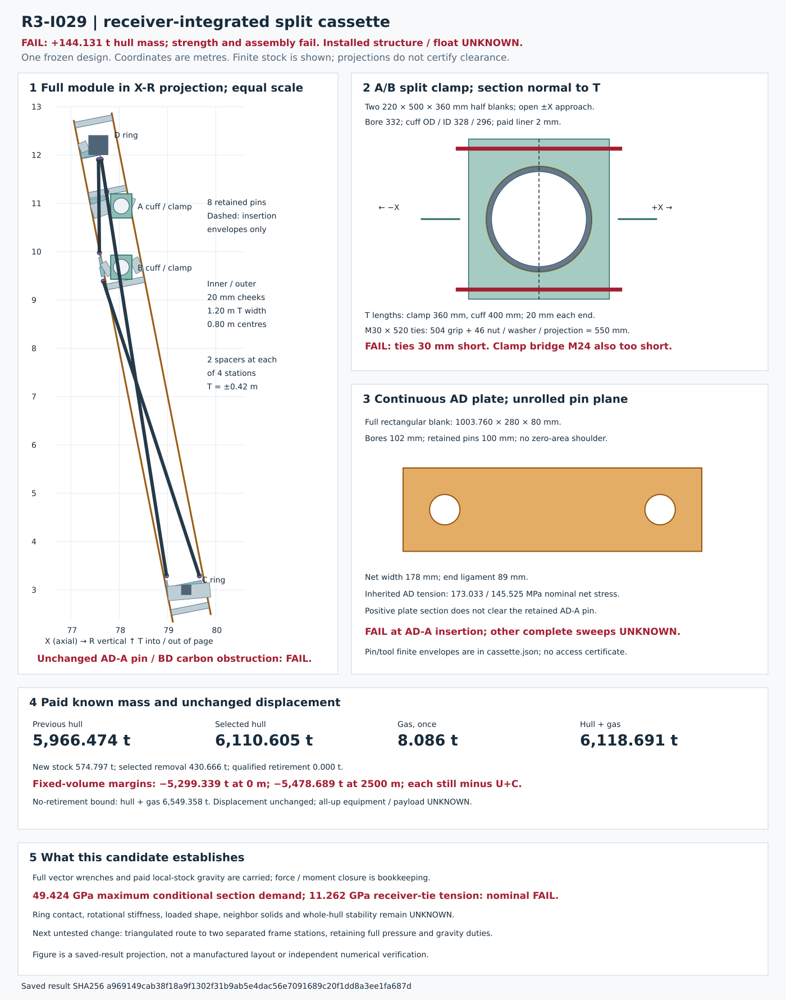

# R3-I029 — receiver-integrated split cassette

**FAIL. This frozen replacement increases the known hull mass by 144.131190 t and makes both fixed-volume reference margins worse by the same amount.** The long cheeks and receiver connections fail nominal strength comparisons; selected fasteners cannot span their actual stacks; the unchanged AD-A pin still conflicts with BD carbon. Ring contact and rotation, complete assembly, loaded shape, global pressure resistance, all-up equipment/payload and physical float remain **UNKNOWN**.

The candidate replaces the stacked collector and receiver yokes with two removable long cheeks, direct split receiver clamps, paid connecting stock and a continuous AD plate. It is a recorded failing alternative, not qualified installed hardware. It changes neither the pressure-surface displacement nor the inherited film duties. A separate no-retirement bound retains every replaced item; it is not added to the selected-alternative bill.

[Saved geometry](geometry.svg) · [calculator](cassette.py) · [complete result](cassette.json) · [frozen input](baseline.json) · [source pins and inherited proxies](sources.json) · [saved-result drawing code](draw.py).

## Full mass and reference margin

All values below are tonnes. The pressure-surface datum stays D80 × 160 m / R40 with volume 668,852.724569 m³. No displacement credit is created by removing or adding an interface. Residual gas is counted once. Additional U+C, equipment, payload and mission obligations have no established value; they remain deductions from these already negative known margins.

| Quantity | Selected alternative, t |
|---|---:|
| I024 known hull | 5,966.473887 |
| I024 local stock already in that hull | 652.553320 |
| Selected I024 stock removed | 430.666098 |
| I024 local stock kept | 221.887222 |
| New cassette, attachments and installation stock | 574.797288 |
| New known hull | 6,110.605077 |
| Residual gas, once | 8.086383 |
| Known hull + gas subtotal | 6,118.691460 |
| Qualified retirement | 0.000000 |
| No-retirement known hull, separate bound | 6,541.271175 |
| No-retirement hull + gas, separate bound | 6,549.357559 |

| Reference altitude | Fixed-volume gross lift, t | I024 known margin, t | Selected known margin, t | Change, t | No-retirement known margin, t |
|---:|---:|---:|---:|---:|---:|
| 0 m | 819.352792 | -5,155.207478 | -5,299.338669 | -144.131190 | -5,730.004767 |
| 2500 m | 640.002053 | -5,334.558217 | -5,478.689408 | -144.131190 | -5,909.355506 |

The arithmetic is `old hull − enumerated selected removal + full new stock`. The entire older 5,313.920567 t hull and its active/inactive contingencies remain. Selected removal is a comparison convention for failed hardware, not a retirement approval: the qualified retirement remains zero. Neither a positive displacement nor a force-closure residual establishes float.

## Frozen geometry and physical interfaces

Coordinates use the existing right-cap X/R/T basis with `X × R = T`; the wrench origin is O = (40, 0, 0) m. A/B below are the actual receiving cuffs, not shifted ring-node labels. The existing eight pin centres, axes and fork roots, and BD/DC/BC carbon/end assemblies are retained.

| Datum | X/R/T, m |
|---|---|
| D ring datum | (77.566732, 12.206171, 0.000000) |
| C ring datum | (79.387341, 3.000000, 0.000000) |
| A receiving cuff | (78.042261, 10.946997, 0.000000) |
| B receiving cuff | (78.042261, 9.678969, 0.000000) |

The cheek long axis is D→C; its normal lies in X/R. Both full steel blanks are 10.584466 m long × 1.20 m in T × 20 mm thick, at normal offsets ±0.40 m; their inner faces are at ±0.39 m. Each extends 0.60 m beyond its ring datum. They approach along opposite normals. Eight 120 × 120 × 12 mm box spacers connect them at four fixed stations, each at T = ±0.42 m, using 160 × 160 × 16 mm end plates and four M30 × 120 sets per end. The full plate blanks, bore/trim material and all spacer stock remain paid.

Each A/B clamp consists of two open 220 × 500 × 360 mm half blanks approaching along ±X, with a 332 mm bore around a 328/296 mm OD/ID cuff and a paid 2 mm liner. The cuff is only 400 mm long; the clamp spans 360 mm, leaving 20 mm at each end in this local datum. Two 400 × 360 × 20 mm exterior reinforcement blanks and two 300 × 300 × 20 mm box bridges per receiver are charged. Four M30 × 520 ties sit at R/T offsets (±220, ±120) mm; each tie has both backers, washers and a nut allowance. These ties need 550 mm under the head for the 504 mm stack and 46 mm nut/washer/thread projection; **the frozen 520 mm selection is 30 mm short**. Ring drilling, a blind thread or missing nut space is not invented to rescue it.

Eight 200 × 200 × 20 mm root boxes run from the retained fork bases to their actual inner-cheek projections. Each gets two 400 × 300 × 30 mm mating plates, eight 80 × 80 × 12 mm backers and four new M24 × 120 sets on its second end. The first-end M24 sets already belong to the retained fork kit and are counted once. Plate angle/miter fit, root-end transfer and welded assembly qualification remain UNKNOWN even where a simple bolt-length allowance is positive.

D/C boundary remainders enter explicit clamps on the existing ring walls. D uses two 600 × 600 × 20 mm contact plates; C uses two 400 × 600 × 20 mm plates. Both have 3 mm liners, four M30 × 600 ties and eight 80 × 80 × 12 mm backers. Their short 200 × 200 × 20 mm bridges, 300 × 300 × 20 mm feet and M24 sets are paid. These are contact duties with unqualified curved fit and rotational capacity, not free fixed points or holes through an undisclosed wall.

The AD replacement is a **continuous 1003.759681 × 280 × 80 mm rectangular plate blank**, retaining the old pin centres and 102 mm bores. Its minimum net width is 178 mm and end ligament is 89 mm; it has positive material around both bores without the old tangent, zero-area shoulder. All blank material is paid. This local containment fact does not remove the unchanged AD-A pin/BD-carbon obstruction.

The separate button load enters at (79.881358, 2.999550, 0) m. A continuous 300 × 300 × 16 mm box reaches its actual inner-cheek projection. Its charged centre length is 0.879828 m and its cut length is 20 mm shorter between 20 mm contact plates; the declared face gap is zero at each end. Four full 400 × 400 × 20 mm feet/profile-pad blanks, source packing, sixteen bolt backers, eight M24 × 140 sets at each end and weld stock are charged. The inherited button strip still fails; finite new box stock does not certify shell-to-foot transfer.

Four 300 × 200 × 12 mm removable access covers, sixteen M12 sets, 2 mm gaskets, 12 mm fillet-weld stock, 15 kg of tool allocation and 12 kg of erection-kit stock per module are explicit additions. Tool and erection capacities remain unqualified; these allowances do not replace unresolved installation obligations.

### Assembly and clearance

The declared sequence is unload/support the old interface, offer the A/B open half clamps along ±X, offer the two cheeks along their opposite normals, connect the spacers and D/C wall clamps, attach the retained forks and offer the AD plate, insert the pins along their finite sweeps, connect the full-length button box and torque exposed fasteners before access closure. Independent unloading/support capacity is UNKNOWN. The sequence **fails at retained AD-A pin access**.

| Check | Saved result | Scope |
|---|---|---|
| D wall to both long cheeks | 152.089 mm minimum normal clearance | Whole cheek T interval ±0.60 m against the curved D wall only |
| C wall to both long cheeks | 260.326 mm minimum normal clearance | Whole cheek T interval ±0.60 m against the curved C wall only |
| AD body continuity and blank containment | Positive 178 mm net width; 89 mm end ligament | The continuous new plate only |
| Retained AD-A pin / BD carbon | FAIL | Preserved finite obstruction from the unchanged I024 bodies |
| Other seven pin/tool paths | UNKNOWN | Finite cylinder/sweep declared, full material clearance not proved |
| Adjacent C sectors | UNKNOWN | 1.20 m cheek T bounds overlap the 0.508836 m chord pitch; overlapping bounds alone do not prove material collision |
| Ring/clamp, bolts, root miter, tool and loaded-shape clearance | UNKNOWN / selected tie FAIL | A separated cheek wall does not qualify the rest of the assembly |

Each pin has its 100 mm diameter, 220 mm occupied length, 300 mm insertion travel, 75 mm tool-cylinder radius and 150 mm additional tool reach recorded in the result. No centreline-only drawing is used as an assembly pass.

## Full vector duties and gravity

The pressure basis stays 121,590 Pa, two caps, 37 sectors per cap, 18 film bays / 666 film columns and the inherited incident-bar counts. The new polar axial demand is **58.362306 MN per cap, once**. The older incoming boundary (−2.555921 MN axial, −0.850242 MN radial) is carried separately. The unrelated whole-end 611 MN is not reapplied. The button force (−92,915.574507, −4,648.052578, 0) N and couple (0, 0, −93,334.261489) Nm are retained separately.

Only the two saved radial assignments `f = 0` and `f = 1` are evaluated, with one frozen design. Pin-root source wrenches go through the corresponding finite arms. At D/C, the old aggregate ring wrench minus the already carried main-root wrench is an explicit boundary remainder, so it is neither omitted nor duplicated. C/D, button and A-root duties go through the inner cheek to A; B-root duties use the B route. There is no assumed half share between A/B or between cheeks.

Every transfer from point P to Q uses `M_Q = M_P + (P − Q) × F`, with moments also tracked about O. Applied section force/couple and internal section force/couple have opposite signs. The 37 sector orientations use `g_local = (0, −g cos θ, +g sin θ)` at g = 9.80665 m/s². Each new and kept local stock row has an explicit mass, centre and receiver assignment; their full 10,766.006892 kg per module is included. Outer-cheek weight reaches the inner cheek through the selected D-side spacer with its entire lever-arm couple. Each box additionally has its own first/last-end gravity screen and independent foot demands; receiver loads already include its own weight and do not receive that weight twice.

The opposite cap uses the same 37 local records under X reflection: force and position transform as vectors, while couple transforms as `(Mx, Mr, Mt) → (Mx, −Mr, −Mt)`, followed by sector rotation. There are 74 saved orientation/assignment records (2 assignments × 37 orientations); the left-cap mapping is explicit, not another pressure load. This symmetry bookkeeping is not an installed two-cap equilibrium or stiffness proof. Earlier hull/global gravity allocation remains UNKNOWN, while all its mass stays charged.

| Assignment | Applied total force X/R/T, N | Total moment about O, Nm | Pressure force residual, N | Pressure moment residual, Nm | AD net stress, MPa |
|---|---|---|---:|---:|---:|
| f=0 | (-1646438.557569, 0.000000, 0.000000) | (0.000000, 0.000000, 13720343.196465) | 0.000e+00 | 2.792e-08 | 173.033467 |
| f=1 | (-1646438.557569, -357320.807075, 0.000000) | (0.000000, 0.000000, -21788.731405) | 2.910e-10 | 6.085e-08 | 145.525360 |

The maximum complete receiver-transfer residual is 4.445e−10 N in force and 6.857e−8 Nm in moment. These are consistency residuals inside this calculation. They are not independent controls, uncertainty bounds or evidence that a real receiving ring can supply the opposite wrench.

### Conditional section and connection screens

Gross box-section stress uses full force and transverse couple, and a closed-wall torsion estimate. Plate bending deliberately uses the weaker gross section modulus for the entire transverse moment envelope; cutout, open-section torsion, local buckling and weld interaction are unqualified. Euler comparisons use the inherited 200 GPa proxy and stated length; supports, effective length, imperfections and global buckling have not been established. Bolt-group demand is an explicitly bilateral elastic distribution of all force and couple components; negative axial values require actual contact. Friction, preload, prying, combined capacity and a certified fastener allowable are UNKNOWN.

| Saved demand or fit | Result | Qualification |
|---|---:|---|
| Maximum conditional gross section normal envelope | 49,423.841619 MPa | FAIL against inherited 355 MPa nominal proxy |
| Maximum receiver root-tie tensile demand | 11,262.330805 MPa | FAIL nominal comparison; not certified fastener capacity |
| Maximum receiver root-tie shear demand | 6,971.349745 MPa | FAIL nominal comparison |
| AD net axial stress f=0 / f=1 | 173.033467 / 145.525360 MPa | Nominal local comparison only; access still FAIL |
| A/B root tie length | 520 mm selected / 550 mm needed | FAIL |
| Receiver-bridge clamp-side through grip | At least 260 mm, with 120 mm M24 selected | FAIL even before required nut/washer/thread projection |
| Receiver complete ring/clamp capacity | UNKNOWN | The whole vector couple, ring rotation and contact remain unresolved |

Connection stacks are distinct: spacer 36 mm; root first/second 72/62 mm; receiver bridge cheek/clamp side 40/260 mm; D/C bridge 40 mm; button 80 mm. A projected force/contact-area ratio does not resist the retained couple. For example, the saved root AD-A second-foot tensile demand at f=0 is 15,446.273903 MPa, so the receiver-tie summary is not an envelope of every bolt in the assembly. Full root and foot records remain in the result.

## Paid stock and explicit retirement map

All 114 new rows are shown below; their full count, stock dimensions, centroid and assigned duty are also in `mass.newItems` in [cassette.json](cassette.json). Steel uses the inherited 7850 kg/m³ mass proxy. Box stock subtracts the explicit inner void; plate/half-clamp blanks retain trim and bore stock. Fastener sets include shank, head/nut blanks and two washers; weld stock is explicit. These are paid construction assumptions, not procurement specifications or qualified capacities.

| ID | New stock | Count/module | Total count, both caps | Each, kg | Both caps, t | Stock dimensions, m unless labelled |
|---:|---|---:|---:|---:|---:|---|
| 0 | cassette inner cheek | 1 | 74 | 1994.113439 | 147.564395 | 10.584466 × 1.200000 × 0.020000 |
| 1 | cassette outer cheek | 1 | 74 | 1994.113439 | 147.564395 | 10.584466 × 1.200000 × 0.020000 |
| 2 | cross spacer 0 -0.42 box stock | 1 | 74 | 31.741632 | 2.348881 | 0.780000 × 0.120000 × 0.012000 |
| 3 | cross spacer 0 -0.42 two end plates | 2 | 148 | 3.215360 | 0.475873 | 0.160000 × 0.160000 × 0.016000 |
| 4 | cross spacer 0 -0.42 M30 sets | 8 | 592 | 1.387474 | 0.821384 | 0.030000 × 0.120000 |
| 5 | cross spacer 0 +0.42 box stock | 1 | 74 | 31.741632 | 2.348881 | 0.780000 × 0.120000 × 0.012000 |
| 6 | cross spacer 0 +0.42 two end plates | 2 | 148 | 3.215360 | 0.475873 | 0.160000 × 0.160000 × 0.016000 |
| 7 | cross spacer 0 +0.42 M30 sets | 8 | 592 | 1.387474 | 0.821384 | 0.030000 × 0.120000 |
| 8 | cross spacer 1 -0.42 box stock | 1 | 74 | 31.741632 | 2.348881 | 0.780000 × 0.120000 × 0.012000 |
| 9 | cross spacer 1 -0.42 two end plates | 2 | 148 | 3.215360 | 0.475873 | 0.160000 × 0.160000 × 0.016000 |
| 10 | cross spacer 1 -0.42 M30 sets | 8 | 592 | 1.387474 | 0.821384 | 0.030000 × 0.120000 |
| 11 | cross spacer 1 +0.42 box stock | 1 | 74 | 31.741632 | 2.348881 | 0.780000 × 0.120000 × 0.012000 |
| 12 | cross spacer 1 +0.42 two end plates | 2 | 148 | 3.215360 | 0.475873 | 0.160000 × 0.160000 × 0.016000 |
| 13 | cross spacer 1 +0.42 M30 sets | 8 | 592 | 1.387474 | 0.821384 | 0.030000 × 0.120000 |
| 14 | cross spacer 2 -0.42 box stock | 1 | 74 | 31.741632 | 2.348881 | 0.780000 × 0.120000 × 0.012000 |
| 15 | cross spacer 2 -0.42 two end plates | 2 | 148 | 3.215360 | 0.475873 | 0.160000 × 0.160000 × 0.016000 |
| 16 | cross spacer 2 -0.42 M30 sets | 8 | 592 | 1.387474 | 0.821384 | 0.030000 × 0.120000 |
| 17 | cross spacer 2 +0.42 box stock | 1 | 74 | 31.741632 | 2.348881 | 0.780000 × 0.120000 × 0.012000 |
| 18 | cross spacer 2 +0.42 two end plates | 2 | 148 | 3.215360 | 0.475873 | 0.160000 × 0.160000 × 0.016000 |
| 19 | cross spacer 2 +0.42 M30 sets | 8 | 592 | 1.387474 | 0.821384 | 0.030000 × 0.120000 |
| 20 | cross spacer 3 -0.42 box stock | 1 | 74 | 31.741632 | 2.348881 | 0.780000 × 0.120000 × 0.012000 |
| 21 | cross spacer 3 -0.42 two end plates | 2 | 148 | 3.215360 | 0.475873 | 0.160000 × 0.160000 × 0.016000 |
| 22 | cross spacer 3 -0.42 M30 sets | 8 | 592 | 1.387474 | 0.821384 | 0.030000 × 0.120000 |
| 23 | cross spacer 3 +0.42 box stock | 1 | 74 | 31.741632 | 2.348881 | 0.780000 × 0.120000 × 0.012000 |
| 24 | cross spacer 3 +0.42 two end plates | 2 | 148 | 3.215360 | 0.475873 | 0.160000 × 0.160000 × 0.016000 |
| 25 | cross spacer 3 +0.42 M30 sets | 8 | 592 | 1.387474 | 0.821384 | 0.030000 × 0.120000 |
| 26 | root AD-A box stock | 1 | 74 | 41.709893 | 3.086532 | 0.368983 × 0.200000 × 0.020000 |
| 27 | AD-A mating plates | 2 | 148 | 28.260000 | 4.182480 | 0.400000 × 0.300000 × 0.030000 |
| 28 | AD-A nut backers | 8 | 592 | 0.602880 | 0.356905 | 0.080000 × 0.080000 × 0.012000 |
| 29 | AD-A added M24 sets | 4 | 296 | 0.795617 | 0.235503 | 0.024000 × 0.120000 |
| 30 | root AD-D box stock | 1 | 74 | 43.856946 | 3.245414 | 0.387977 × 0.200000 × 0.020000 |
| 31 | AD-D mating plates | 2 | 148 | 28.260000 | 4.182480 | 0.400000 × 0.300000 × 0.030000 |
| 32 | AD-D nut backers | 8 | 592 | 0.602880 | 0.356905 | 0.080000 × 0.080000 × 0.012000 |
| 33 | AD-D added M24 sets | 4 | 296 | 0.795617 | 0.235503 | 0.024000 × 0.120000 |
| 34 | root BD-B box stock | 1 | 74 | 6.389685 | 0.472837 | 0.056526 × 0.200000 × 0.020000 |
| 35 | BD-B mating plates | 2 | 148 | 28.260000 | 4.182480 | 0.400000 × 0.300000 × 0.030000 |
| 36 | BD-B nut backers | 8 | 592 | 0.602880 | 0.356905 | 0.080000 × 0.080000 × 0.012000 |
| 37 | BD-B added M24 sets | 4 | 296 | 0.795617 | 0.235503 | 0.024000 × 0.120000 |
| 38 | root BD-D box stock | 1 | 74 | 41.970144 | 3.105791 | 0.371286 × 0.200000 × 0.020000 |
| 39 | BD-D mating plates | 2 | 148 | 28.260000 | 4.182480 | 0.400000 × 0.300000 × 0.030000 |
| 40 | BD-D nut backers | 8 | 592 | 0.602880 | 0.356905 | 0.080000 × 0.080000 × 0.012000 |
| 41 | BD-D added M24 sets | 4 | 296 | 0.795617 | 0.235503 | 0.024000 × 0.120000 |
| 42 | root DC-D box stock | 1 | 74 | 44.975086 | 3.328156 | 0.397869 × 0.200000 × 0.020000 |
| 43 | DC-D mating plates | 2 | 148 | 28.260000 | 4.182480 | 0.400000 × 0.300000 × 0.030000 |
| 44 | DC-D nut backers | 8 | 592 | 0.602880 | 0.356905 | 0.080000 × 0.080000 × 0.012000 |
| 45 | DC-D added M24 sets | 4 | 296 | 0.795617 | 0.235503 | 0.024000 × 0.120000 |
| 46 | root DC-C box stock | 1 | 74 | 4.383788 | 0.324400 | 0.038781 × 0.200000 × 0.020000 |
| 47 | DC-C mating plates | 2 | 148 | 28.260000 | 4.182480 | 0.400000 × 0.300000 × 0.030000 |
| 48 | DC-C nut backers | 8 | 592 | 0.602880 | 0.356905 | 0.080000 × 0.080000 × 0.012000 |
| 49 | DC-C added M24 sets | 4 | 296 | 0.795617 | 0.235503 | 0.024000 × 0.120000 |
| 50 | root BC-B box stock | 1 | 74 | 8.922797 | 0.660287 | 0.078935 × 0.200000 × 0.020000 |
| 51 | BC-B mating plates | 2 | 148 | 28.260000 | 4.182480 | 0.400000 × 0.300000 × 0.030000 |
| 52 | BC-B nut backers | 8 | 592 | 0.602880 | 0.356905 | 0.080000 × 0.080000 × 0.012000 |
| 53 | BC-B added M24 sets | 4 | 296 | 0.795617 | 0.235503 | 0.024000 × 0.120000 |
| 54 | root BC-C box stock | 1 | 74 | 83.315582 | 6.165353 | 0.737045 × 0.200000 × 0.020000 |
| 55 | BC-C mating plates | 2 | 148 | 28.260000 | 4.182480 | 0.400000 × 0.300000 × 0.030000 |
| 56 | BC-C nut backers | 8 | 592 | 0.602880 | 0.356905 | 0.080000 × 0.080000 × 0.012000 |
| 57 | BC-C added M24 sets | 4 | 296 | 0.795617 | 0.235503 | 0.024000 × 0.120000 |
| 58 | A clamp half -1 | 1 | 74 | 310.860000 | 23.003640 | 0.220000 × 0.500000 × 0.360000 |
| 59 | A external ring reinforcement -1 | 1 | 74 | 22.608000 | 1.672992 | 0.400000 × 0.360000 × 0.020000 |
| 60 | A receiver bridge -1 box stock | 1 | 74 | 66.755328 | 4.939894 | 0.379637 × 0.300000 × 0.020000 |
| 61 | A receiver bridge -1 two end plates | 2 | 148 | 20.347200 | 3.011386 | 0.360000 × 0.360000 × 0.020000 |
| 62 | A receiver bridge -1 M24 sets | 8 | 592 | 0.795617 | 0.471005 | 0.024000 × 0.120000 |
| 63 | A clamp half 1 | 1 | 74 | 310.860000 | 23.003640 | 0.220000 × 0.500000 × 0.360000 |
| 64 | A external ring reinforcement 1 | 1 | 74 | 22.608000 | 1.672992 | 0.400000 × 0.360000 × 0.020000 |
| 65 | A receiver bridge 1 box stock | 1 | 74 | 14.440925 | 1.068628 | 0.082125 × 0.300000 × 0.020000 |
| 66 | A receiver bridge 1 two end plates | 2 | 148 | 20.347200 | 3.011386 | 0.360000 × 0.360000 × 0.020000 |
| 67 | A receiver bridge 1 M24 sets | 8 | 592 | 0.795617 | 0.471005 | 0.024000 × 0.120000 |
| 68 | A lining stock | 1 | 74 | 0.821087 | 0.060760 | 0.332000 × 0.328000 × 0.360000 |
| 69 | A root M30 ties | 4 | 296 | 3.607009 | 1.067675 | 0.030000 × 0.520000 |
| 70 | A root tie backers | 8 | 592 | 0.602880 | 0.356905 | 0.080000 × 0.080000 × 0.012000 |
| 71 | B clamp half -1 | 1 | 74 | 310.860000 | 23.003640 | 0.220000 × 0.500000 × 0.360000 |
| 72 | B external ring reinforcement -1 | 1 | 74 | 22.608000 | 1.672992 | 0.400000 × 0.360000 × 0.020000 |
| 73 | B receiver bridge -1 box stock | 1 | 74 | 24.408664 | 1.806241 | 0.138812 × 0.300000 × 0.020000 |
| 74 | B receiver bridge -1 two end plates | 2 | 148 | 20.347200 | 3.011386 | 0.360000 × 0.360000 × 0.020000 |
| 75 | B receiver bridge -1 M24 sets | 8 | 592 | 0.795617 | 0.471005 | 0.024000 × 0.120000 |
| 76 | B clamp half 1 | 1 | 74 | 310.860000 | 23.003640 | 0.220000 × 0.500000 × 0.360000 |
| 77 | B external ring reinforcement 1 | 1 | 74 | 22.608000 | 1.672992 | 0.400000 × 0.360000 × 0.020000 |
| 78 | B receiver bridge 1 box stock | 1 | 74 | 32.412033 | 2.398490 | 0.184327 × 0.300000 × 0.020000 |
| 79 | B receiver bridge 1 two end plates | 2 | 148 | 20.347200 | 3.011386 | 0.360000 × 0.360000 × 0.020000 |
| 80 | B receiver bridge 1 M24 sets | 8 | 592 | 0.795617 | 0.471005 | 0.024000 × 0.120000 |
| 81 | B lining stock | 1 | 74 | 0.821087 | 0.060760 | 0.332000 × 0.328000 × 0.360000 |
| 82 | B root M30 ties | 4 | 296 | 3.607009 | 1.067675 | 0.030000 × 0.520000 |
| 83 | B root tie backers | 8 | 592 | 0.602880 | 0.356905 | 0.080000 × 0.080000 × 0.012000 |
| 84 | D ring contact plate -1 | 1 | 74 | 56.520000 | 4.182480 | 0.020000 × 0.600000 × 0.600000 |
| 85 | D ring liner -1 | 1 | 74 | 1.188000 | 0.087912 | 0.003000 × 0.600000 × 0.600000 |
| 86 | D ring contact plate 1 | 1 | 74 | 56.520000 | 4.182480 | 0.020000 × 0.600000 × 0.600000 |
| 87 | D ring liner 1 | 1 | 74 | 1.188000 | 0.087912 | 0.003000 × 0.600000 × 0.600000 |
| 88 | D ring M30 ties | 4 | 296 | 4.050916 | 1.199071 | 0.030000 × 0.600000 |
| 89 | D ring tie backers | 8 | 592 | 0.602880 | 0.356905 | 0.080000 × 0.080000 × 0.012000 |
| 90 | D ring boundary bridge box stock | 1 | 74 | 19.964821 | 1.477397 | 0.176617 × 0.200000 × 0.020000 |
| 91 | D bridge feet | 2 | 148 | 14.130000 | 2.091240 | 0.300000 × 0.300000 × 0.020000 |
| 92 | D bridge M24 sets | 8 | 592 | 0.795617 | 0.471005 | 0.024000 × 0.120000 |
| 93 | C ring contact plate -1 | 1 | 74 | 37.680000 | 2.788320 | 0.020000 × 0.400000 × 0.600000 |
| 94 | C ring liner -1 | 1 | 74 | 0.792000 | 0.058608 | 0.003000 × 0.400000 × 0.600000 |
| 95 | C ring contact plate 1 | 1 | 74 | 37.680000 | 2.788320 | 0.020000 × 0.400000 × 0.600000 |
| 96 | C ring liner 1 | 1 | 74 | 0.792000 | 0.058608 | 0.003000 × 0.400000 × 0.600000 |
| 97 | C ring M30 ties | 4 | 296 | 4.050916 | 1.199071 | 0.030000 × 0.600000 |
| 98 | C ring tie backers | 8 | 592 | 0.602880 | 0.356905 | 0.080000 × 0.080000 × 0.012000 |
| 99 | C ring boundary bridge box stock | 1 | 74 | 30.565096 | 2.261817 | 0.270392 × 0.200000 × 0.020000 |
| 100 | C bridge feet | 2 | 148 | 14.130000 | 2.091240 | 0.300000 × 0.300000 × 0.020000 |
| 101 | C bridge M24 sets | 8 | 592 | 0.795617 | 0.471005 | 0.024000 × 0.120000 |
| 102 | continuous AD plate blank | 1 | 74 | 176.501102 | 13.061082 | 1.003760 × 0.280000 × 0.080000 |
| 103 | button continuous arm box stock | 1 | 74 | 125.535247 | 9.289608 | 0.879828 × 0.300000 × 0.016000 |
| 104 | button feet and pads | 4 | 296 | 25.120000 | 7.435520 | 0.400000 × 0.400000 × 0.020000 |
| 105 | button source packing | 1 | 74 | 10.048000 | 0.743552 | 0.400000 × 0.400000 × 0.008000 |
| 106 | button bolt backers | 16 | 1184 | 1.004800 | 1.189683 | 0.080000 × 0.080000 × 0.020000 |
| 107 | button M24 sets | 16 | 1184 | 0.866642 | 1.026104 | 0.024000 × 0.140000 |
| 108 | removable access covers | 4 | 296 | 5.652000 | 1.672992 | 0.300000 × 0.200000 × 0.012000 |
| 109 | access M12 sets | 16 | 1184 | 0.108330 | 0.128263 | 0.012000 × 0.070000 |
| 110 | access gasket stock | 4 | 296 | 0.132000 | 0.039072 | 0.300000 × 0.200000 × 0.002000 |
| 111 | new fabrication weld stock | 1 | 74 | 44.558423 | 3.297323 | {"legM":0.012,"totalLengthM":78.83655916182111} |
| 112 | installation tool allocation | 1 | 74 | 15.000000 | 1.110000 | allocation; capacity UNKNOWN |
| 113 | erection kit stock allocation | 1 | 74 | 12.000000 | 0.888000 | allocation; capacity UNKNOWN |

The complete 64-row I024 partition follows. “Removed” applies only to this selected failing alternative and has **zero qualified retirement**. Kept rows and all older hull rows remain charged.

| I024 row | Existing stock | Original t | Selected disposition | Replacement duty / retained obligation |
|---:|---|---:|---|---|
| 0 | AD one-piece machined cartridge billet | 20.840016 | Removed in selected alternative | Continuous AD plate, new row102; old pin bodies retained |
| 1 | main carbon BD | 3.543690 | Kept / reassigned unchanged | Changed member cut; both caps |
| 2 | main carbon DC | 20.196778 | Kept / reassigned unchanged | Changed member cut; both caps |
| 3 | main carbon BC | 14.570714 | Kept / reassigned unchanged | Changed member cut; both caps |
| 4 | BD DC BC end assemblies | 42.291965 | Kept / reassigned unchanged | Six ends per module; selected eye full plate blank includes charged bore trim, other explicit kit allocations unchanged; no AD end overlap |
| 5 | eight spaced fork root kits | 65.166696 | Kept / reassigned unchanged | Eight separate roots per module; actual cheeks full plate blanks with charged bore trim and actual annular collars; other explicit allocations unchanged, no shared free pin |
| 6 | root stem AD-A | 1.328919 | Removed in selected alternative | Eight finite root boxes, mating plates/backers/second-end bolts and charged weld stock |
| 7 | root stem AD-D | 1.963484 | Removed in selected alternative | Eight finite root boxes, mating plates/backers/second-end bolts and charged weld stock |
| 8 | root stem BD-B | 2.438705 | Removed in selected alternative | Eight finite root boxes, mating plates/backers/second-end bolts and charged weld stock |
| 9 | root stem BD-D | 1.993256 | Removed in selected alternative | Eight finite root boxes, mating plates/backers/second-end bolts and charged weld stock |
| 10 | root stem DC-D | 1.768275 | Removed in selected alternative | Eight finite root boxes, mating plates/backers/second-end bolts and charged weld stock |
| 11 | root stem DC-C | 2.338227 | Removed in selected alternative | Eight finite root boxes, mating plates/backers/second-end bolts and charged weld stock |
| 12 | root stem BC-B | 2.295058 | Removed in selected alternative | Eight finite root boxes, mating plates/backers/second-end bolts and charged weld stock |
| 13 | root stem BC-C | 2.018286 | Removed in selected alternative | Eight finite root boxes, mating plates/backers/second-end bolts and charged weld stock |
| 14 | root mating plates and nut backers | 18.039108 | Removed in selected alternative | Eight finite root boxes, mating plates/backers/second-end bolts and charged weld stock |
| 15 | root stem fabrication weld | 0.535357 | Removed in selected alternative | Eight finite root boxes, mating plates/backers/second-end bolts and charged weld stock |
| 16 | collector spine stock | 209.335159 | Removed in selected alternative | Two cheeks, eight spacers, explicit D/C wall clamps and receiver bridges; covers and fasteners paid |
| 17 | collector A receiver arm | 30.954016 | Removed in selected alternative | Two cheeks, eight spacers, explicit D/C wall clamps and receiver bridges; covers and fasteners paid |
| 18 | collector node arm D | 4.580768 | Removed in selected alternative | Two cheeks, eight spacers, explicit D/C wall clamps and receiver bridges; covers and fasteners paid |
| 19 | collector node arm C | 5.539156 | Removed in selected alternative | Two cheeks, eight spacers, explicit D/C wall clamps and receiver bridges; covers and fasteners paid |
| 20 | collector four-face splice covers | 17.427000 | Removed in selected alternative | Two cheeks, eight spacers, explicit D/C wall clamps and receiver bridges; covers and fasteners paid |
| 21 | collector splice M24 sets | 1.705870 | Removed in selected alternative | Two cheeks, eight spacers, explicit D/C wall clamps and receiver bridges; covers and fasteners paid |
| 22 | collector arm end plates | 23.236000 | Removed in selected alternative | Two cheeks, eight spacers, explicit D/C wall clamps and receiver bridges; covers and fasteners paid |
| 23 | collector attachment M24 sets | 1.705870 | Removed in selected alternative | Two cheeks, eight spacers, explicit D/C wall clamps and receiver bridges; covers and fasteners paid |
| 24 | collector attachment nut backers | 1.309188 | Removed in selected alternative | Two cheeks, eight spacers, explicit D/C wall clamps and receiver bridges; covers and fasteners paid |
| 25 | collector four-seam fabrication weld | 1.362861 | Removed in selected alternative | Two cheeks, eight spacers, explicit D/C wall clamps and receiver bridges; covers and fasteners paid |
| 26 | collector attachment perimeter weld | 0.464720 | Removed in selected alternative | Two cheeks, eight spacers, explicit D/C wall clamps and receiver bridges; covers and fasteners paid |
| 27 | receiver yokes | 17.427000 | Removed in selected alternative | Split A/B clamps, two external reinforcement blanks each, root ties and backers |
| 28 | receiver profiled pad full stock | 34.854000 | Removed in selected alternative | Split A/B clamps, two external reinforcement blanks each, root ties and backers |
| 29 | receiver new M24 and backers | 1.507529 | Removed in selected alternative | Split A/B clamps, two external reinforcement blanks each, root ties and backers |
| 30 | receiver welds | 0.232360 | Removed in selected alternative | Split A/B clamps, two external reinforcement blanks each, root ties and backers |
| 31 | profiled root datum adapters | 4.280842 | Kept / reassigned unchanged | Exact old/new normal and tangent datum displacement;no flat-plate gap credit |
| 32 | root adapter M8 and backers | 0.651399 | Kept / reassigned unchanged | Two series feet,8 bolts total |
| 33 | root adapter welds | 0.066920 | Kept / reassigned unchanged | Two sides of each100mm web at each plate |
| 34 | canted stanchion row 1 | 0.029074 | Kept / reassigned unchanged | No shortening to hide foot/socket space or insert overlap |
| 35 | canted stanchion row 2 | 0.042839 | Kept / reassigned unchanged | No shortening to hide foot/socket space or insert overlap |
| 36 | canted stanchion row 3 | 0.054505 | Kept / reassigned unchanged | No shortening to hide foot/socket space or insert overlap |
| 37 | canted stanchion row 4 | 0.064904 | Kept / reassigned unchanged | No shortening to hide foot/socket space or insert overlap |
| 38 | canted stanchion row 5 | 0.074166 | Kept / reassigned unchanged | No shortening to hide foot/socket space or insert overlap |
| 39 | canted stanchion row 6 | 0.082231 | Kept / reassigned unchanged | No shortening to hide foot/socket space or insert overlap |
| 40 | canted stanchion row 7 | 0.088999 | Kept / reassigned unchanged | No shortening to hide foot/socket space or insert overlap |
| 41 | canted stanchion row 8 | 0.094371 | Kept / reassigned unchanged | No shortening to hide foot/socket space or insert overlap |
| 42 | canted stanchion row 9 | 0.098263 | Kept / reassigned unchanged | No shortening to hide foot/socket space or insert overlap |
| 43 | canted stanchion row 10 | 0.100606 | Kept / reassigned unchanged | No shortening to hide foot/socket space or insert overlap |
| 44 | canted stanchion row 11 | 0.101345 | Kept / reassigned unchanged | No shortening to hide foot/socket space or insert overlap |
| 45 | canted stanchion row 12 | 0.100435 | Kept / reassigned unchanged | No shortening to hide foot/socket space or insert overlap |
| 46 | canted stanchion row 13 | 0.097838 | Kept / reassigned unchanged | No shortening to hide foot/socket space or insert overlap |
| 47 | canted stanchion row 14 | 0.093526 | Kept / reassigned unchanged | No shortening to hide foot/socket space or insert overlap |
| 48 | canted stanchion row 15 | 0.087471 | Kept / reassigned unchanged | No shortening to hide foot/socket space or insert overlap |
| 49 | canted stanchion row 16 | 0.079653 | Kept / reassigned unchanged | No shortening to hide foot/socket space or insert overlap |
| 50 | canted stanchion row 17 | 0.070053 | Kept / reassigned unchanged | No shortening to hide foot/socket space or insert overlap |
| 51 | new stanchion beam cuffs | 44.708659 | Kept / reassigned unchanged | Separate from the four-M12 plate feet |
| 52 | new stanchion hoop cuffs | 4.033775 | Kept / reassigned unchanged | At existing108OD splice datum; no pooled foot area |
| 53 | stanchion mating plates and socket shoes | 15.926884 | Kept / reassigned unchanged | 62mm each-end occupied depth:12pad+12base+30web+8head |
| 54 | stanchion inserts and bonds | 3.336612 | Kept / reassigned unchanged | Insert overlap explicitly checked against actual carbon cut |
| 55 | stanchion plate-foot M12 sets and backers | 1.470643 | Kept / reassigned unchanged | Eight total per two-foot kit; each grip12base+12pad+6backer |
| 56 | stanchion shoe welds | 0.281367 | Kept / reassigned unchanged | All interfaces separately charged; moment distribution remains unqualified |
| 57 | button support box | 10.263510 | Removed in selected alternative | Continuous button box, two feet/pads, packing, sixteen M24 sets/backers and weld stock |
| 58 | button feet profile pads and backers | 8.625203 | Removed in selected alternative | Continuous button box, two feet/pads, packing, sixteen M24 sets/backers and weld stock |
| 59 | button source packing | 0.743552 | Removed in selected alternative | Continuous button box, two feet/pads, packing, sixteen M24 sets/backers and weld stock |
| 60 | button foot M24 sets | 0.937029 | Removed in selected alternative | Continuous button box, two feet/pads, packing, sixteen M24 sets/backers and weld stock |
| 61 | button support seams and foot weld | 0.182643 | Removed in selected alternative | Continuous button box, two feet/pads, packing, sixteen M24 sets/backers and weld stock |
| 62 | collector nut access closure kits | 1.842293 | Removed in selected alternative | Four access covers, gaskets and sixteen M12 sets |
| 63 | new collector erection kits | 0.871680 | Removed in selected alternative | Explicit 12kg/module erection stock plus separate tool allocation; capacity UNKNOWN |

Kept stock gravity is listed separately in `mass.keptStockGravity` at declared centres. Those local centroid and route allocations are explicit assumptions, not measured installed mass distribution. No I020 or earlier stock, inactive contingency, film, button-strip duty, bar, end fitting or unpriced whole-airship obligation is silently retired.

## Evidence scope, sources and carry

The integration base is `e3a6f7b854ef0683fbcdacd6db330a7c3b94044b`, tree `91c7eadb15f641e918fd94faf87c70599a418363`. The predecessor is the public [R3-I024 record](../R3-I024/README.md), including its later public-path metadata correction. Installed input pins in [sources.json](sources.json) identify the exact README, result and source bytes read. Nested historical result pins retain their original meaning; they are not substituted for the installed input digest. The inherited [I020 record](../R3-I020/README.md) and [programme](../../program/PROGRAM.md) retain their own qualifications.

No ancestor code was imported or executed. The calculator reads standard-library modules, the frozen baseline and source manifest, and hashes the three named predecessor inputs. The historical material references in the manifest were not accessed again. Steel 200 GPa / 355 MPa and carbon/composite, liner, adhesive and film values are provisional inherited comparisons; they establish no cassette, ring, pin, weld, laminate, adhesive, creep or fatigue certification.

Two numerical executions evaluated the same frozen design. The first completed; a demonstrated implementation error used a shared foot-grip stack where different stacks were required. The second corrected that accounting and compacted JSON presentation whitespace, without changing geometry, materials, source duties, mass, clearance or the headline results. Its source and output are the published pair. Both attempts, the exact correction and immutable inputs are retained in the execution evidence. No dimension/material tuning, parameter sweep, ancestor replay or independent scientific control was performed.

The first execution applied local CPU/address-space/process limits and recorded its actual resource use, but did not establish private IPC or task-specific CPU quota, memory/swap cgroup enforcement. That historical control/provenance limitation remains. The prospective corrected execution used the amended bounded task: actual CPU29 affinity, one-CPU quota, 1 GiB memory/address space, zero swap, 60 CPU / 120 wall seconds, a 16-task launcher cap and a one-process scientific guard. The actual child IPC identity differed from the host before calculation. Source/input hashes, actual cgroup/rlimits, runtime, stdout/stderr and measured task resources were recorded. These corrected controls are not backdated to the first execution.

The corrected task completed in 1.359836 s as observed by the launcher; task GNU-time measured 1.28 user + 0.02 system CPU seconds and 31,788 KiB maximum RSS, including the namespace wrapper and waited descendants. Those measurements are not the allowed limits or client-only resource use. One saved-result drawing and one preview used the separate lower 30 CPU / 60 wall-second caps. Their guard/source/output receipts are distinct from science; a viewed projection is not numerical validation. The scientific run occurred on the dirty integration worktree before the governed commit; final custody uses exact source/output bytes, not a claimed execution of the later commit.

Inherited FAIL/UNKNOWN findings remain: film 68.639 MPa versus a 50 MPa proxy; finite button strip 22,798.125 MPa nominal failure; retained AD-A/BD-carbon interference; stanchion socket rows1–3, finite cuff rows1–8 and carbon cuff footprints1/17; barrel/mid-cap and non-replaced erection failures. Earlier targeted reviews apply only to their stated corrected scope. Historical failed launches, control/launcher gaps, rendering/source distinctions, governance coverage/fallback limitations and metadata-only packaging are carried by the predecessor records; this unit does not requalify them.

### Exact published numerical binding

| File | SHA256 |
|---|---|
| [baseline.json](baseline.json) | `7961122ced6e42b51e7b04d99202ed3756fc9d3a6ff1114ecf5a45dba296ba4d` |
| [sources.json](sources.json) | `12e34f20b76098e9f251afee05e02c234259baf49b9ec80338e77c32bc69c6bc` |
| [cassette.py](cassette.py) | `2cdb2f0a414b14bb81640df4c8d4197aa75db74ed987e978a1fd79b9ccbcd529` |
| [cassette.json](cassette.json) | `a969149cab38f18a9f1302f31b9ab5e4dac56e7091689c20f1dd8a3ee1fa687d` |
| [draw.py](draw.py) | `1a19ae12325c1879118b34ade550f87ecba363505bc336bc512dcd4b160a27cf` |
| [geometry.svg](geometry.svg) | `5add80d7b2436ecc0b8d3648a35f8564d03a4a27859b6ec9aee0ec9ad55ae758` |

## Expert-confirmation ledger and one next change

| Unresolved matter | Required confirmation | Present status |
|---|---|---|
| Complete receiver force and couple into finite ring wall | Curved contact, preload, slip, rotation/compliance and local/global ring transfer | UNKNOWN; chosen bolts and gross demands FAIL |
| Long-cheek route | Gross and net section, weak-axis bending, open-section torsion, cutouts, plate buckling, welds and supports | Nominal FAIL; no installed stiffness or global stability proof |
| Positive material and assembly | Root/plate miter fits, finite cuffs and pads, each pin/tool sweep, adjacent modules and tolerances | AD body containment local PASS; unchanged AD-A obstruction and selected fastener lengths FAIL; remainder UNKNOWN |
| Materials and manufacturing | Actual steel/bolt/weld specifications, laminates, adhesives, liner/film creep, fatigue and process | UNKNOWN; inherited proxies only |
| Gravity and all-up mass | Measured centres/routes, full-hull gravity and erection support, equipment/payload/mission U+C | Local paid-stock calculation only; remaining duties UNKNOWN |
| Pressure and displacement | Complete loaded shape, both caps/barrel/frame coupling, global buckling and pressure boundary | UNKNOWN; no new displacement credit or physical float assertion |

The **weakest assumption** is that the direct split receiver clamp can transmit the complete vector couple into the existing ring wall without reinforcement becoming the dominant mass. Contact, rotation and stiffness sensitivity are UNKNOWN. Algebraically, each additional tonne reduces both margins by one tonne; each extra kilogram per module reduces each margin by 0.074 t. This design already has no saving to spend, so the additional-stock allowance before losing a saving is zero. That is mass bookkeeping, not a prediction of the reinforcement required.

The single next untested change is to **replace the long plate-cheek moment route with a triangulated route to two separated existing frame stations**, retaining the same paid full pressure and gravity duties. This is a next hypothesis only; no second geometry or scientific execution of it belongs to this unit.
