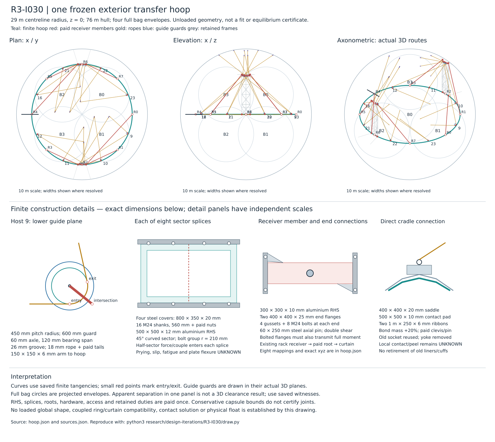

# R3-I030 — one circumferential transfer hoop

**Result: FAIL for this frozen construction.** The hoop alone clears the four full bag envelopes in the bounded unloaded screen, but its receivers and rerouted ropes intersect bags and one another. Nearly horizontal lower departures amplify the required tensions. Every one of the 32 rope-strength, actuator-strength and fixed-node stroke screens fails. Known construction becomes **109.538038 t + U + C**, an increase of **18.627648 t**. Physical float, global compatibility and the complete installed mass remain **UNKNOWN**.

Cold P100 margins are **-56.979196 t / -56.920056 t** before U+C. With the same fixed water aboard, cold M20 margins are **-34.648668 t / -34.589529 t**. These are matching **conditional mass-ledger comparisons**, not a physically consistent gas-volume or float certificate. The failed routes and stock remain unchanged after the first calculation.

The question is whether a single paid hoop can replace the long low approaches and eccentric radial yokes of the [preceding construction](../R3-I026/README.md) without buying a larger sector, splice and receiving-structure burden. The inherited known construction is **90.910391 t + U + C**. Its cold P100 margins are **−38.351548 t / −38.292409 t** at sea level / 2500 m; cold M20 after the fixed water is **−16.021021 t / −15.961881 t**. These are predecessor results, not results of the hoop.

## Frozen construction

The 76 m nominal hull, loaded radius 37.81598750363525 m, four full bag radii 15.949183886356778 m and their named centres are unchanged. The new assumed hoop has **29 m centreline radius in the z = 0 plane**, eight 45° sectors and no adjustable geometry after execution begins. This radius is a candidate datum, not an optimized clearance or asserted fit.

Each sector is a curved aluminium **500 × 500 × 12 mm RHS**. Each boundary has four steel **800 × 350 × 20 mm** splice covers and **16 nominal M24 through-shanks, 560 mm long**, plus 0.5 kg per shank for its head, nut and washers. The shank group radius used in the scalar joint screen is 210 mm. Nominal dimensions do not establish thread, bearing, slip, fatigue or prying capacity.

Azimuths are clockwise from +x, viewed from +z. The inherited host list is preserved in that cyclic order, including any resulting crossings. Each route follows its original lower cradle point, a new finite hoop guide, its existing upper rack guide and the unchanged upper actuator/anchor. Both guide tangent constructions and their support arms are rebuilt. There is no added ideal corner or unpriced sheave.

| Sector / host | Hoop guide azimuth ° | Starting root azimuth ° | Existing frame receiver | Receiver xyz m |
| --- | ---: | ---: | --- | --- |
| 0 / 9 | −22.5 | 0 | rack−1 root1 | 2.4, −29, 0 |
| 1 / 10 | −67.5 | −45 | rack−1 root3 | 2.4, −29, 23 |
| 2 / 11 | −112.5 | −90 | rack−1 root0 | −2.4, −29, 0 |
| 3 / 12 | −157.5 | −135 | rack−1 root2 | −2.4, −29, 23 |
| 4 / 16 | −202.5 | −180 | rack+1 root0 | −2.4, 29, 0 |
| 5 / 21 | −247.5 | −225 | rack+1 root2 | −2.4, 29, 23 |
| 6 / 22 | −292.5 | −270 | rack+1 root1 | 2.4, 29, 0 |
| 7 / 23 | −337.5 | −315 | rack+1 root3 | 2.4, 29, 23 |

Each root has a finite **300 × 300 × 10 mm aluminium RHS** member to the named receiver, not an ideal fix at the hoop. Both ends carry a 400 × 400 × 25 mm aluminium plate, four 300 × 250 × 20 mm gussets, eight nominal M24 × 120 mm bolts with the same head/nut allowance, two 250 × 300 × 20 mm clevis plates and a 60 × 250 mm steel pin. The bolts, at a 150 mm assumed group radius, must transmit the full required couple. A single pin cannot erase that moment. Existing receiver-to-pad members, curtain endpoints and their unqualified stiffness remain in the load path and mass ledger.

All **16 existing guide bodies/axles/bearings/guards** are reused for their same eight two-bend duties. The lower eight move to the hoop; upper guide tangent planes change as the incoming direction changes. Their bend radii remain 450 mm, guard radii 600 mm, axles 60 mm with a 120 mm bearing span, grooves 26 mm wide with an assumed 10 mm root radius. Both sets of arms are replaced by 150 × 150 × 6 mm RHS at the actual guide-centre offsets. No bearing/contact rating is inferred from paying the stock.

The eight radial yokes and their local feet, plates, posts, ties, diagonal pieces, straps, gussets and access stock are conditionally superseded. At each original lower cradle point a new direct connection supplies a 400 × 400 × 20 mm aluminium saddle, two clevis plates and a 60 mm pin, a 500 × 500 × 10 mm laminate pad and two opposite 1 m × 250 × 6 mm geodesic ribbons, with 20% bond mass on laminate stock. The old 12 kg lower socket is reused. This is a paid proposed contact detail; peel, local deformation and load spreading are not qualified.

The 18 mm rope selection, 35 mm clamp/chafe enclosure, 50 GPa assumed axial modulus and 150 MPa assumed working stress remain. The new free stock is the unloaded curved path rounded **up to 0.5 m**, with two additional paid 1 m tails outside the free length. The actuator selection and nominal one-metre length are unchanged; its fixed-node stroke interval remains 0.8–1.2 m. No loaded answer chooses the cut length.




The drawing uses [saved geometry and vectors](hoop.json), not a second calculation. Its isometric, plan and elevation panels share the actual coordinates; lower construction details have independent schematic scales. Guard circles lie in the actual guide planes and red points mark finite tangencies. Rope tails are paid and shown folded back along endpoint directions; side-by-side splice packing and the detailed loaded contact shape remain unqualified.

## Scope of the mass replacement

The bill is the preceding 90,910.39059080572 kg, minus the individually named superseded yoke parts, eight ropes and sixteen guide arms, plus every newly specified part. Conditional hardware replacement is separate from qualified retirement. The existing two rack frames, their eight roots/curtains, all other hangers, upper anchors, sixteen sockets and eight actuators remain paid. **All eight old penetration duties and 1,346.1290425468696 kg of liners/cuffs remain; qualified retirement is zero.** Simultaneous old/new load sharing has not been solved.

The new bill includes the eight curved sectors, eight complete splices, eight receiver members with sixteen end connections, sixteen guide arms, eight replacement ropes, eight direct cradle details, 4 kg isolation and 1 kg bonding stock per root, and 20 kg access/erection stock per sector. All hollow members vent to common gas. Material properties are screening assumptions: aluminium 2,700 kg/m³, 70 GPa, 150 MPa; steel 7,850 kg/m³ and 160 MPa; laminate 1,400 kg/m³. Rope stock uses 1,440 kg/m³ plus 0.2 kg/m coating. Factored strength demand is 1.5 times the calculated load.

Unpriced strengthening **U** and contact/connection resolution **C** remain additional to every subtotal and subtract from every margin. The 17 t equipment convention, 8,666.759795 kg pressure system with its original 2 t equipment allowance counted once, 5 t energy allowance and 3 t propulsion allowance are carried. This unit does not turn the known construction subtotal into a complete all-up bill.

## Conditional mechanics and geometry

The [calculator](hoop.py) reads only [frozen data](baseline.json) and [source bindings and assumptions](sources.json). It derives all straight-span directions and actual 3D circular entry/exit tangencies. Each lower rope is required to supply its inherited bag duty plus its local deadweight through its **actual upward direction cosine**. If that cosine cannot support an upward tension force, the route fails. Equal vertical shares do not imply equal tensions independent of inclination.

Rope force on a guide is `T (u_out − u_in)`. Lower and upper endpoint forces are equal and opposite to their corresponding rope actions. Guide deadweight, arm CG offsets and full moments are carried to their supports. Upper anchors retain actuator/socket CG gravity and the current endpoint rope allocation. Lower contact stock has its stated CG and an explicit local gravity couple. Each paid part has a mass, material volume and CG.

For each span the transverse load is `q = μg sqrt(1 − u_z²)`. The small-slope screen uses `sag = q L²/(8T)` and **positive** geometric excess `q² L³/(24T²)`. The compatibility identity is:

```text
free stock + axial extension + actuator stretch + actuator command
  = unloaded curved path + nominal actuator length + positive sag excess
```

The inherited rope gravity allocation places half each straight span at its adjacent endpoints/guides, each arc at its guide, and half paid-minus-geometric excess at each rope endpoint. This accounts for mass but is not a distributed loaded-rope moment solution. The complete paid-subassembly gravity moment is reported separately; global equilibrium and the missing whole-vehicle CG remain unclosed.

Each hoop half-sector is screened as a curved cantilever fixed at its adjacent splice/root. The actual guide wrench is split equally between the two halves; sector and access-stock gravity use their arc CGs. End forces and full couples feed the paid receiver members, then the original rack/curtain receiving points. Axial load, biaxial bending, torsion, nominal bolt/shank demand and conditional cantilever compliance are displayed. Arc length is used in a straight-beam compliance surrogate; this is neither a rigorous curved-beam bound nor a solution of the elastically continuous ring. **Eight independent assumed fixes cannot establish global ring/curtain compatibility.** A formal displacement outside the declared 0.2 m domain is a failed screen, not a predicted loaded shape.

The finite clearance screen uses full bag envelopes, straight-member capsules, 32 inflated chords per hoop sector, 16 inflated chords per rope bend and explicit guard/root/splice bodies. It keeps closest-point witnesses, unchanged pressure/hanger/service envelopes, rope-pair conflicts and rope-to-hoop/receiver interfaces. A negative conservative enclosure gap is unqualified clearance; a negative centreline upper bound demonstrates an intrusion for the represented axis. Drawn connections are not blanket exemptions from contact checking. Local fitted joint geometry, loaded contact and the global shape remain UNKNOWN.

## Saved rowwise construction bill

| Conditional bill item | kg |
| --- | ---: |
| I026 known construction, before replacement | 90910.390591 |
| Remove proposed alternative: replacement lower guide arms | −20.497747 |
| Remove proposed alternative: replacement eight ropes | −330.515037 |
| Remove proposed alternative: yoke legs RHS 100x100x6 | −757.901203 |
| Remove proposed alternative: root posts RHS 120x120x6 | −47.278080 |
| Remove proposed alternative: root plates clevis pins terminals | −538.670688 |
| Remove proposed alternative: conformal pads and bond | −105.557513 |
| Remove proposed alternative: four curved straps and bond | −72.577110 |
| Remove proposed alternative: base ties and diagonals | −487.895514 |
| Remove proposed alternative: base gussets | −144.000000 |
| Remove proposed alternative: tip plate four pins and saddle | −191.661408 |
| Remove proposed alternative: erection access | −64.000000 |
| Remove proposed alternative: guide support arms | −17.260138 |
| **Total named conditional removals** | **−2777.814439** |
| Supply: hoop sectors | +11523.985145 |
| Supply: splice plates bolts | +1725.274054 |
| Supply: receiver members | +6433.754361 |
| Supply: receiver plates gussets pins bolts | +768.928706 |
| Supply: isolation contact | +32.000000 |
| Supply: bonding | +8.000000 |
| Supply: access erection | +160.000000 |
| Supply: eight replacement ropes | +390.273968 |
| Supply: guide arms | +111.015111 |
| Supply: eight direct cradle connections | +252.230704 |
| **All new supplied hardware** | **+21405.462050** |
| **New known construction** | **109538.038202 + U + C** |
| **Increase over I026** | **+18627.647611** |

Every row is backed by individually named parts, volumes and CGs in hoop.json. The original 1,346.129043 kg of liners/cuffs is retained, not part of these removals. No multiplicity assumes that one guide serves two new duties.

## Saved geometry and force result

The complete hoop has a minimum conservative bag gap of **0.871895 m**, or **0.471895 m** after the two declared 0.2 m movement allowances. That local screen improves the hoop placement only. Receiver 0 has a **-3.586968 m** enclosure gap to bag 1; its straight centreline is **-3.374836 m** inside the sphere, so this is more than an overlap of conservative bounds. Host 12's middle span intrudes into full upper bag 3: the centreline gap is **-7.806126 m**. Hosts 16/21 cross with a −0.070000 m combined rope-envelope gap. No receiver or route is moved to repair these results.

| Host | Own lower-span envelope gap m | Curved route m | New free stock m | Cold required tension kN | Change from I026 kN | Cold command m |
| ---: | ---: | ---: | ---: | ---: | ---: | ---: |
| 9 | -0.471023 | 88.604158 | 89.0 | 1762.888 | +1136.000 | -12.514729 |
| 10 | -4.319657 | 82.709141 | 83.0 | 3082.594 | +2535.052 | -20.776948 |
| 11 | -0.035000 | 73.515944 | 74.0 | 2731.138 | +2327.976 | -16.588569 |
| 12 | -0.035000 | 83.992216 | 84.0 | 3338.278 | +3117.116 | -22.538398 |
| 16 | -4.384044 | 79.709090 | 80.0 | 3096.304 | +2875.142 | -20.142500 |
| 21 | -4.384044 | 83.757637 | 84.0 | 3096.592 | +2490.585 | -21.069398 |
| 22 | -1.185026 | 87.634593 | 88.0 | 3735.858 | +3188.316 | -26.872938 |
| 23 | -0.035000 | 90.709182 | 91.0 | 3325.579 | +2924.203 | -24.561541 |

The −0.035 m endpoint bounds for hosts 11/12/23 occur at the original surface attachment, with centreline contact zero to rounding; they do not demonstrate a finite interior span intrusion. The other named negative own-span centreline gaps and the middle-span witness above do. Contact/peel at all original attachment regions remains unqualified.

The lower upward direction cosine is only 0.005601–0.011844. All eight cold tensions increase over I026, while the new connection and hoop bill also grows. Thus the ring-only clearance gain buys neither a route-force reduction nor a mass saving. The positive sag identity residual is at most 1.4211e−14 m in saved rows; this algebraic consistency does not cure the stroke, strength or contact failures.

| Altitude m / superheat K | Required tension kN | Formal half-sector stress maximum GPa | Formal receiver stress maximum GPa | Largest receiver displacement surrogate m |
| --- | ---: | ---: | ---: | ---: |
| 0 / +0 | 1762.888–3735.858 | 12.601187 | 239.406147 | 19486.553869 |
| 0 / +10 | 1616.978–3427.334 | 11.559435 | 219.580318 | 17872.305448 |
| 2500 / +0 | 461.426–983.928 | 3.309155 | 62.572816 | 5088.650642 |
| 2500 / +10 | 296.586–635.377 | 2.132275 | 40.180931 | 3265.600935 |

**The enormous elastic stress/displacement extrapolations are outside the model domain. They reject the section/support assumptions; they are not predictions of actual stress, shape or displacement.** The 0.15 GPa aluminium working assumption and 0.2 m movement domain are not approached with margin. Splice/root bolt, pin, axle and receiving-curtain demands remain in the saved result rather than being removed by ideal supports. Local buckling, plate prying and fatigue are UNKNOWN. Nonlinear redistribution would require a different, paid construction and model, not another run of this failed design.

The observed bottleneck is the low departure inclination together with long eccentric receiving members. The weakest assumption remains that the finite ring and its receivers can distribute these reactions without dominant bending/rotation/curtain mass. Coupled stiffness sensitivity is UNKNOWN. A local fixed-root compliance screen cannot resolve it.

## Matching budgets and interpretation

The saved four cases are sea level / 2500 m at 0 / +10 K superheat. Common gas stays **27,670.136440858078 kg helium + 8,343.231319462353 kg impurity air**, the 96/4 inventory. **74,669.47250300998 kg water remains aboard** for the fixed-water comparison. M20 uses 3,000 kg payload; P100 uses 100,000 kg. Equipment is included once. For each case the complete known all-up subtotal and matching gross displacement produce the raw and fixed-water margins.

For an unchanged represented gas basis, each old margin changes by the negative of the construction-mass change. The same fixed water is also shown for P100 as an explicitly matched comparison. U+C subtract further. If material amount fits the 50 m³ routing reserve within the 100 m³ datum debit but the routes or receiving structure intersect bags, **physical volume consistency remains UNKNOWN**. A matching conditional bookkeeping margin may still be shown; unchanged physical lift cannot be asserted from material volume alone. There is no sealed-volume, bag-capacity, ballast-release or powered-lift credit.

The trapped-bag/header/lower-trip pressure failures remain. Pressure/contact qualification, full loaded shape, trim, global structural adequacy and mission energy remain UNKNOWN. A local improvement would not by itself establish physical float.

### Four matching conditional mass and lift ledgers

| Altitude m / superheat K | Gross displacement t | M20 all-up before water t | P100 all-up before water t | M20 raw t | P100 raw t | M20 after fixed water t | P100 after the same water t | Δ each margin t |
| --- | ---: | ---: | ---: | ---: | ---: | ---: | ---: | ---: |
| 0 / +0 | 277.495142 | 237.474337 | 334.474337 | 40.020804 | -56.979196 | -34.648668 | -131.648668 | -18.627648 |
| 0 / +10 | 277.495142 | 230.212230 | 327.212230 | 47.282912 | -49.717088 | -27.386561 | -124.386561 | -18.627648 |
| 2500 / +0 | 216.753347 | 176.673404 | 273.673404 | 40.079944 | -56.920056 | -34.589529 | -131.589529 | -18.627648 |
| 2500 / +10 | 216.753347 | 168.954504 | 265.954504 | 47.798843 | -49.201157 | -26.870629 | -123.870629 | -18.627648 |

U+C are in tonnes in this table: add them to the all-up masses and subtract them once from every margin. The saved JSON also gives each known component, all-up totals with fixed water and the inherited-delta identity residual. No positive raw M20 entry establishes a floating candidate with the fixed water and unpriced work included.

New paid material totals **13.986561 m³** inside the represented 50 m³ routing reserve. That scalar amount fits, but actual routes/receivers do not fit the full bag construction. The hydrostatic redistribution and physically consistent lift remain UNKNOWN; no extra displacement or restored gas capacity is claimed.

## Execution and next construction

**One numerical execution completed; no numerical correction or repeat was used.** The observed child ran Python 3.14.4 in a distinct private IPC namespace, on one assigned CPU with one thread, 512 MiB address-space/cgroup memory and no swap. Its 180 CPU / 240 outer-wall-second ceilings were enforced; the inner monitor used a tighter 230-second wall stop. Actual child usage including the pre-exec guard was **1.984864 s wall, 1.981158 s CPU and 41,228 KiB maximum RSS**, exit 0. No predecessor calculator or solver was imported or run.

Execution occurred on parent `e3a6f7b854ef0683fbcdacd6db330a7c3b94044b`, tree `91c7eadb15f641e918fd94faf87c70599a418363`, with the new uncommitted calculator and pinned inputs. The final README was written from saved results afterwards. This is not a final-commit replay. Scientific-source SHA256: `6b8e1cff8f560a60d09dfe15ec8bc007ed370aad8810bb058ec1794e91b324ce`; sources.json SHA256: `aec1a2fa95c9a7a11f96ba611d06199bad9737ce49952ccddeafcdf94057618a`; baseline.json SHA256: `ff4890f1b5b73f221602bbe4ff82616b9a7ba575db977b278dabfb7ea099fb96`.

One standalone drawing completed from the saved JSON. Its first raster preview omitted specified strokes and circles; the permitted defect-driven second preview of the **unchanged SVG** displayed them correctly. The second renderer observed **five library threads after rendering**, despite its one-thread request and successful one-thread pre-exec guard. This visualization execution deviation is retained without retroactive authorization or a further preview. Private IPC, one-CPU affinity, 512 MiB/no-swap and 30 CPU / 60 outer-wall-second limits remained enforced. The numerical result and drawing source were not replayed or changed to repair that record.

Reproduction commands, inside a suitably bounded and isolated launcher, are:

```sh
python3 -I -B research/design-iterations/R3-I030/hoop.py > research/design-iterations/R3-I030/hoop.json
python3 -I -B research/design-iterations/R3-I030/draw.py
```

The failed geometry and materials are preserved. Subsequent numerical execution is not needed for this result; a physical failure does not justify tuning it.

**One next construction:** raise the load-transfer guide plane onto a paid three-dimensional upper crown, retaining the full bag envelopes, to improve the observed lower departure inclination. Freeze its finite receiving connections and price their bending/couple path before evaluating it. This next construction is selected from the observed bottleneck and has not been evaluated.
